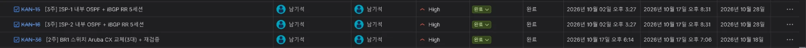
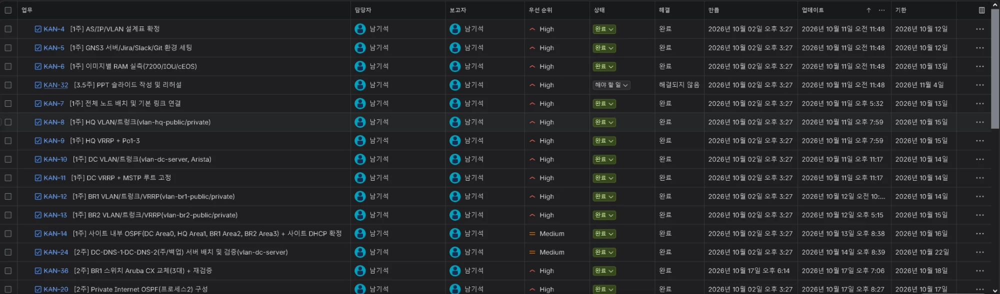
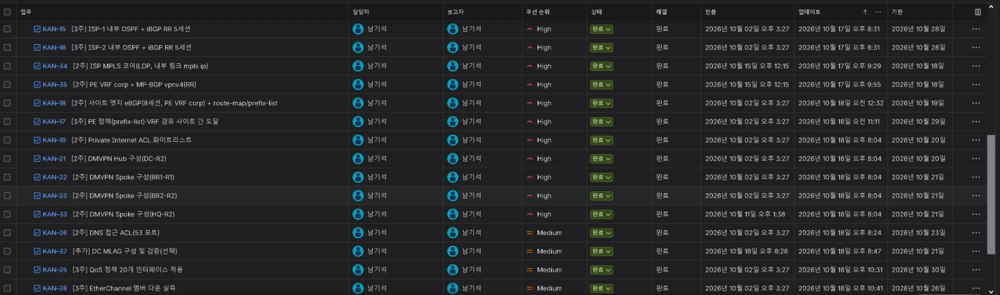
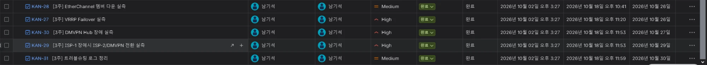
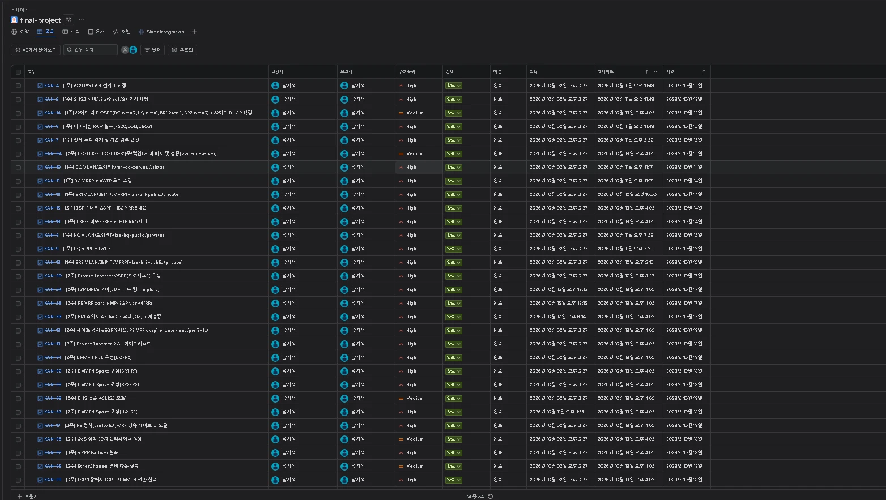
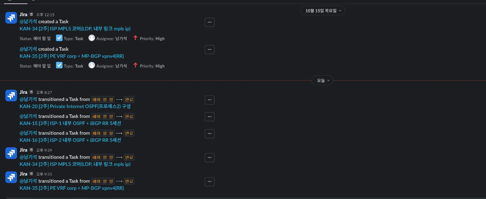
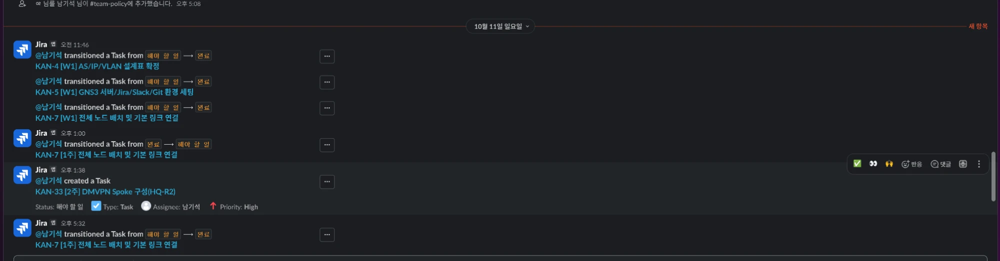

# 프로젝트 관리 (Jira, Slack)

1인 프로젝트이며 Jira 이슈와 Slack 알림으로 일정과 진행을 관리. 일정은 [`schedule.md`](./schedule.md), 이슈 등록 기준은 [`jira/jira-tickets-3person.csv`](../jira/jira-tickets-3person.csv).

## 1. Jira

Jira 목록 화면. 이슈 번호, 제목, 우선순위, 상태, 마감일, 갱신 시각이 한 화면에 표시됨.

이후 완료 처리한 이슈(KAN-15, KAN-16, KAN-36).

## 1.1 Jira 진행 현황(2026-10-19)

KAN-4 ~ KAN-37 전체 34개 이슈 중 33개가 완료이고, KAN-32(PPT 슬라이드 작성 및 리허설, 기한 2026-11-04)만 "해야 할 일"로 남음.

## 1.2 기한의 실제 일정 반영(2026-10-19)

완료한 구성과 검증 이슈 23건(KAN-14 - KAN-37 중 해당 건)의 기한을 계획일에서 실제 완료일(2026-10-12 - 10-18)로 변경. 근거는 커밋 날짜이며, 근거 커밋이 없는 KAN-4 - KAN-13과 PPT 이슈(KAN-32)는 계획일 유지. 이슈별 계획일, 실제일, 근거는 [`jira/jira-actual-due-dates.csv`](../jira/jira-actual-due-dates.csv) 참조.

## 2. Slack

Jira 이슈의 생성과 상태 전환이 Slack 채널에 알림으로 전달됨. 아래는 2026-10-17의 전환 알림(KAN-20, KAN-15, KAN-16, KAN-34, KAN-35).

1주차 이슈의 완료 알림(2026-10-11).

공지와 설정 기록은 [`slack/slack-announcement.md`](../slack/slack-announcement.md), [`slack/2026-10-02-setup-summary.md`](../slack/2026-10-02-setup-summary.md).
