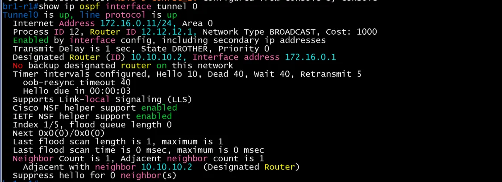
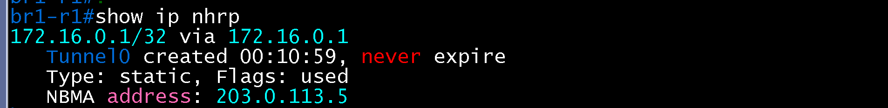
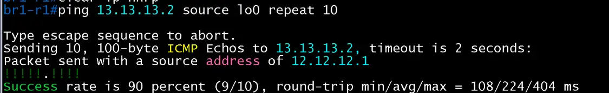
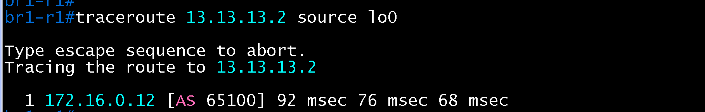
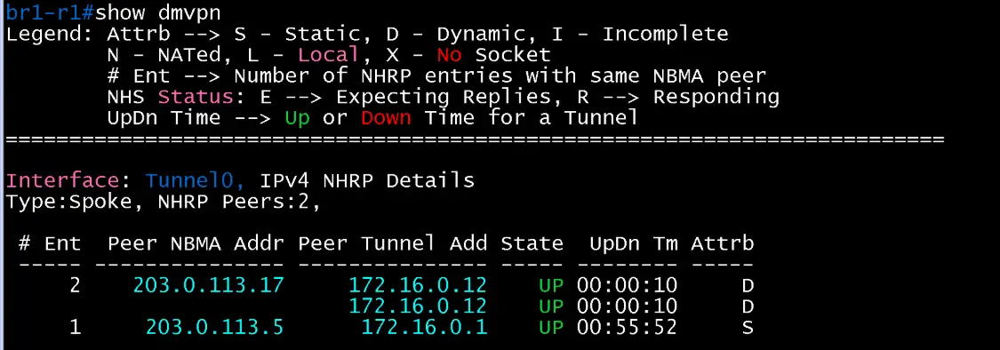
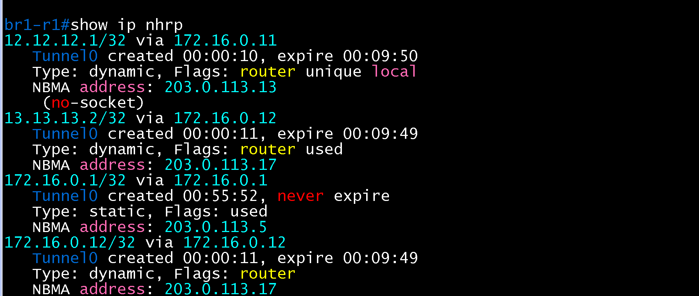
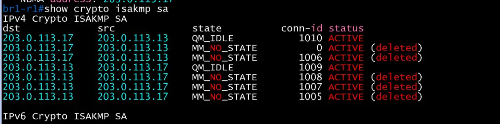

# DMVPN Spoke 검증 (BR1 / core)

- Jira: KAN-22
- 대상 장비: BR1-R1
- 기준 문서: [dmvpn-design.md](../../../docs/dmvpn-design.md) 1~4절
- 검증일: 2026-10-18

| 장비 | 명령 | 기대 결과 | 실제 결과 | 판정 |
|---|---|---|---|---|
| BR1-R1 | `show dmvpn` | Hub(172.16.0.1) Up, Tunnel0 172.16.0.11, NBMA 203.0.113.13 | Tunnel0 Type:Spoke, NHRP Peers 1. Hub 203.0.113.5(172.16.0.1) State UP, Attrb S(Static) | 통과 |
| BR1-R1 | `show ip ospf neighbor` | Tunnel0에서 DC-R2와 FULL(Spoke priority 0) | Tunnel0에서 10.10.10.2(172.16.0.1) FULL/DR(Pri 255). Gi4/0에서 Private-net 203.0.113.14(Private-net 2.2.2.2) FULL. 사이트 내부 이웃 12.12.12.2(10.3.0.18, Gi2/0) | 통과 |
| BR1-R1 | `show ip ospf interface tunnel 0` | Spoke priority 0, Hub(DR)와 인접 | Tunnel0 up/up, 172.16.0.11/24, Area 0, 프로세스 12, Router ID 12.12.12.1, BROADCAST, State DROTHER, Priority 0, DR는 10.10.10.2(172.16.0.1), BDR 없음. Neighbor Count 1, Adjacent neighbor 1(10.10.10.2, DR) | 통과 |
| BR1-R1 | `show crypto isakmp sa` | Hub와 QM_IDLE | dst 203.0.113.5, src 203.0.113.13 QM_IDLE ACTIVE(conn-id 1002). 이전 시도의 MM_NO_STATE(deleted) 항목이 함께 표시됨 | 통과 |
| BR1-R1 | `show ip nhrp` | Hub(172.16.0.1) static 항목, NBMA 203.0.113.5 | 172.16.0.1/32 via 172.16.0.1, Type static, Flags used, NBMA 203.0.113.5, never expire | 통과 |
| BR1-R1 | `show crypto ipsec sa` | Hub와 SA, 암호화 카운트 증가 | Tunnel0, profile dmvpn-profile-head-1, local 203.0.113.13, 상대 203.0.113.5(GRE/47). encaps 18, decaps 21, recv errors 0, send errors 80(SA 수립 전 시도분), PFS Y, DH group5 | 통과 |
| BR1-R1 | `ping 13.13.13.2 source lo0 repeat 10` 후 `traceroute`, `show dmvpn`, `show ip nhrp`, `show crypto isakmp sa` (BR2-R2 대상) | Phase 3 shortcut 생성, `show ip nhrp`에 Spoke 간 dynamic 항목, `traceroute`가 Hub를 거치지 않음 | ping 9/10 성공(108/224/404ms, 1개 손실). `traceroute 13.13.13.2 source lo0`은 1홉 `172.16.0.12`(BR2-R2)로 직행해 Hub를 거치지 않음. `show dmvpn`에 `203.0.113.17`(172.16.0.12)이 Dynamic(D)으로 추가(Peers 2), `show ip nhrp`에 `172.16.0.12/32`(NBMA 203.0.113.17)와 `13.13.13.2/32 via 172.16.0.12` dynamic 항목, `show crypto isakmp sa`에 203.0.113.13과 203.0.113.17 사이 QM_IDLE 2건(conn-id 1009, 1010). HQ-R2 대상 shortcut은 `verification/hq/core/dmvpn.md`에서 확인 | 통과 |

Phase 3 shortcut 검증은 2026-10-18에 BR1-R1에서 BR2-R2 대상으로 수행.

BR1-R1 show ip ospf interface tunnel 0

BR1-R1 dmvpn

BR1-R1 nhrp

BR1-R1 isakmp

BR1-R1 ipsec

BR1-R1 ospf-neighbor

BR1-R1 ping 13.13.13.2

BR1-R1 traceroute 13.13.13.2

BR1-R1 show dmvpn(shortcut 후)

BR1-R1 show ip nhrp(shortcut 후)

BR1-R1 show crypto isakmp sa(shortcut 후)

