# ISP 연결 검증 (BR1 / core)

- Jira: KAN-18
- 대상 장비: BR1-R1, BR1-R2
- 기준 문서: [ospf-design.md](../../../docs/ospf-design.md) 6절, [bgp-design.md](../../../docs/bgp-design.md) 5~6절
- 검증일: 2026-10-18

| 장비 | 명령 | 기대 결과 | 실제 결과 | 판정 |
|---|---|---|---|---|
| BR1-R1, BR1-R2 | `show ip bgp summary` | ISP PE와 Established(ISP AS 65100 또는 65200) | BR1-R1은 100.1.31.2(AS 65100)와 Established, PfxRcd 1(기본 경로), Up/Down 00:03:00, router-id 12.12.12.1. BR1-R2는 100.2.32.2(AS 65200)와 Established, PfxRcd 1(기본 경로), router-id 12.12.12.2 | 통과 |
| BR1-R1, BR1-R2 | `show ip route 0.0.0.0` | BGP 기본 경로 `B*`(PE 방향) | BR1-R1은 `bgp 65003` distance 20 `candidate default path`, via 100.1.31.2(Tag 65100). BR1-R2는 `bgp 65003` distance 20 `candidate default path`, via 100.2.32.2(Tag 65200) | 통과 |
| BR1-R1, BR1-R2 | `show ip bgp neighbors <PE 주소> advertised-routes` | 사이트 /16만 광고(`rm-isp-out`) | BR1-R1은 `10.3.0.0/16`(로컬, Next Hop 0.0.0.0, Weight 32768) 한 개만 광고, Total number of prefixes 1. BR1-R2는 `10.3.0.0/16`(로컬, Next Hop 0.0.0.0, Weight 32768) 한 개만 광고, Total number of prefixes 1 | 통과 |
| BR1-R1, BR1-R2 | `show route-map`, `show ip prefix-list` | `rm-isp-in`, `rm-isp-out`, `pl-default`, `pl-site` 적용 | BR1-R1은 `rm-isp-out`(match `pl-site`), `rm-isp-in`(match `pl-default`), `pl-site`(permit 10.3.0.0/16), `pl-default`(permit 0.0.0.0/0) 확인. BR1-R2는 `rm-isp-out`(match `pl-site`), `rm-isp-in`(match `pl-default`), `pl-site`(permit 10.3.0.0/16), `pl-default`(permit 0.0.0.0/0) 확인 | 통과 |
| BR1-R1, BR1-R2 | `show ip ospf database external` | `default-information originate` 기본 경로 Type 1 광고 | BR1-R1(OSPF 프로세스 12, router-id 12.12.12.1)이 `0.0.0.0/0` Type 5 외부 LSA를 Metric Type 1, metric 100으로 광고(External Route Tag 12). 프로세스 2(PI)는 별도 Router ID 203.0.113.13으로 표시. BR1-R2(metric 200)는 링크 49 구성 후 | 통과 |

장애 시 BGP 세션이 내려가 기본 경로가 철회되고 OSPF 기본 경로 광고가 ISP-2로 전환되는지는 [scenarios/](../../scenarios/)에서 확인.

BR1-R1 BGP summary
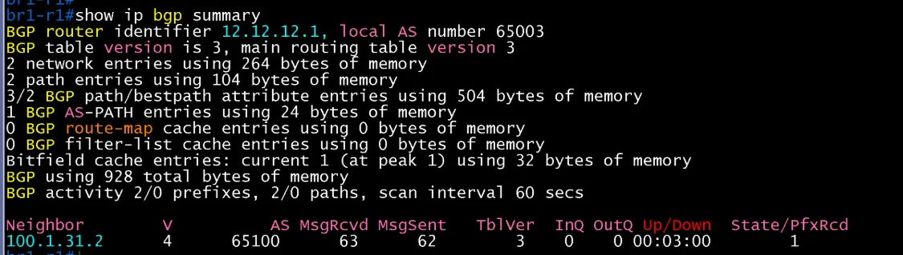

BR1-R1 기본 경로(show ip route 0.0.0.0)
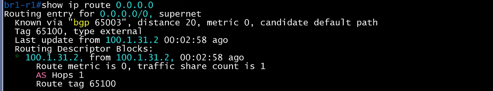

BR1-R1 advertised-routes
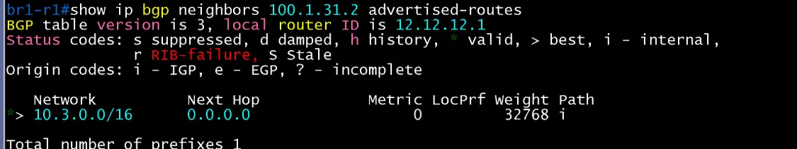

BR1-R1 route-map
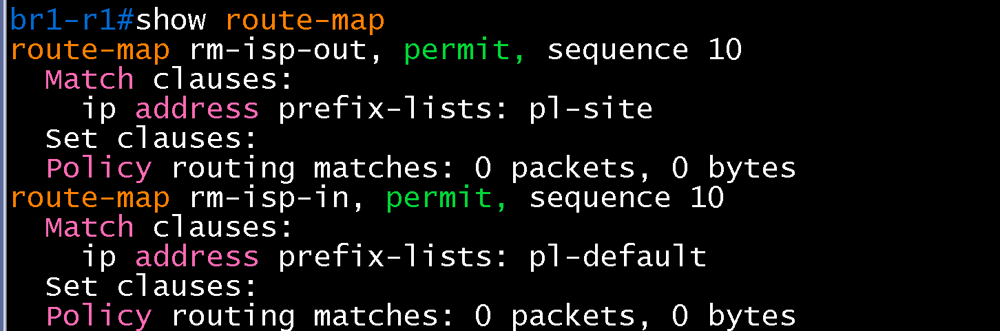

BR1-R1 prefix-list
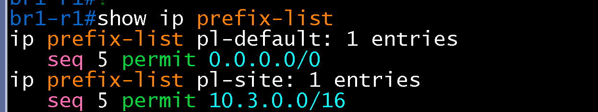

BR1-R1 OSPF database external
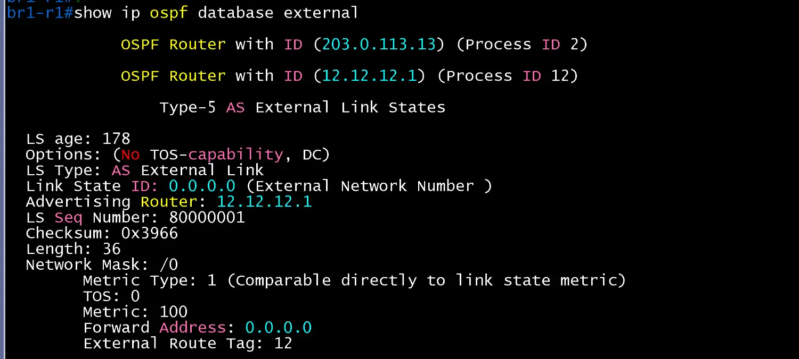

BR1-R2 BGP summary
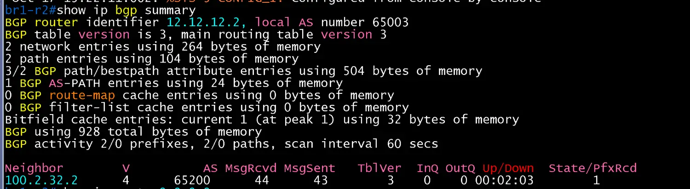

BR1-R2 기본 경로(show ip route 0.0.0.0)
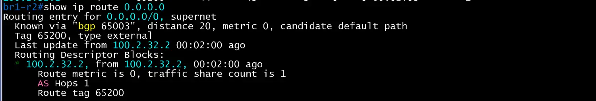

BR1-R2 advertised-routes
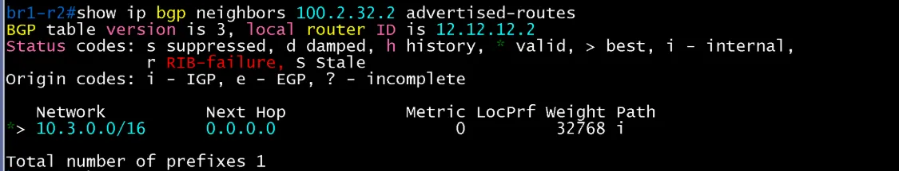

BR1-R2 route-map
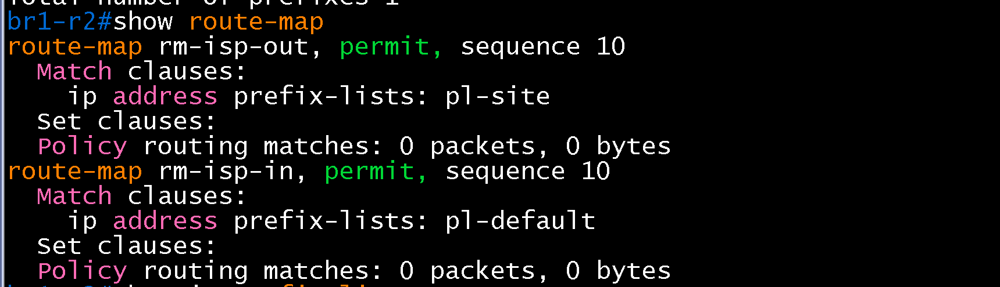

BR1-R2 prefix-list

BR1-R2 OSPF database external
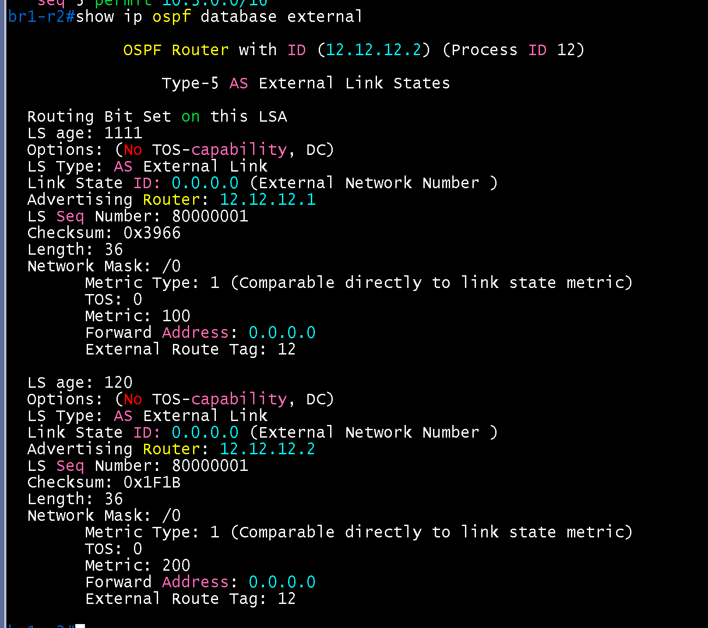
