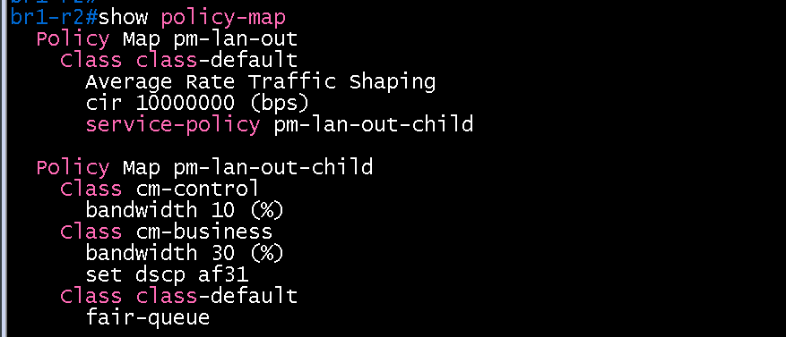
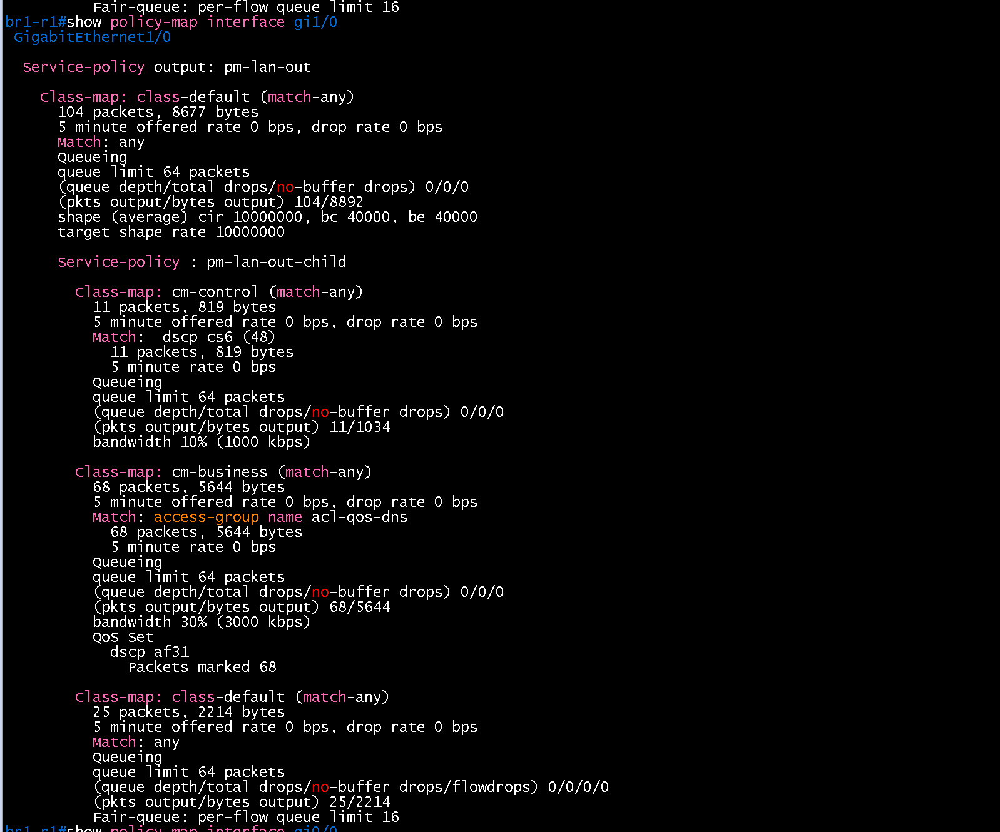
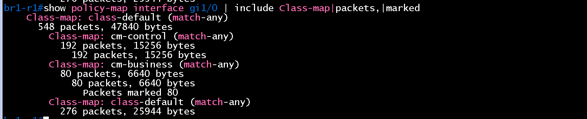
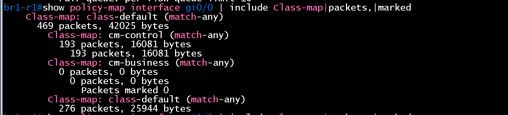
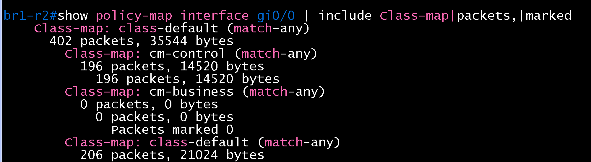
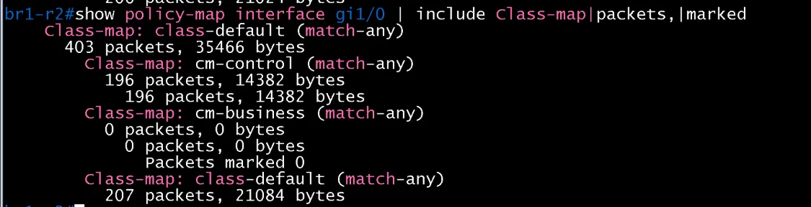
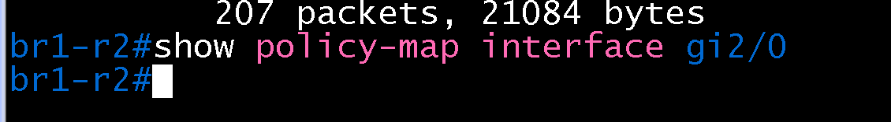
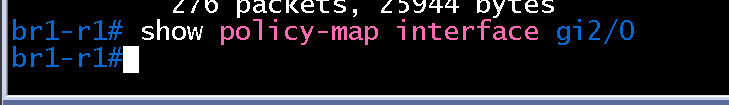

# QoS 검증 (BR1 / core)

- Jira: KAN-25
- 대상 장비: BR1-R1, BR1-R2
- 기준 문서: [qos-design.md](../../../docs/qos-design.md), [cisco-router.md](../../../docs/config-guide/cisco-router.md) 3.7절
- 검증일: 2026-10-18

| 장비 | 명령 | 기대 결과 | 실제 결과 | 판정 |
|---|---|---|---|---|
| BR1-R1, BR1-R2 | `show policy-map` | 정책 `pm-lan-out`, `pm-lan-out-child` 정의, 클래스 `cm-control`, `cm-business`, `class-default` | 두 장비 모두 `pm-lan-out`(class-default `shape average cir 10000000`, `service-policy pm-lan-out-child`)과 `pm-lan-out-child`(`cm-control` bandwidth 10%, `cm-business` bandwidth 30%와 `set dscp af31`, `class-default` fair-queue) 정의 | 통과 |
| BR1-R1, BR1-R2 | `show policy-map interface gi0/0`, `gi1/0` | `pm-lan-out` 출력 방향 적용, 클래스 3개 표시 | `gi0/0`에 `Service-policy output: pm-lan-out`. `shape (average) cir 10000000, bc 40000, be 40000`, `cm-control`은 `Match: dscp cs6 (48)`와 bandwidth 10%(1000 kbps), `cm-business`는 `Match: access-group name acl-qos-dns`와 bandwidth 30%(3000 kbps), `QoS Set dscp af31`, `class-default`는 `Fair-queue`. 카운터는 `cm-control`에 라우터 제어 트래픽 1~2패킷, `cm-business` 0, drop 0. BR1-R1 `gi1/0`와 BR1-R2 `gi0/0`, `gi1/0`도 클래스 3개(`cm-control`, `cm-business`, `class-default`) 카운터가 표시되어 `pm-lan-out` 적용 확인 | 통과 |
| 호스트(BR1-PC1) | `nslookup dc-r1.lab.local 10.2.50.10` 반복 후 BR1-R1 `show policy-map interface gi1/0` | `cm-business` 매치 패킷 증가 | BR1-R1 `gi1/0`(BR1-SW2-L3 방향)에서 `cm-business` 68 packets, 5644 bytes(`Match: access-group name acl-qos-dns` 68 packets), `QoS Set dscp af31` Packets marked 68. 부모 `class-default` 104 packets = `cm-control` 11 + `cm-business` 68 + 자식 `class-default` 25, drop 0. DNS 응답이 `gi0/0`이 아니라 `gi1/0`으로 나감(`gi0/0`의 `cm-business`는 0) 추가로 BR1-R1 `gi1/0`는 시험 후 `cm-business` 80 packets, `Packets marked 80`으로 증가, BR1-R1 `gi0/0`과 BR1-R2 `gi0/0`, `gi1/0`은 `cm-business` 0 | BR1-R1 통과 |
| 호스트(BR1-PC1) | 큰 트래픽(`ping -s 1400`) 후 `show policy-map interface` | `class-default`에 drop 발생, `cm-business` 보장 | BR1-PC1에서 `ping -s 1400 -c 2000 -i 0.01 10.10.10.13`을 백그라운드로 보내고(DC-R2 `pm-lan-out`의 `shape average 1000000`으로 병목을 키움) 같은 시간에 `nslookup dc-r1.lab.local 10.2.50.10` 20회 반복. DC-R2 `gi0/0`: 자식 `class-default` drop 578에서 1333(+755), 5분 drop rate 18000 bps. `cm-business` 160에서 232 packets(+72, 재시도 포함 추정), drop 0/0/0, `Packets marked 232`, `cm-control` 296 packets drop 0/0/0. DNS 질의 20회 중 맨 앞 2번은 `connection timed out`(앞단 지연으로 보이며 DC-R2에서 drop은 없음) 이후 `10.10.10.1`로 정상 응답. BR1 경로의 대표 시험이며 정책 동작은 DC-R2 `gi0/0`에서 확인(`verification/dc/core/qos.md`) | 통과(대표 시험) |
| BR1-R1, BR1-R2 | `show policy-map interface gi2/0`(해당 시) | 정책 미적용(제외 대상) | BR1-R1, BR1-R2 모두 `gi2/0`(BR1-R1↔R2 라우터 간 링크)의 출력이 비어 있어 정책 미적용 | 통과 |

BR1-R1 show policy-map

BR1-R1 show policy-map interface gi0/0

BR1-R2 show policy-map

BR1-R2 show policy-map interface gi0/0

BR1-R1 show policy-map interface gi1/0 (DNS 질의 후)

BR1-R1 gi1/0 (DNS 질의 후, cm-business 80)

BR1-R1 gi0/0 (cm-business 0)

BR1-R2 gi0/0

BR1-R2 gi1/0

BR1-R2 show policy-map interface gi2/0 (정책 미적용)

BR1-R1 show policy-map interface gi2/0 (정책 미적용)

DC-R2 gi0/0 병목 시험 중(class-default drop 578)

BR1-PC1 큰 트래픽 중 nslookup

DC-R2 gi0/0 병목 시험 후(class-default drop 1333, cm-business drop 0)

