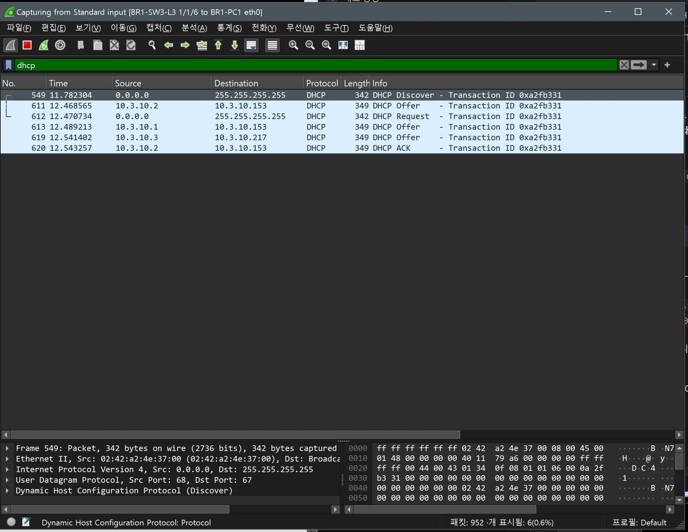
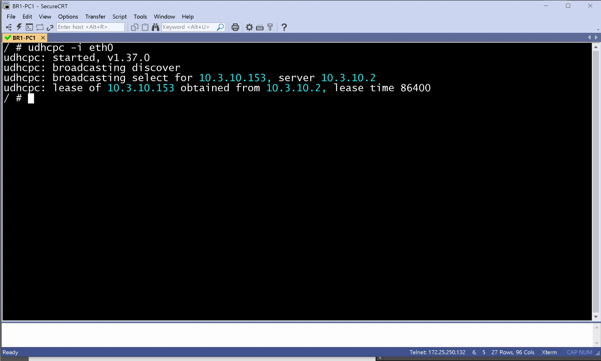
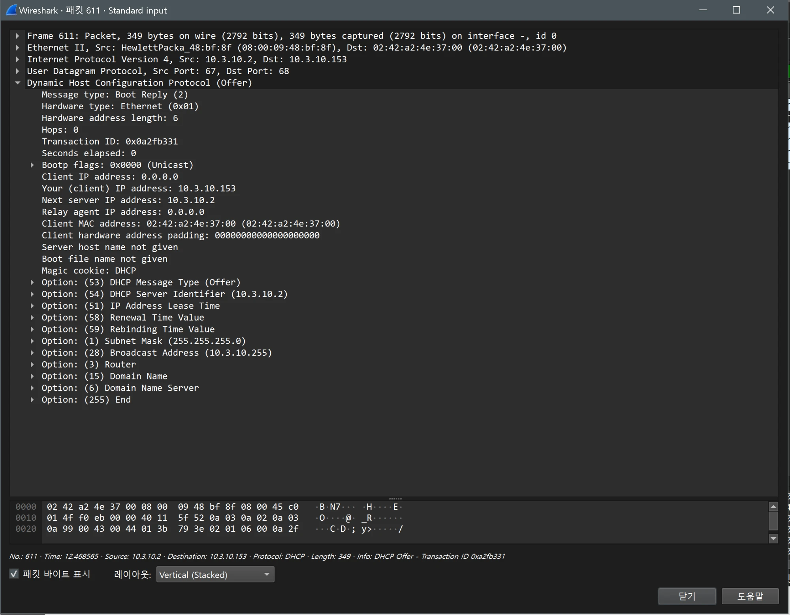
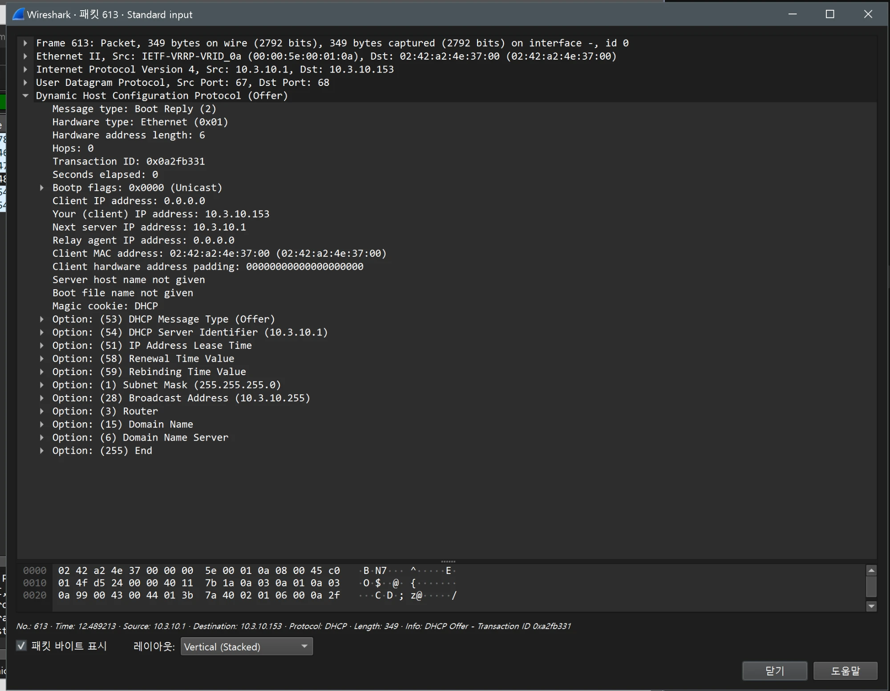
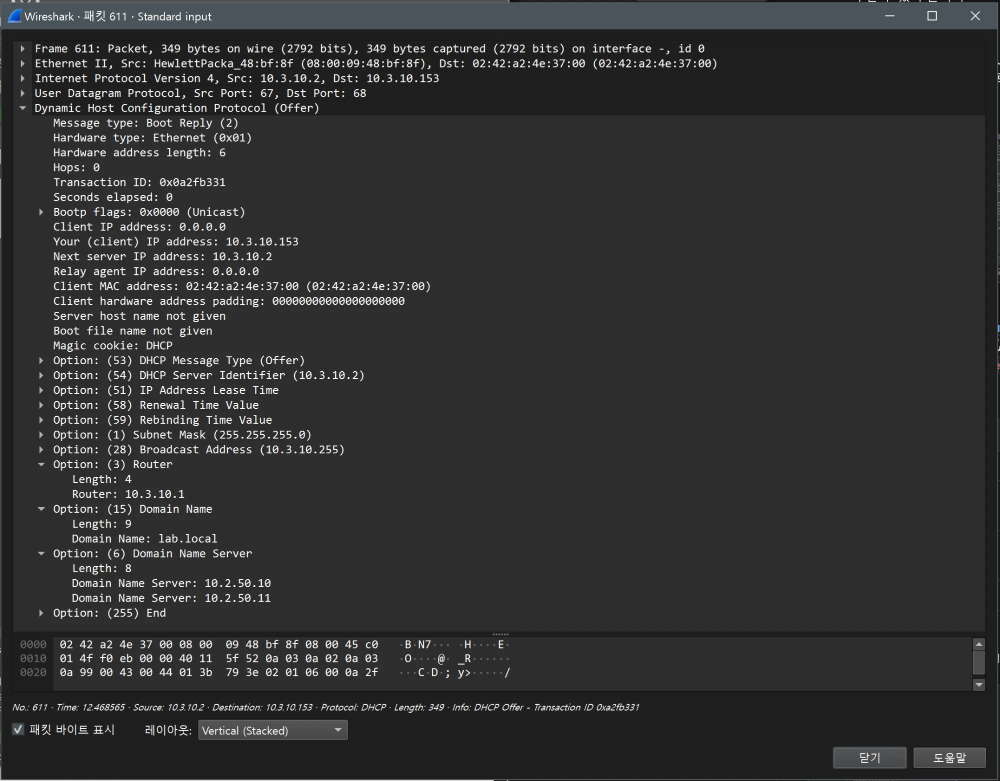

# DHCP 검증 (BR1 / distribution)

- Jira: KAN-14
- 대상 장비: BR1-SW1-L3, BR1-SW2-L3
- 기준 문서: [dhcp-dns-design.md](../../../docs/dhcp-dns-design.md) 3절
- 검증일: 2026-10-17
- Aruba CX 교체: BR1 스위치를 Aruba CX(ArubaOS-CX Virtual 10.07)로 교체하고 AOS-CX 명령 기준으로 재검증

| 장비 | 명령 | 기대 결과 | 실제 결과 | 판정 |
|---|---|---|---|---|
| BR1-SW1-L3 | `show dhcp-server` | 풀 범위 Active `.100`-`.163` | enabled, operational. br1-public 10.3.10.100-.163, br1-private 10.3.20.100-.163, prefix 24, Lease Duration 01:00:00, 옵션 3(10.3.10.1, 10.3.20.1), 6(10.2.50.10 10.2.50.11), 15(lab.local) | 통과 |
| BR1-SW2-L3 | `show dhcp-server` | 풀 범위 Standby `.164`-`.227` | enabled, operational. br1-public 10.3.10.164-.227, br1-private 10.3.20.164-.227, prefix 24, Lease Duration 01:00:00, 옵션 3, 6, 15는 SW1과 동일 | 통과 |
| BR1-SW1-L3 | `show dhcp-server leases` | 호스트에 풀 범위 주소 임대 | 10.3.10.153(02:42:a2:4e:37:00), 10.3.20.117(02:42:b8:51:88:00) 임대, 클라이언트 ID가 호스트 MAC과 일치, 만료 18/10/2026 09:40(24시간 후) | 통과 |
| BR1-SW2-L3 | `show dhcp-server leases` | 먼저 응답한 SW1이 할당하므로 바인딩 없음 | No DHCP leases in the database | 통과 |
| BR1-PC1 | `udhcpc -i eth0`, `ip addr`, `cat /etc/resolv.conf` | 풀 범위 주소와 `resolv.conf` DNS 두 대 | 10.3.10.153/24(서버 10.3.10.2, lease time 86400), resolv.conf search lab.local, nameserver 10.2.50.10과 10.2.50.11 | 통과 |
| BR1-PC2 | `udhcpc -i eth0`, `ip addr`, `cat /etc/resolv.conf` | 풀 범위 주소와 `resolv.conf` DNS 두 대 | 10.3.20.117/24(서버 10.3.20.2, lease time 86400), resolv.conf search lab.local, nameserver 10.2.50.10과 10.2.50.11 | 통과 |

BR1-SW1-L3 DHCP POOL

BR1-SW1-L3 DHCP LEASE

BR1-SW2-L3 DHCP POOL

BR1-SW2-L3 DHCP LEASE

BR1-PC1

BR1-PC2

## Wireshark DORA 확인

- 검증일: 2026-10-19
- 캡처 링크: `BR1-SW3-L3 1/1/6 ↔ BR1-PC1 eth0`, 필터 `dhcp`. BR1-PC1에서 `udhcpc -i eth0`.
- 서버: BR1-SW1-L3(`10.3.10.2`, 풀 `.100~163`), BR1-SW2-L3(`10.3.10.3`, 풀 `.164~227`), VRRP VIP `10.3.10.1`

| 시각(초) | 출발지 → 목적지 | 메시지 | 내용 |
|---|---|---|---|
| 11.782 | `0.0.0.0` → `255.255.255.255` | Discover | 브로드캐스트, 트랜잭션 ID `0xa2fb331` |
| 12.469 | `10.3.10.2` → `10.3.10.153` | Offer(349바이트) | BR1-SW1-L3 풀의 `.153` 제안 |
| 12.471 | `0.0.0.0` → `255.255.255.255` | Request | 서버 `10.3.10.2`의 제안 선택 |
| 12.489 | **`10.3.10.1`** → `10.3.10.153` | Offer | **VRRP VIP를 출발지로** 같은 `.153`을 제안한 두 번째 Offer |
| 12.541 | `10.3.10.3` → `10.3.10.217` | Offer | BR1-SW2-L3 풀의 `.217` 제안, 사용되지 않음 |
| 12.543 | `10.3.10.2` → `10.3.10.153` | ACK | `10.3.10.153` 임대 확정 |

- `udhcpc` 출력: `lease of 10.3.10.153 obtained from 10.3.10.2, lease time 86400`(Aruba 설정 `lease 01:00:00`, AOS-CX 형식으로 1일).
- 한 요청에 Offer가 3개: SW-1(실제 IP), SW-1 쪽으로 보이는 VIP 출발지, SW-2. Cisco(HQ, BR2)에서는 Offer가 2개이고 VIP 출발지 Offer는 없었음. VIP 출발지 Offer는 Ethernet 출발지가 VRRP 가상 MAC(`00:00:5e:00:01:0a`)이고 Server Identifier가 `10.3.10.1`이라, VRRP Master인 BR1-SW1-L3가 VIP 주소로도 DHCP 응답을 보낸 것으로 보임(아래 상세). Aruba 장비의 일반 동작인지는 확인하지 못함.
- BR1 풀 범위 `.153`은 SW-1 풀(`.100~163`), `.217`은 SW-2 풀(`.164~227`)에 속해 어느 서버의 Offer인지 주소로 구분됨.

BR1-PC1 Wireshark(`dhcp`): Discover, Offer(3개), Request, ACK

BR1-PC1 `udhcpc -i eth0`

### Offer 패킷 상세(출발지별 비교)

| 프레임 | 출발지 IP / Ethernet 출발지 | Server Identifier | 제안 주소 |
|---|---|---|---|
| 611 | `10.3.10.2` / `HewlettPacka_48:bf:8f`(SW-1 포트 MAC) | `10.3.10.2` | `10.3.10.153` |
| 613 | `10.3.10.1` / `IETF-VRRP-VRID_0a`(`00:00:5e:00:01:0a`, VRRP 가상 MAC) | `10.3.10.1` | `10.3.10.153` |
| 619 | `10.3.10.3` / `HewlettPacka_ff:26:f3`(SW-2 포트 MAC) | `10.3.10.3` | `10.3.10.217` |

- 세 Offer 모두 옵션 구성이 같음: 53(Message Type), 54(Server Identifier), 51(Lease Time), 58(Renewal), 59(Rebinding), 1(Subnet Mask `255.255.255.0`), 28(Broadcast `10.3.10.255`), 3(Router), 15(Domain Name), 6(Domain Name Server). BR1(Aruba) Offer의 옵션 값: Router `10.3.10.1`(VRRP VIP), Domain Name `lab.local`, Domain Name Server `10.2.50.10`과 `10.2.50.11`(옵션 순서는 3, 15, 6).
- VRRP Master(SW-1)가 VIP 주소로도 서버 역할을 해서, 장애 전환 후에는 SW-2가 VIP로 응답하게 되고 Server Identifier `10.3.10.1`은 유지될 것으로 예상되나 실측하지 않음.

Offer 프레임 611(`10.3.10.2`)

Offer 프레임 613(VIP `10.3.10.1`, VRRP 가상 MAC)

Offer 프레임 619(`10.3.10.3`)

Offer 옵션 3, 15, 6 펼친 화면(프레임 611)

