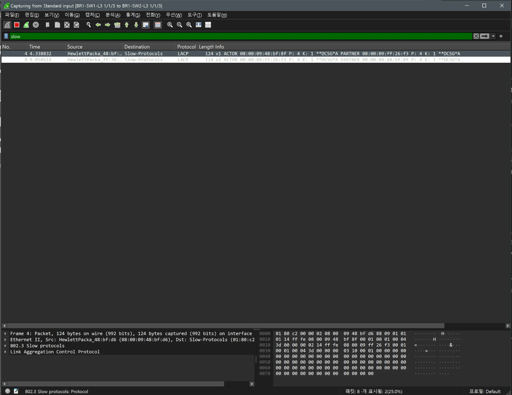
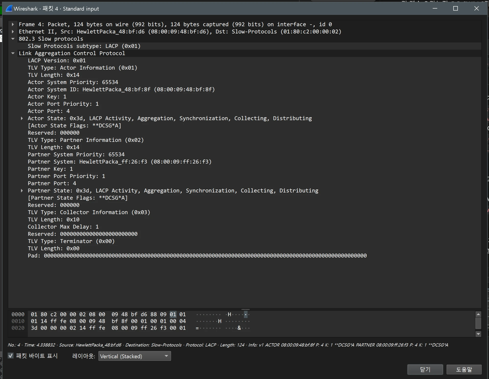

# EtherChannel 검증 (BR1 / distribution)

- Jira: KAN-12
- 대상 장비: BR1-SW1-L3, BR1-SW2-L3
- 기준 문서: [vlan-design.md](../../../docs/vlan-design.md) 1, 4~6절
- 검증일: 2026-10-17
- Aruba CX 교체: BR1 스위치를 Aruba CX(ArubaOS-CX Virtual 10.07)로 교체하고 AOS-CX 명령 기준으로 재검증

| 장비 | 명령 | 기대 결과 | 실제 결과 | 판정 |
|---|---|---|---|---|
| BR1-SW1-L3 | `show lacp aggregates` | LAG 1(1/1/3, 1/1/4) LACP active | lag1, Interfaces 1/1/3 1/1/4, Heartbeat rate Slow, Hash l3-src-dst, Aggregate mode Active | 통과 |
| BR1-SW2-L3 | `show lacp aggregates` | LAG 1(1/1/3, 1/1/4) LACP active | lag1, Interfaces 1/1/4 1/1/3, Heartbeat rate Slow, Hash l3-src-dst, Aggregate mode Active | 통과 |

BR1-SW1-L3 Po1

BR1-SW2-L3 Po1

## Wireshark 확인(Aruba LAG LACPDU)

- 검증일: 2026-10-19
- 캡처 링크: `BR1-SW1-L3 1/1/3 ↔ BR1-SW2-L3 1/1/3`(LAG 1 멤버), 필터 `slow`

| 시각(초) | 보낸 쪽 | Actor System ID | Actor Key / Port | Partner System | Partner Key / Port |
|---|---|---|---|---|---|
| 4.34 | BR1-SW1-L3(`08:00:09:48:bf:d6`) | `08:00:09:48:bf:8f` | 1 / 4 | `08:00:09:ff:26:f3`(BR1-SW2-L3) | 1 / 4 |
| 9.06 | BR1-SW2-L3(`08:00:09:ff:36:…`) | `08:00:09:ff:26:f3` | 1 / 4 | `08:00:09:48:bf:8f` | 1 / 4 |

- 양쪽이 서로를 Partner로 인식하고 같은 Key 1로 LAG 1을 구성. Actor System Priority는 65534.
- 상태 `0x3d`(`**DCSG*A**`): LACP Activity, Aggregation, Synchronization, Collecting, Distributing. `lacp mode active` 설정과 일치.
- 이 캡처는 약 10초 분량이라 LACP 전송 간격(slow/fast)은 확인하지 못함.
- 장애 시 재분산은 [etherchannel-link-down](../../scenarios/etherchannel-link-down.md) 참조(손실 5개, 최대 응답 5015 ms).

BR1 LAG 멤버 Wireshark(`slow`)

BR1-SW1-L3 LACPDU 상세

