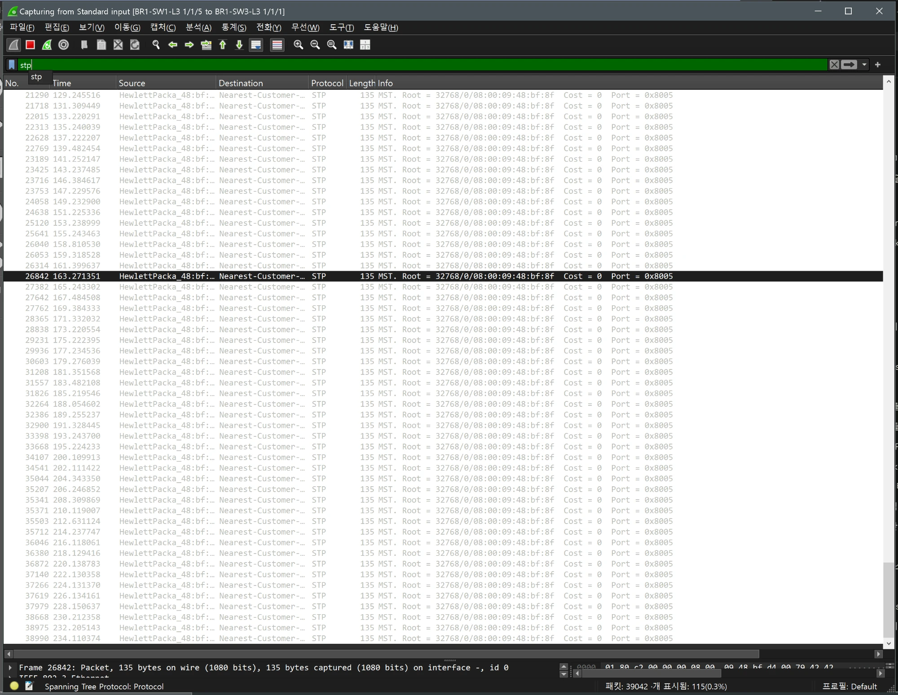
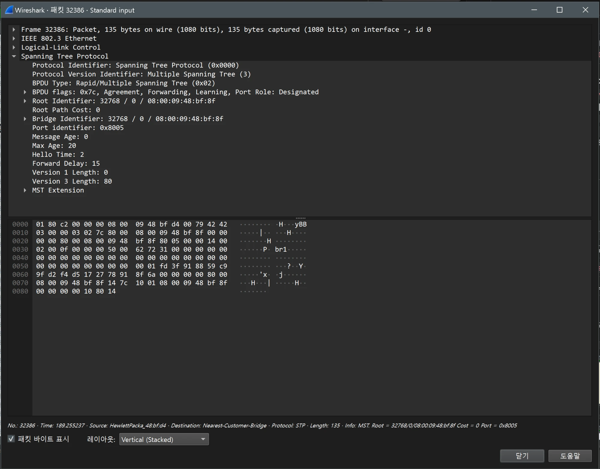
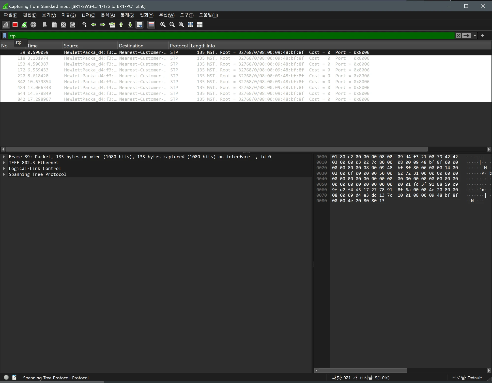
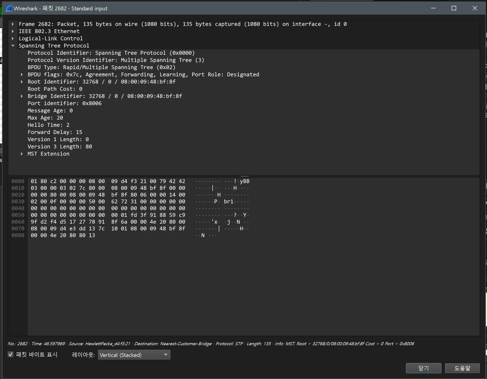

# STP(MST) 검증 (BR1 / distribution)

- Jira: KAN-12
- 대상 장비: BR1-SW1-L3, BR1-SW2-L3
- 기준 문서: [vrrp-mstp-design.md](../../../docs/vrrp-mstp-design.md) 3절
- 검증일: 2026-10-17
- Aruba CX 교체: BR1 스위치를 Aruba CX(ArubaOS-CX Virtual 10.07)로 교체하고 AOS-CX 명령 기준으로 재검증

| 장비 | 명령 | 기대 결과 | 실제 결과 | 판정 |
|---|---|---|---|---|
| BR1-SW1-L3 | `show spanning-tree mst` | 루트(priority 4096), region br1, instance 1 VLAN 10,20,100 | MST1 VLAN 10,20,100, Bridge와 Root 모두 08:00:09:48:bf:8f priority 4096(이 스위치가 루트), 1/1/5와 lag1 Designated FWD. region 이름은 이 출력에 없음(`show spanning-tree mst-config`에서 SW3 br1 확인) | 통과 |
| BR1-SW2-L3 | `show spanning-tree mst` | 보조 루트(8192), 루트는 SW1 | MST1 Bridge priority 8192, Root 08:00:09:48:bf:8f(BR1-SW1-L3, 4096), Root 포트 lag1(cost 20000) FWD, 1/1/5 Designated FWD(MST0에서는 Alternate BLK) | 통과 |

BR1-SW1-L3 MSTP

BR1-SW2-L3 MSTP

## Wireshark 확인(MST BPDU)

- 검증일: 2026-10-19
- 캡처 링크: 트렁크 `BR1-SW1-L3 1/1/5 ↔ BR1-SW3-L3 1/1/1`, 호스트 링크 `BR1-SW3-L3 1/1/6 ↔ BR1-PC1 eth0`, 필터 `stp`

| 항목 | 캡처 결과 |
|---|---|
| 전송 간격 | 트렁크 BPDU가 129.25, 131.31, 133.22, 135.24, 137.22초(약 2초 간격, Hello Time 2) |
| 프로토콜 | `Protocol Version: Multiple Spanning Tree (3)`, `BPDU Type: Rapid/Multiple Spanning Tree`, BPDU 길이 135바이트 |
| 플래그 | `0x7c`, Agreement, Forwarding, Learning, Port Role: Designated(SW-1 `1/1/5`가 Designated) |
| Root, Bridge ID | `32768 / 0 / 08:00:09:48:bf:8f`(BR1-SW1-L3), Root Path Cost 0, Port ID `0x8005`(트렁크) |
| 타이머 | Message Age 0, Max Age 20, Hello Time 2, Forward Delay 15 |
| MST Extension(패킷 바이트에서 해석) | Config Name `br1`, Revision 1, Digest `FD3F918859C99FD2F4D5172778918F6A`(`show spanning-tree mst-config`와 같은 값), CIST 남은 홉 20, 인스턴스 1 Regional Root 우선순위 4096 / `08:00:09:48:bf:8f` |
| 호스트 링크 | SW-3 `1/1/6`(Port ID `0x8006`)이 PC 방향으로도 같은 BPDU를 약 2초 간격으로 전송. 호스트 포트에 `bpdu-guard`가 있어 PC가 BPDU를 보내면 차단되는 구성 |

- 트렁크 BPDU의 digest가 세 스위치의 `mst-config` 출력(`FD3F9188…F6A`)과 일치해 같은 MST 영역으로 동작함.
- MST Extension은 상세 트리를 펼친 화면이 아니라 패킷 바이트에서 해석한 값(`62 72 31` = `br1`, 인스턴스 1 Regional Root 필드 `10 01` = 우선순위 4096 + 인스턴스 ID 1).

트렁크 Wireshark(`stp`): BPDU 2초 간격

트렁크 BPDU 상세(프레임 32386)

호스트 링크 Wireshark(`stp`)

호스트 링크 BPDU 상세(프레임 2682)

