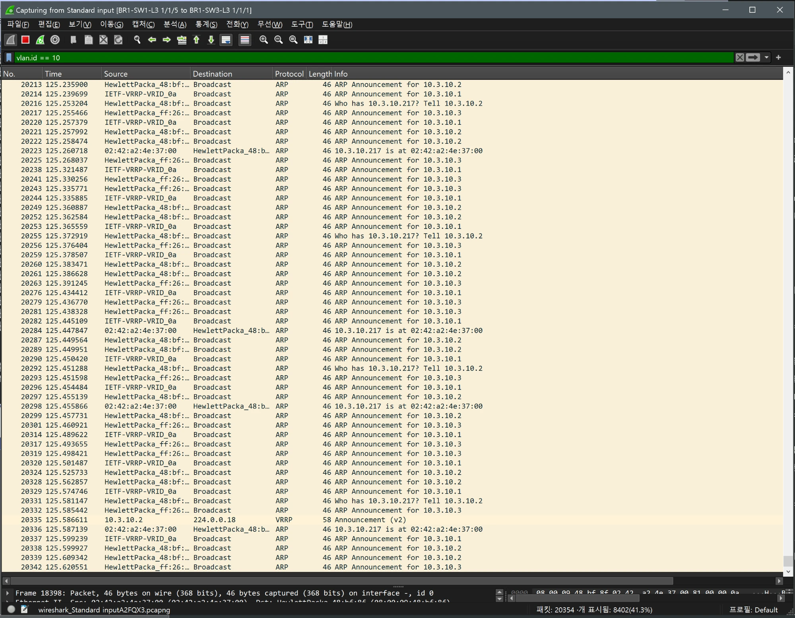
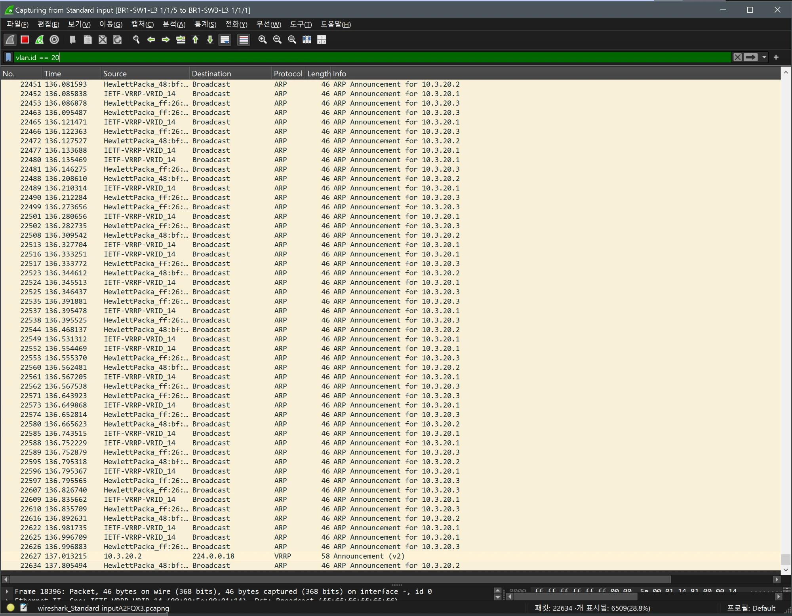
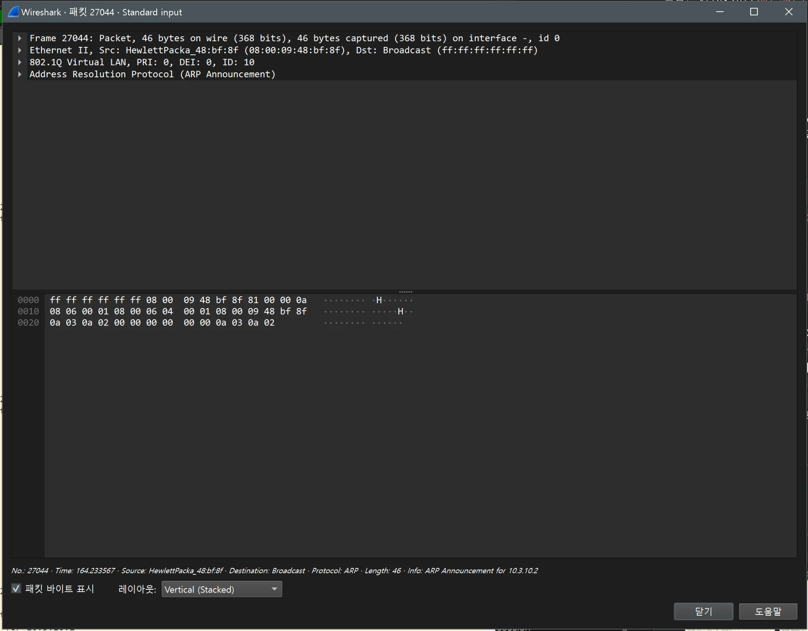
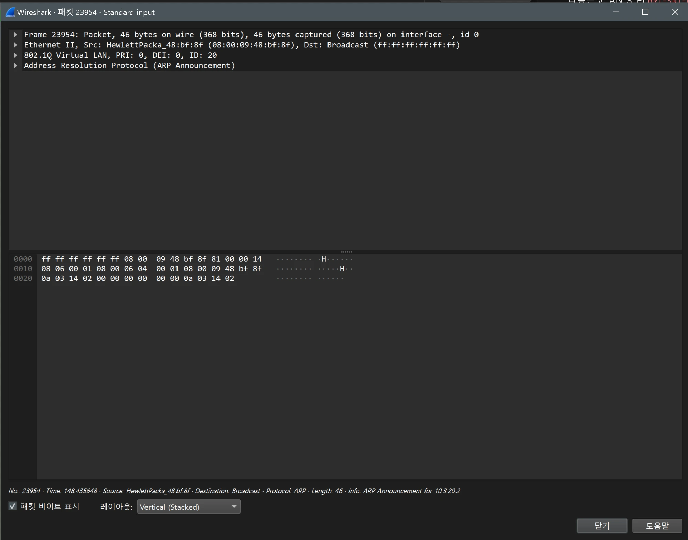
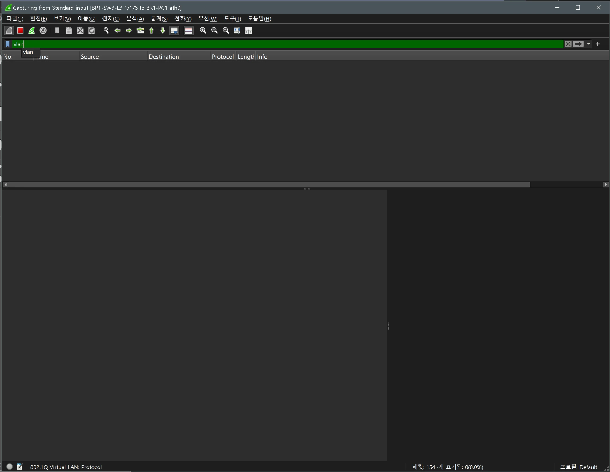

# VLAN, 트렁크 검증 (BR1 / distribution)

- Jira: KAN-12
- 대상 장비: BR1-SW1-L3, BR1-SW2-L3
- 기준 문서: [vlan-design.md](../../../docs/vlan-design.md) 1, 4~6절
- 검증일: 2026-10-17
- Aruba CX 교체: BR1 스위치를 Aruba CX(ArubaOS-CX Virtual 10.07)로 교체하고 AOS-CX 명령 기준으로 재검증

| 장비 | 명령 | 기대 결과 | 실제 결과 | 판정 |
|---|---|---|---|---|
| BR1-SW1-L3 | `show interface trunk` | lag1과 BR1-SW3-L3 방향 `1/1/5` 트렁크, 허용 10,20,100(native 999는 허용 목록에 없음) | 1/1/5, lag1 Trunk VLANs 10,20,100. Native VLAN은 None으로 표시 | 통과 |
| BR1-SW2-L3 | `show interface trunk` | lag1과 BR1-SW3-L3 방향 `1/1/5` 트렁크, 허용 10,20,100(native 999는 허용 목록에 없음) | 1/1/5, lag1 Trunk VLANs 10,20,100. Native VLAN은 None으로 표시 | 통과 |
| BR1-SW1-L3, BR1-SW2-L3 | `show vlan` | VLAN 10 br1-public, 20 br1-private, 100 mgmt up | VLAN 10 br1-public, 20 br1-private, 100 mgmt 모두 up(1/1/5, lag1), 999 native와 1 DEFAULT_VLAN_1은 down(no_member_port). SW1, SW2 동일 | 통과 |

트렁크 링크: BR1-SW1-L3 1/1/5 ↔ BR1-SW3-L3 1/1/1, BR1-SW2-L3 1/1/5 ↔ BR1-SW3-L3 1/1/2

BR1-SW1-L3 TRUNK

BR1-SW1-L3 VLAN

BR1-SW2-L3 TRUNK

BR1-SW2-L3 VLAN

## Wireshark 확인(802.1Q 태그)

- 검증일: 2026-10-19
- 트렁크 링크: `BR1-SW1-L3 1/1/5 ↔ BR1-SW3-L3 1/1/1`(native 999, 허용 VLAN 10·20·100), 호스트 링크: `BR1-SW3-L3 1/1/6 ↔ BR1-PC1 eth0`(access VLAN 10)

| 링크 | 필터 | 결과 |
|---|---|---|
| 트렁크 | `vlan.id == 10` | VLAN 10 프레임 8402개(전체 20354개 중). `802.1Q Virtual LAN, PRI: 0, DEI: 0, ID: 10`(`10.3.10.2`의 ARP Announcement, VRRP `10.3.10.2` 광고, `10.3.10.217`(PC)와의 ARP 요청·응답) |
| 트렁크 | `vlan.id == 20` | VLAN 20 프레임 6509개(전체 22634개 중). `ID: 20`(`10.3.20.x` ARP, VRRP `10.3.20.2` 광고, VRID `0x14`) |
| 호스트(access) | `vlan` | 154개 캡처 중 **표시 0개**. access 포트가 태그를 제거해 호스트 쪽에는 태그가 없음 |

- 트렁크에서는 VLAN 10, 20이 802.1Q 태그로 구분되고, 호스트 링크에서는 태그가 없는 것으로 트렁크와 access 포트의 동작 차이가 확인됨.
- 관찰: 트렁크 캡처의 상당수가 ARP Announcement(VRRP VIP `10.3.10.1`, SW-1 `10.3.10.2`, SW-2 `10.3.10.3`)이고 초당 수십 개 이상으로 보임. 원인은 확인하지 못했고, STP는 안정 상태로 확인됨: BR1-SW3-L3 `show spanning-tree`에서 Root가 SW-1(`08:00:09:48:bf:8f`), `1/1/1` Root / Forwarding, 토폴로지 변경 31회에서 더 늘지 않고 마지막 변경이 98초 전(직전 변경은 호스트 포트 `1/1/6`, `1/1/7`의 `shutdown`/`no shutdown` 시험 때문). 따라서 ARP 다수의 원인이 STP 불안정은 아님. SW-2의 `1/1/5` 차단 상태(`show spanning-tree mst`)는 별도 확인 필요.

트렁크 Wireshark(`vlan.id == 10`)

트렁크 Wireshark(`vlan.id == 20`)

프레임 상세: 802.1Q ID 10

프레임 상세: 802.1Q ID 20

호스트 링크 Wireshark(`vlan`): 표시 0개(태그 없음)

