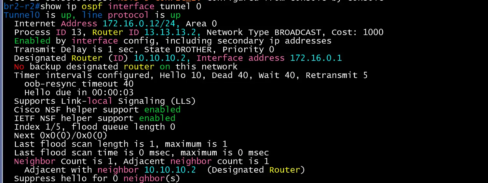
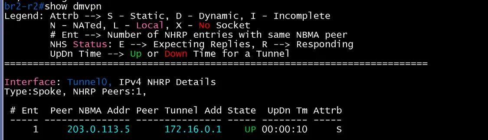
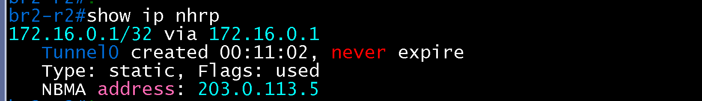
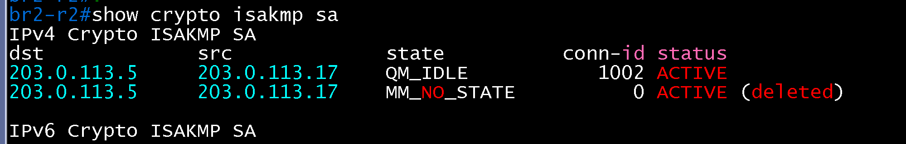
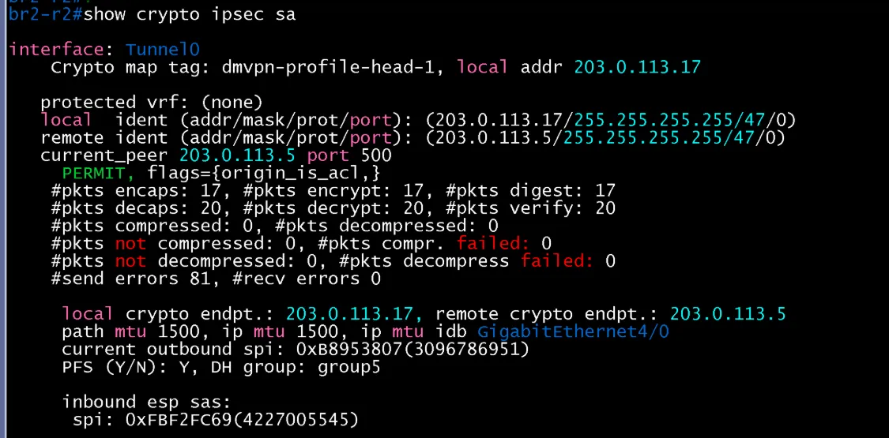
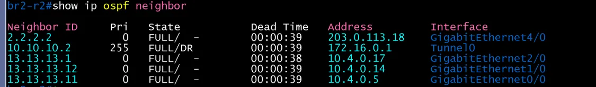
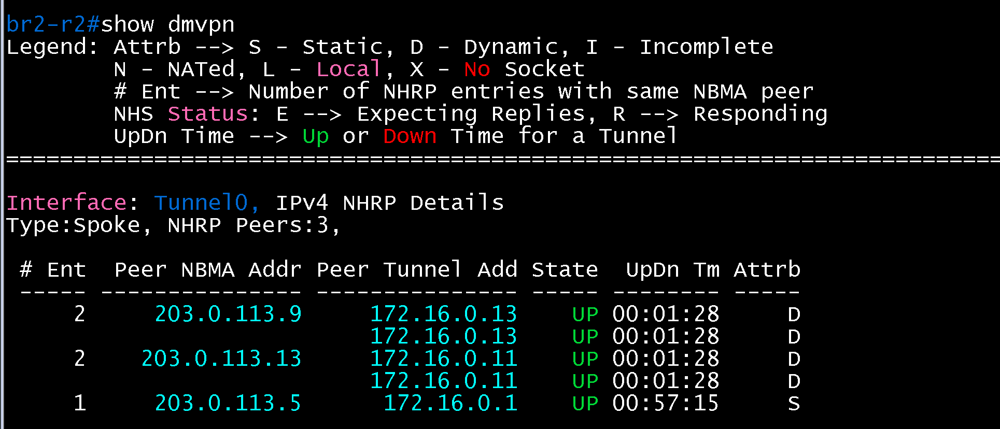
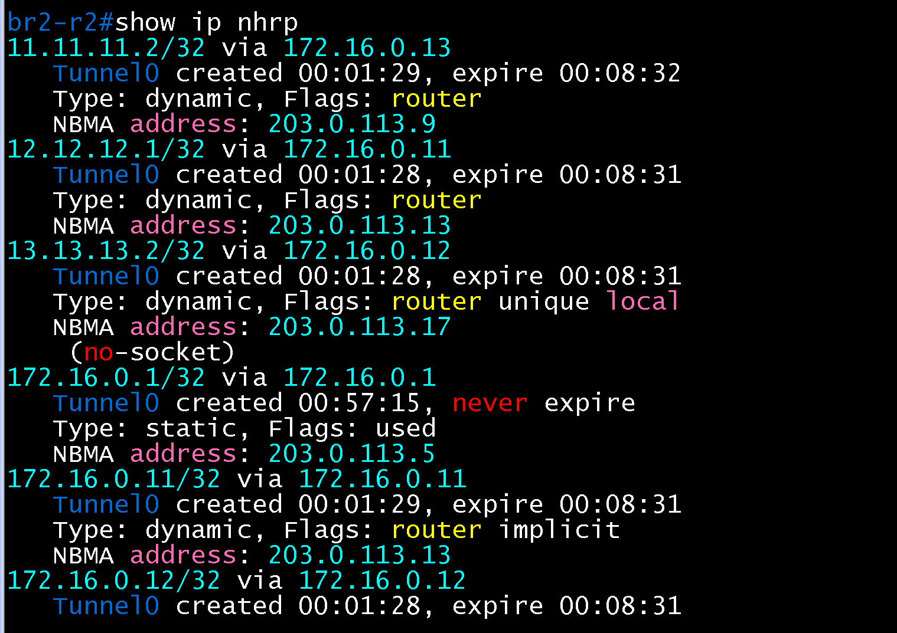
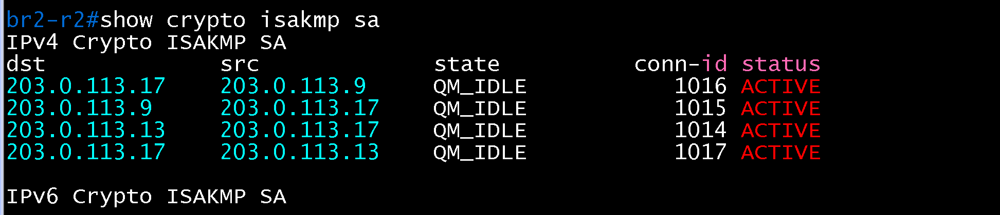

# DMVPN Spoke 검증 (BR2 / core)

- Jira: KAN-23
- 대상 장비: BR2-R2
- 기준 문서: [dmvpn-design.md](../../../docs/dmvpn-design.md) 1~4절
- 검증일: 2026-10-18

| 장비 | 명령 | 기대 결과 | 실제 결과 | 판정 |
|---|---|---|---|---|
| BR2-R2 | `show dmvpn` | Hub(172.16.0.1) Up, Tunnel0 172.16.0.12, NBMA 203.0.113.17 | Tunnel0 Type:Spoke, NHRP Peers 1. Hub 203.0.113.5(172.16.0.1) State UP, Attrb S(Static) | 통과 |
| BR2-R2 | `show ip ospf neighbor` | Tunnel0에서 DC-R2와 FULL(Spoke priority 0) | Tunnel0에서 10.10.10.2(172.16.0.1) FULL/DR(Pri 255). Gi4/0에서 Private-net 203.0.113.18(Private-net 2.2.2.2) FULL. 사이트 내부 이웃 13.13.13.1(10.4.0.17, Gi2/0), 13.13.13.12(10.4.0.14, Gi1/0), 13.13.13.11(10.4.0.5, Gi0/0) | 통과 |
| BR2-R2 | `show ip ospf interface tunnel 0` | Spoke priority 0, Hub(DR)와 인접 | Tunnel0 up/up, 172.16.0.12/24, Area 0, 프로세스 13, Router ID 13.13.13.2, BROADCAST, State DROTHER, Priority 0, DR는 10.10.10.2(172.16.0.1), BDR 없음. Neighbor Count 1, Adjacent neighbor 1(10.10.10.2, DR) | 통과 |
| BR2-R2 | `show crypto isakmp sa` | Hub와 QM_IDLE | dst 203.0.113.5, src 203.0.113.17 QM_IDLE ACTIVE(conn-id 1002). 이전 시도의 MM_NO_STATE(deleted) 항목이 함께 표시됨 | 통과 |
| BR2-R2 | `show ip nhrp` | Hub(172.16.0.1) static 항목, NBMA 203.0.113.5 | 172.16.0.1/32 via 172.16.0.1, Type static, Flags used, NBMA 203.0.113.5, never expire | 통과 |
| BR2-R2 | `show crypto ipsec sa` | Hub와 SA, 암호화 카운트 증가 | Tunnel0, profile dmvpn-profile-head-1, local 203.0.113.17, 상대 203.0.113.5(GRE/47). encaps 17, decaps 20, recv errors 0, send errors 81(SA 수립 전 시도분), PFS Y, DH group5 | 통과 |
| BR2-R2 | HQ-R2, BR1-R1과 Spoke 간 통신 후 `show dmvpn`, `show ip nhrp`, `show crypto isakmp sa` | Phase 3 shortcut 생성, `show ip nhrp`에 Spoke 간 dynamic 항목, `traceroute`가 Hub를 거치지 않음 | `show dmvpn`에 `203.0.113.9`(172.16.0.13)와 `203.0.113.13`(172.16.0.11)이 Dynamic(D)으로 추가(Peers 3, Hub는 Static), `show ip nhrp`에 `172.16.0.11/32`, `172.16.0.13/32`와 목적지 호스트 경로 `12.12.12.1/32 via 172.16.0.11`, `11.11.11.2/32 via 172.16.0.13` dynamic 항목, `show crypto isakmp sa`에 203.0.113.9, 203.0.113.13과의 QM_IDLE 4건(conn-id 1014~1017). Hub 미경유 직접 경로는 `verification/hq/core/dmvpn.md`, `br1/core/dmvpn.md`의 traceroute로 확인 | 통과 |

Phase 3 shortcut 검증은 2026-10-18에 수행.

BR2-R2 show ip ospf interface tunnel 0

BR2-R2 dmvpn

BR2-R2 nhrp

BR2-R2 isakmp

BR2-R2 ipsec

BR2-R2 ospf-neighbor

BR2-R2 show dmvpn(shortcut 후)

BR2-R2 show ip nhrp(shortcut 후)

BR2-R2 show crypto isakmp sa(shortcut 후)

