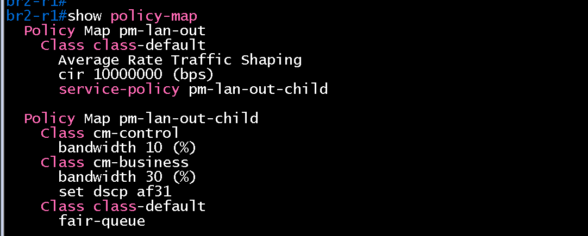
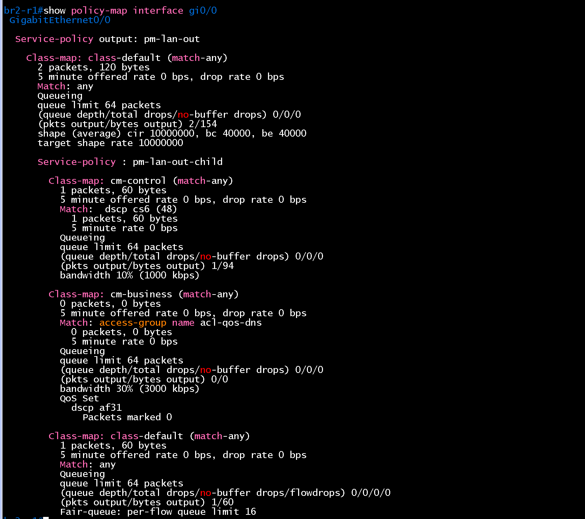
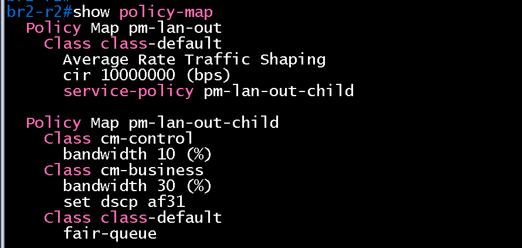
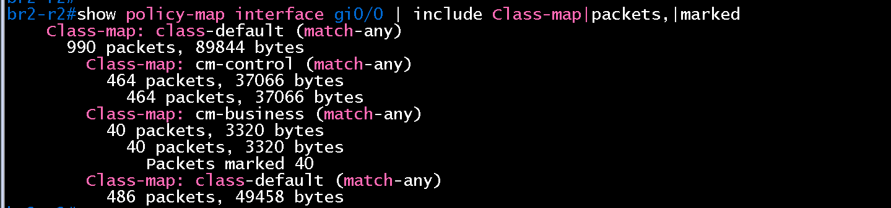
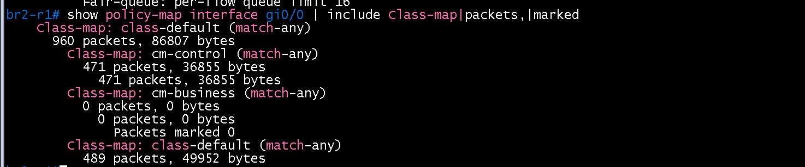
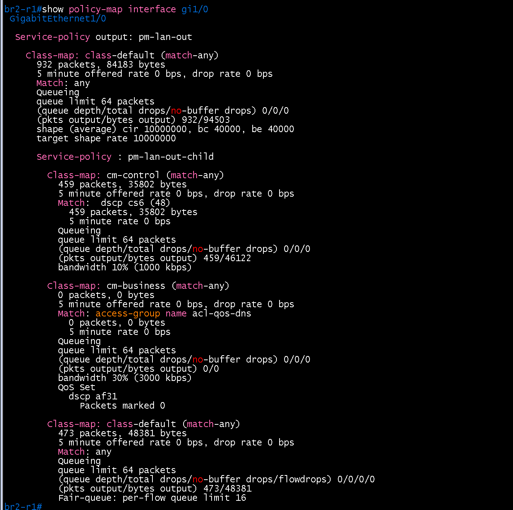
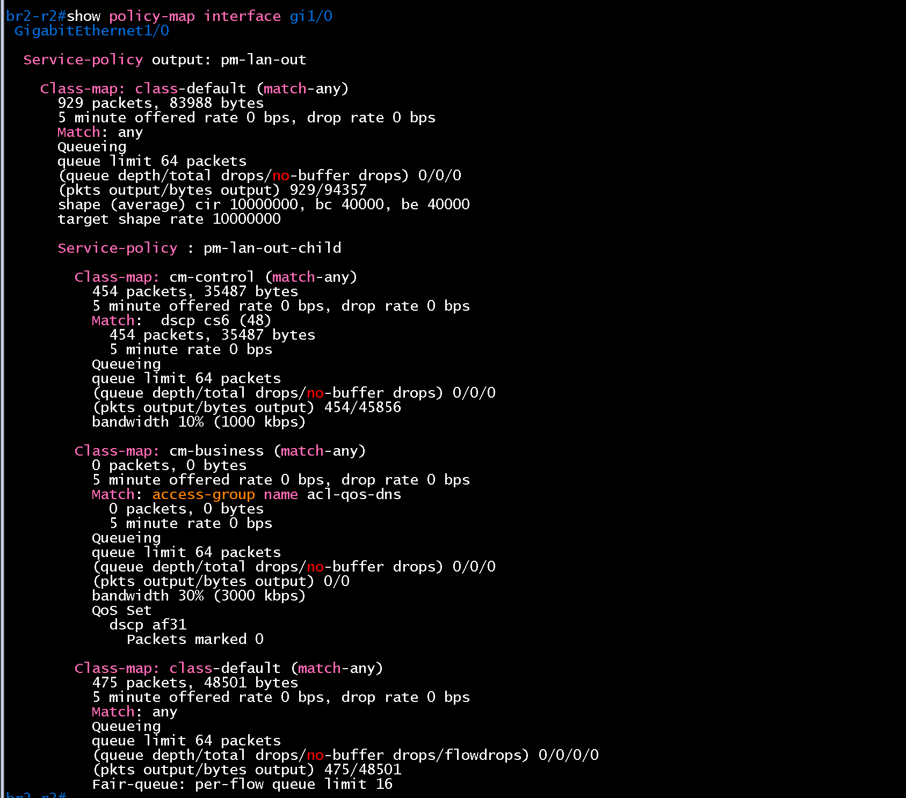
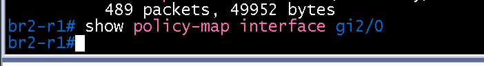
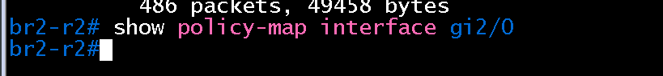

# QoS 검증 (BR2 / core)

- Jira: KAN-25
- 대상 장비: BR2-R1, BR2-R2
- 기준 문서: [qos-design.md](../../../docs/qos-design.md), [cisco-router.md](../../../docs/config-guide/cisco-router.md) 3.7절
- 검증일: 2026-10-18

| 장비 | 명령 | 기대 결과 | 실제 결과 | 판정 |
|---|---|---|---|---|
| BR2-R1, BR2-R2 | `show policy-map` | 정책 `pm-lan-out`, `pm-lan-out-child` 정의, 클래스 `cm-control`, `cm-business`, `class-default` | 두 장비 모두 `pm-lan-out`(class-default `shape average cir 10000000`, `service-policy pm-lan-out-child`)과 `pm-lan-out-child`(`cm-control` bandwidth 10%, `cm-business` bandwidth 30%와 `set dscp af31`, `class-default` fair-queue) 정의 | 통과 |
| BR2-R1, BR2-R2 | `show policy-map interface gi0/0`, `gi1/0` | `pm-lan-out` 출력 방향 적용, 클래스 3개 표시 | `gi0/0`에 `Service-policy output: pm-lan-out`. `shape (average) cir 10000000, bc 40000, be 40000`, `cm-control`은 `Match: dscp cs6 (48)`와 bandwidth 10%(1000 kbps), `cm-business`는 `Match: access-group name acl-qos-dns`와 bandwidth 30%(3000 kbps), `QoS Set dscp af31`, `class-default`는 `Fair-queue`. 카운터는 `cm-control`에 라우터 제어 트래픽 1~2패킷, `cm-business` 0, drop 0. BR2-R1, BR2-R2의 `gi1/0`도 `Service-policy output: pm-lan-out` 적용 확인 | 통과 |
| 호스트(BR2-PC1) | `nslookup dc-r1.lab.local 10.2.50.10` 20회 반복 후 BR2-R1, BR2-R2 `show policy-map interface gi0/0`, `gi1/0` | `cm-business` 매치 패킷 증가 | BR2-R2 `gi0/0`(BR2-SW1-L3 방향)에서 `cm-business` 40 packets, 3320 bytes, `Packets marked 40`(20회 질의의 응답 2패킷씩). BR2-R2 `gi1/0`, BR2-R1 `gi0/0`, `gi1/0`의 `cm-business`는 0이라 응답은 DMVPN 스포크 BR2-R2의 `gi0/0`으로 나감 | BR2-R2 통과 |
| 호스트(BR2-PC1) | 큰 트래픽(`ping -s 1400`) 후 `show policy-map interface` | `class-default`에 drop 발생, `cm-business` 보장 | 사이트별 개별 시험은 하지 않고 BR1-PC1 → DC-R2 `gi0/0` 대표 시험으로 대체. 같은 `pm-lan-out` 정책이므로 DC-R2에서 `class-default` drop +755(578에서 1333), `cm-business` drop 0/0/0을 확인(`verification/dc/core/qos.md`). BR2-PC1 경로 시험은 생략 | 통과(대표 시험) |
| BR2-R1, BR2-R2 | `show policy-map interface gi2/0`(해당 시) | 정책 미적용(제외 대상) | BR2-R1, BR2-R2 모두 `gi2/0`(BR2-R1↔R2 라우터 간 링크)의 출력이 비어 있어 정책 미적용 | 통과 |

BR2-R1 show policy-map

BR2-R1 show policy-map interface gi0/0

BR2-R2 show policy-map

BR2-R2 show policy-map interface gi0/0

BR2-R2 gi0/0 (DNS 질의 후, cm-business 40)

BR2-R1 gi0/0 (DNS 질의 후, cm-business 0)

BR2-R1 gi1/0

BR2-R2 gi1/0

BR2-R1 show policy-map interface gi2/0 (정책 미적용)

BR2-R2 show policy-map interface gi2/0 (정책 미적용)

