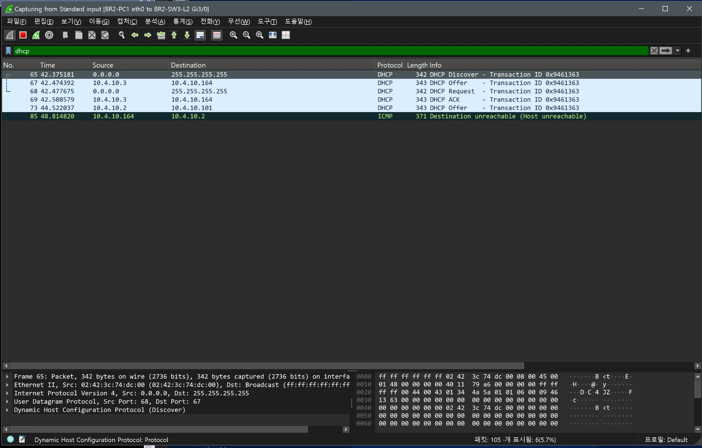
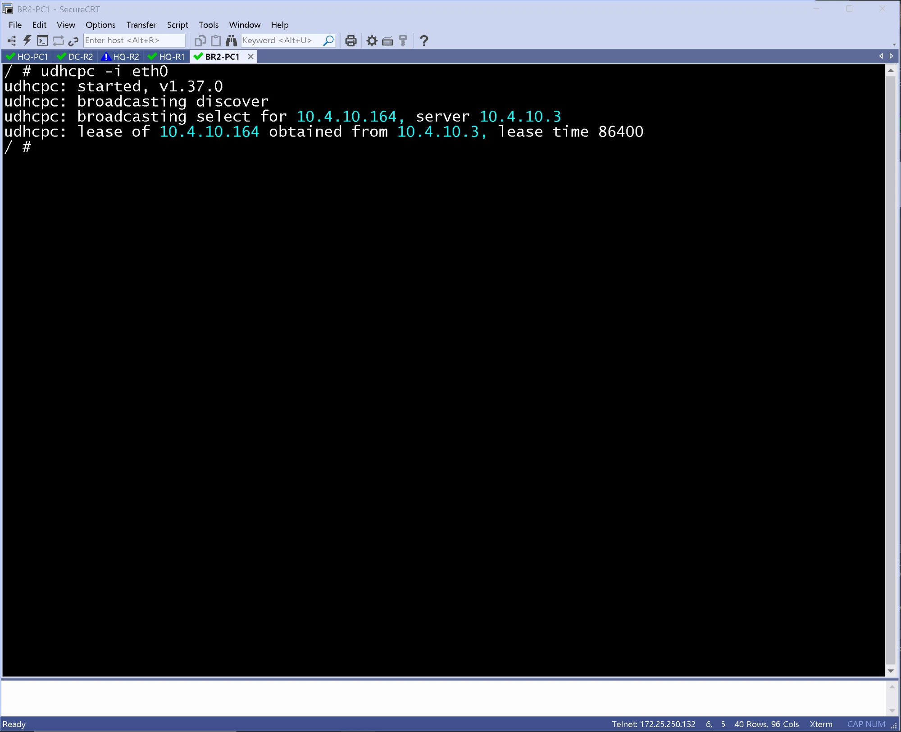

# DHCP 검증 (BR2 / distribution)

- Jira: KAN-14
- 대상 장비: BR2-SW1-L3, BR2-SW2-L3
- 기준 문서: [dhcp-dns-design.md](../../../docs/dhcp-dns-design.md) 3절
- 검증일: 2026-10-13

| 장비                     | 명령                                                  | 기대 결과                                            | 실제 결과 | 판정  |
| ---------------------- | --------------------------------------------------- | ------------------------------------------------ | ----- | --- |
| BR2-SW1-L3, BR2-SW2-L3 | `show ip dhcp pool` | 풀 범위 Active `.100`~`.163`, Standby `.164`~`.227` | 두 스위치 모두 풀 br2-public, br2-private, Total 254, Excluded 190. BR2-SW1-L3(Active)는 임대 시작 지수 .101(Active 범위 .100~), BR2-SW2-L3(Standby)는 지수 .165, .166(Standby 범위 .164~) | 통과 |
| BR2-SW1-L3, BR2-SW2-L3 | `show ip dhcp binding` | 호스트에 풀 범위 주소 임대, 게이트웨이 VIP, DNS 10.2.50.10 / .11 | BR2-SW1-L3에 10.4.10.100(Vlan10), 10.4.20.100(Vlan20) 임대, 클라이언트 ID가 호스트 MAC과 일치, 임대 만료 24시간 후. BR2-SW2-L3는 먼저 응답한 SW1이 할당해 바인딩 없음 | 통과 |
| 호스트 | `udhcpc -i eth0`, `ip addr`, `cat /etc/resolv.conf` | 풀 범위 주소와 `resolv.conf` DNS 두 대 | BR2-PC1 10.4.10.100(서버 10.4.10.2), BR2-PC2 10.4.20.100(서버 10.4.20.2), lease time 86400, resolv.conf search lab.local, nameserver 10.2.50.10과 10.2.50.11 | 통과 |

BR2-SW1-L3  DHCP POOL

BR2-SW1-L3  DHCP BINDING

BR2-SW2-L3 DHCP POOL

BR2-SW2-L3 DHCP BINDING

BR2-PC1

BR2-PC2

## Wireshark DORA 확인

- 검증일: 2026-10-19
- 캡처 링크: `BR2-PC1 eth0 ↔ BR2-SW3-L2 Gi3/0`, 필터 `dhcp`. BR2-PC1에서 `udhcpc -i eth0`로 주소를 다시 요청.
- 대표 시험: Cisco 서버(BR2-SW1-L3, BR2-SW2-L3)에서 확인. Aruba(BR1) DHCP는 Wireshark 확인을 하지 않음.

| 시각(초) | 출발지 → 목적지 | 메시지 | 내용 |
|---|---|---|---|
| 42.375 | `0.0.0.0` → `255.255.255.255` | Discover | 브로드캐스트, 트랜잭션 ID `0x9461363` |
| 42.474 | `10.4.10.3` → `10.4.10.164` | Offer | BR2-SW2-L3(Standby 풀 `.164~`)이 먼저 응답 |
| 42.478 | `0.0.0.0` → `255.255.255.255` | Request | 서버 `10.4.10.3`의 제안 선택 |
| 42.509 | `10.4.10.3` → `10.4.10.164` | ACK | `10.4.10.164` 임대 확정 |
| 44.522 | `10.4.10.2` → `10.4.10.101` | Offer | BR2-SW1-L3(Active 풀 `.100~`)의 Offer가 약 2초 뒤 도착, 사용되지 않음 |
| 48.815 | `10.4.10.164` → `10.4.10.2` | ICMP Destination unreachable | 늦은 Offer에 대한 PC의 응답으로 보이며 원인은 확인하지 못함 |

- `udhcpc` 출력: `lease of 10.4.10.164 obtained from 10.4.10.3, lease time 86400`(설계의 `lease 1`, 1일과 일치).
- 두 서버(Active, Standby)가 모두 Offer를 보내며 먼저 도착한 Offer를 선택함. 이 시험에서는 Standby가 먼저 응답해 Standby 풀 주소를 받았고, 이전 시험(`10.4.10.100`, 서버 `10.4.10.2`)과 서버가 달랐음. 어느 서버가 먼저 응답하는지는 고정이 아님.

BR2-PC1 Wireshark(`dhcp`): Discover, Offer, Request, ACK

BR2-PC1 `udhcpc -i eth0`

