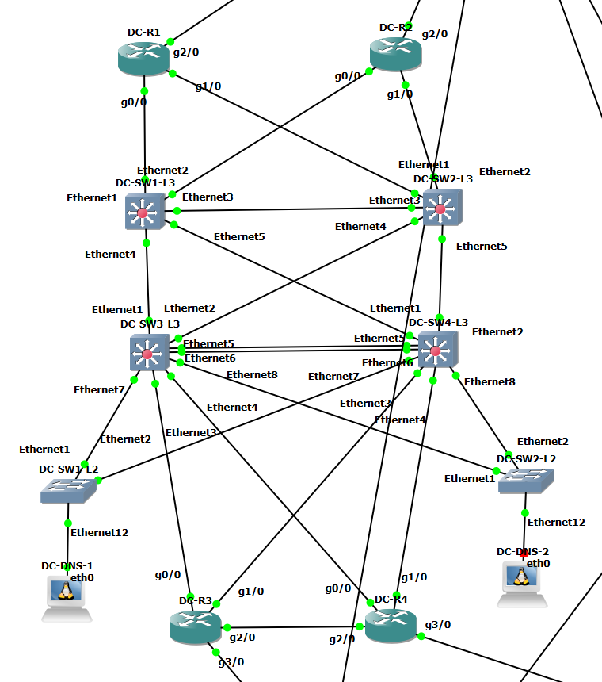

# DC 검증 개요

GNS3 토폴로지(검증 대상 장비와 포트). 상세 결과는 아래 문서 링크에서 확인.

## 핵심 결과

- VRRP 장애 전환(Arista): 약 3.2초, `ping` 손실 5개 → [vrrp-failover](../scenarios/vrrp-failover.md)
- MLAG 링크 다운: 손실 1개, 복구 후 Active-full 2 → [etherchannel-link-down](../scenarios/etherchannel-link-down.md), [mlag](distribution/mlag.md)
- DMVPN Hub 장애: Hub ESP 중단, 중단 약 105초, 약 44초 뒤 ISP 경로로 우회 → [dmvpn-hub-failure](../scenarios/dmvpn-hub-failure.md)
- DNS ACL, QoS 병목 시험 → [acl](core/acl.md), [qos-verification](../scenarios/qos-verification.md)

## 계층별 검증 문서

| 계층 | 항목 | Jira | 문서 |
|---|---|---|---|
| access(L2) | STP | KAN-11 | [access/stp.md](access/stp.md) |
| access(L2) | VLAN, 트렁크 검증 | KAN-10 | [access/vlan-trunk.md](access/vlan-trunk.md) |
| core | 서버 VLAN ACL 검증 | KAN-26 | [core/acl.md](core/acl.md) |
| core | DMVPN Hub 검증 | KAN-21 | [core/dmvpn.md](core/dmvpn.md) |
| core | ISP 연결 검증 | KAN-18 | [core/isp-link.md](core/isp-link.md) |
| core | OSPF 검증 | KAN-14 | [core/ospf.md](core/ospf.md) |
| core | QoS 검증 | KAN-25 | [core/qos.md](core/qos.md) |
| distribution | L3 인터페이스 검증 | KAN-10, KAN-14 선행 | [distribution/l3-interface.md](distribution/l3-interface.md) |
| distribution | MLAG 검증 | KAN-37 | [distribution/mlag.md](distribution/mlag.md) |
| distribution | OSPF 검증 | KAN-14 | [distribution/ospf.md](distribution/ospf.md) |
| distribution | EtherChannel 검증 | KAN-10 | [distribution/po-channel.md](distribution/po-channel.md) |
| distribution | STP | KAN-11 | [distribution/stp.md](distribution/stp.md) |
| distribution | VLAN, 트렁크 검증 | KAN-10 | [distribution/vlan-trunk.md](distribution/vlan-trunk.md) |
| distribution | VRRP 검증 | KAN-11 | [distribution/vrrp.md](distribution/vrrp.md) |
| host | DNS 서버 검증 | KAN-24 | [host/dns.md](host/dns.md) |

상세 서식과 상태는 [검증 README](../README.md) 참조.
