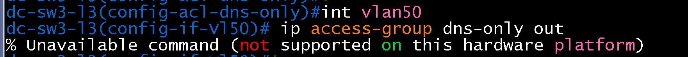
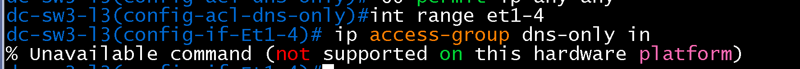
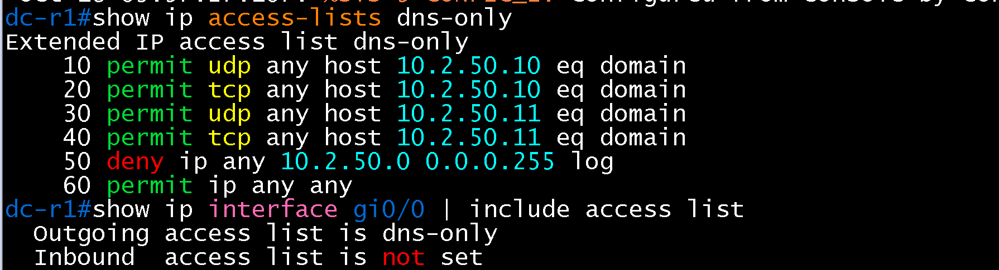
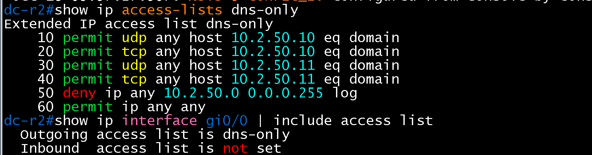
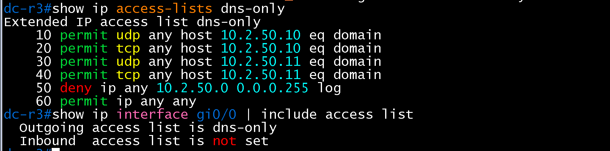
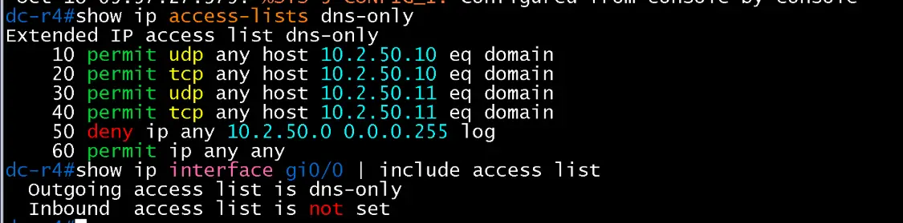
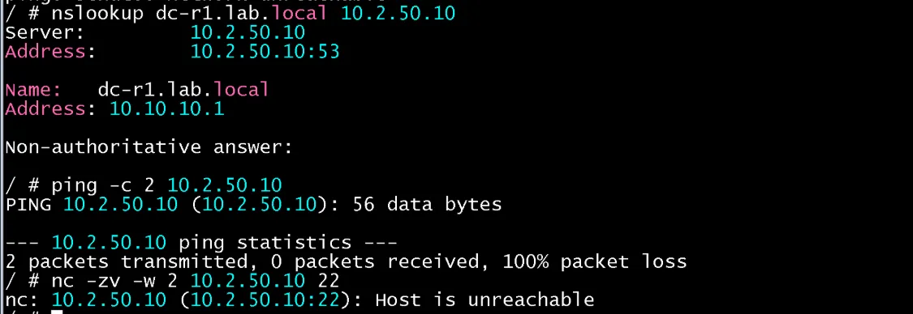
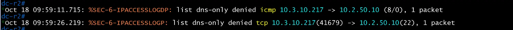
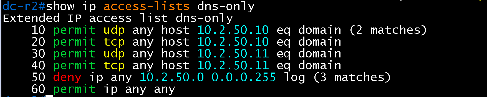

# 서버 VLAN ACL 검증 (DC / core)

- Jira: KAN-26
- 대상 장비: DC-R1, DC-R2, DC-R3, DC-R4 (DC-SW3-L3, DC-SW4-L3는 vEOS-lab ACL 미지원 확인)
- 기준 문서: [dhcp-dns-design.md](../../../docs/dhcp-dns-design.md) 5절
- 검증일: 2026-10-18

| 장비 | 명령 | 기대 결과 | 실제 결과 | 판정 |
|---|---|---|---|---|
| DC-SW3-L3 | `int vlan50`, `ip access-group dns-only out` | 적용(설계 초안) | `% Unavailable command (not supported on this hardware platform)`로 거부 | vEOS-lab 미지원 확인 |
| DC-SW3-L3 | `int range et1-4`, `ip access-group dns-only in` | 적용(대체안) | 같은 메시지로 거부 | vEOS-lab 미지원 확인, 적용 위치를 DC 라우터로 변경 |
| DC-R1, DC-R2, DC-R3, DC-R4 | `show ip access-lists dns-only` | DNS(UDP/TCP 53) 허용 4항목, 서버 VLAN deny(로그), `permit ip any any` | 4대 모두 10 `permit udp any host 10.2.50.10 eq domain`, 20 `permit tcp ...`, 30 `permit udp any host 10.2.50.11 eq domain`, 40 `permit tcp ...`, 50 `deny ip any 10.2.50.0 0.0.0.255 log`, 60 `permit ip any any` 구성 확인. 매치 카운트는 이번 캡처에 표시되지 않음 | 구성 통과 |
| DC-R1, DC-R2, DC-R3, DC-R4 | `show ip interface gi0/0 \| include access list` | 스위치 방향 인터페이스에 `dns-only` 출력 방향 적용 | 4대 모두 `Outgoing access list is dns-only`, `Inbound access list is not set` | 통과 |
| 호스트 | `nslookup dc-r1.lab.local 10.2.50.10` | 10.10.10.1 응답 | `Server: 10.2.50.10`, `Name: dc-r1.lab.local`, `Address: 10.10.10.1`(Non-authoritative answer) | 통과 |
| 호스트 | `nc -zv -w 2 10.2.50.10 22` | DNS 외 포트 차단 | `nc: 10.2.50.10 (10.2.50.10:22): Host is unreachable` | 통과 |
| 호스트 | `ping -c 2 10.2.50.10` | ICMP 차단(ACL 적용 후 정상) | 2 packets transmitted, 0 packets received, 100% packet loss | 통과 |
| DC-R2 | `show ip access-lists dns-only` (시험 후) | 허용 항목과 `deny` 항목 매치 카운트 증가 | `10 permit udp any host 10.2.50.10 eq domain (2 matches)`, `50 deny ip any 10.2.50.0 0.0.0.255 log (3 matches)`. 나머지 항목은 0(미표시) | 통과 |
| DC-R2 | `deny` 로그(`%SEC-6-IPACCESSLOGP`) | 허용 목록 밖 트래픽에 대해 `deny` 로그 기록 | DC-R2에서 BR1 호스트(10.3.10.217) 발 `icmp -> 10.2.50.10 (8/0)`과 `tcp 41679 -> 10.2.50.10(22)`가 `list dns-only denied`로 기록(1 packet씩). BR1 호스트의 서버 VLAN 접근이 DMVPN을 거쳐 DC-R2에서 차단됨 | 통과 |

허용 항목 10은 BR1 호스트의 `nslookup` 2건, deny 항목 50은 `nc`와 `ping` 등 3건의 시험 트래픽과 대응함.

DC-SW3-L3 ip access-group out 거부

DC-SW3-L3 ip access-group in 거부

DC-R1 dns-only

DC-R2 dns-only

DC-R3 dns-only

DC-R4 dns-only

호스트 nslookup, ping, nc 시험

DC-R2 deny 로그

DC-R2 ACL 매치 카운트

