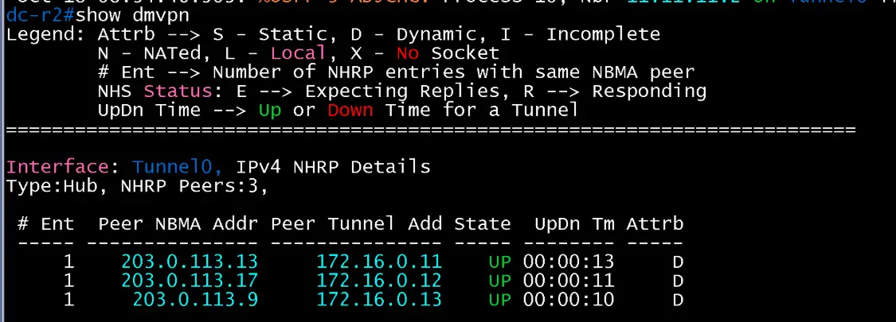
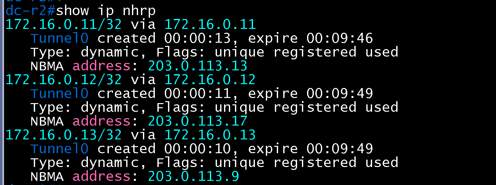
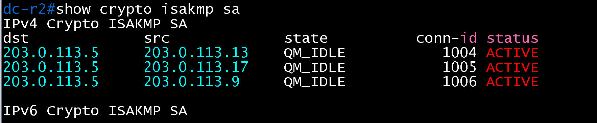
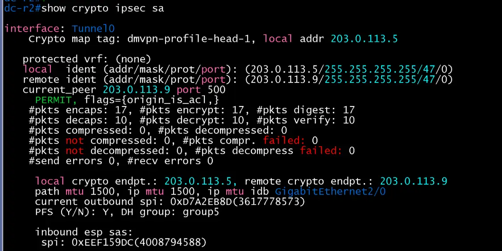
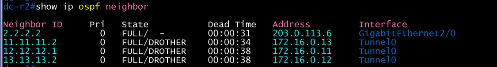

# DMVPN Hub 검증 (DC / core)

- Jira: KAN-21
- 대상 장비: DC-R2
- 기준 문서: [dmvpn-design.md](../../../docs/dmvpn-design.md) 1~4절
- 검증일: 2026-10-18

| 장비 | 명령 | 기대 결과 | 실제 결과 | 판정 |
|---|---|---|---|---|
| DC-R2 | `show dmvpn` | Spoke 3개(HQ-R2, BR1-R1, BR2-R2) Up, Tunnel0 172.16.0.1, NBMA 203.0.113.5 | Tunnel0 Type:Hub, NHRP Peers 3. 203.0.113.13(172.16.0.11), 203.0.113.17(172.16.0.12), 203.0.113.9(172.16.0.13) 모두 State UP, Attrb D(Dynamic) | 통과 |
| DC-R2 | `show ip nhrp` | Spoke 3개의 터널 주소와 NBMA 매핑(dynamic) | 172.16.0.11, .12, .13/32가 Type dynamic, Flags unique registered used, NBMA 203.0.113.13, .17, .9로 등록(expire 약 9분 46초~49초) | 통과 |
| DC-R2 | `show crypto isakmp sa` | Spoke별 SA QM_IDLE | dst 203.0.113.5, src 203.0.113.13, .17, .9 세 건 모두 QM_IDLE ACTIVE(conn-id 1004~1006) | 통과 |
| DC-R2 | `show crypto ipsec sa` | 암호화 카운트 증가 | Tunnel0, profile dmvpn-profile-head-1, local 203.0.113.5, 상대 203.0.113.9(GRE/47). encaps 17, encrypt 17, decaps 10, decrypt 10, send/recv errors 0, PFS Y, DH group5 | 통과 |
| DC-R2 | `show ip ospf neighbor` | Tunnel0에서 Spoke 이웃 FULL(Hub priority 255, DR) | Tunnel0에서 11.11.11.2(172.16.0.13), 12.12.12.1(172.16.0.11), 13.13.13.2(172.16.0.12) 모두 FULL/DROTHER. Gi2/0에서 Private-net 2.2.2.2 FULL(Pri 0) | 통과 |
| DC-R2 | `show ip ospf interface tunnel 0` | Hub priority 255, DR, Spoke 3대와 인접 | Tunnel0 up/up, 172.16.0.1/24, Area 0, 프로세스 10, Router ID 10.10.10.2, BROADCAST, State DR, Priority 255, DR는 자기 자신(10.10.10.2, 172.16.0.1). Neighbor Count 3, Adjacent neighbor 3(11.11.11.2, 12.12.12.1, 13.13.13.2) | 통과 |

DC-R2 show ip ospf interface tunnel 0

DC-R2 dmvpn

DC-R2 nhrp

DC-R2 isakmp

DC-R2 ipsec

DC-R2 ospf-neighbor

