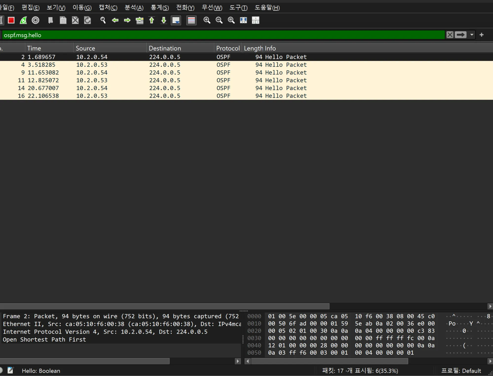
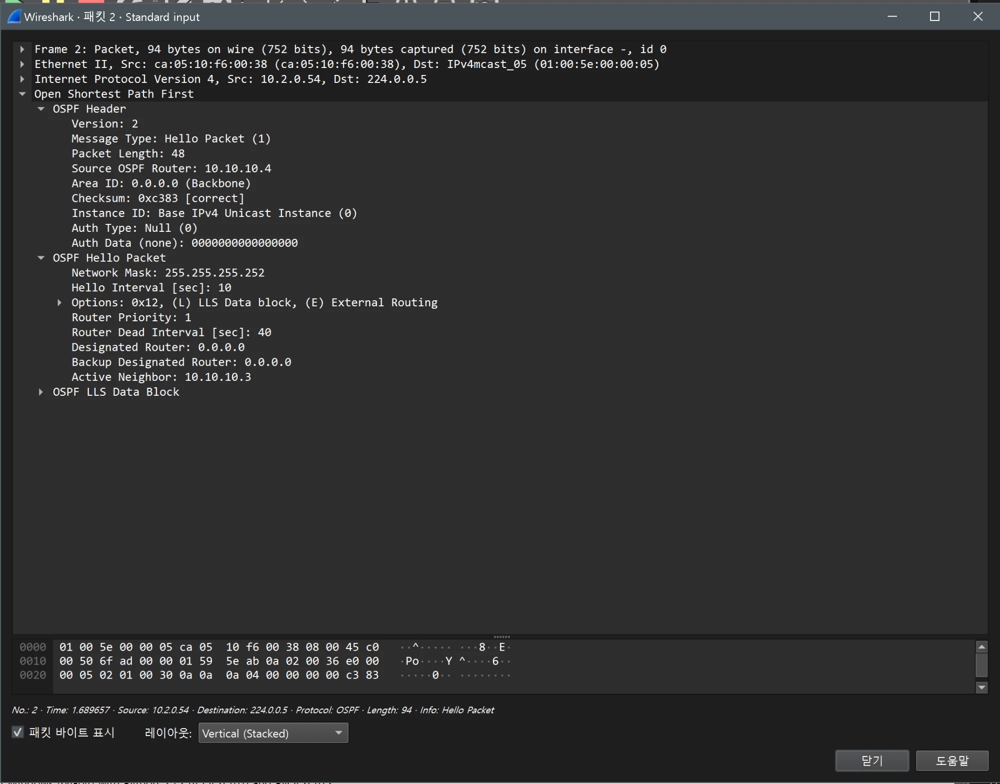

# OSPF 검증 (DC / core)

- Jira: KAN-14
- 대상 장비: DC-R1-R4(10.10.10.1-4)
- 기준 문서: [ospf-design.md](../../../docs/ospf-design.md) 2~4절
- 검증일: 2026-10-12

| 장비                     | 명령                      | 기대 결과                                            | 실제 결과 | 판정  |
| ---------------------- | ----------------------- | ------------------------------------------------ | ----- | --- |
| DC-R1-R4(10.10.10.1-4) | `show ip ospf neighbor` | 모든 이웃 FULL, 네트워크 타입 point-to-point | DC-R1, R2는 DC-SW1-L3, DC-SW2-L3와 2개, DC-R3, R4는 DC-SW3-L3, DC-SW4-L3, 상대 라우터와 3개, 모두 FULL(P2P) | 통과 |
| DC-R1-R4(10.10.10.1-4) | `show ip route ospf` | 사이트 /30 링크, 사용자·서버 VLAN, 다른 장비 `lo0` 학습(프로세스 10) | 23개 서브넷 학습: 사이트 /30 링크, 서버 VLAN 10.2.50.0/24, 다른 장비 lo0(10.10.10.1-4, 11-14) | 통과 |

프로세스 10, Area 0, Router ID는 장비의 `lo0`.
DC-R1 OSPF

DC-R2 OSPF

DC-R3 OSPF

DC-R4 OSPF

## Wireshark 확인(OSPF Hello, Area 0)

- 검증일: 2026-10-19
- 캡처 링크: DC 라우터 간 링크(`10.2.0.52/30`, 양쪽 `10.2.0.53`, `10.2.0.54`), 필터 `ospf.msg.hello`

| 항목 | 값 |
|---|---|
| 전송 | `10.2.0.54`가 1.69, 11.65, 20.68초(약 9~10초 간격), `10.2.0.53`이 3.52, 12.83, 22.11초. 목적지 `224.0.0.5` |
| Source OSPF Router | `10.10.10.4`(DC-R4) |
| Area ID | `0.0.0.0 (Backbone)` |
| Version / Type | 2 / Hello Packet, Auth Type Null |
| Network Mask | `255.255.255.252`(`/30`) |
| Hello Interval / Dead Interval | 10초 / 40초 |
| Router Priority / DR / BDR | 1 / `0.0.0.0` / `0.0.0.0`(point-to-point) |
| Active Neighbor | `10.10.10.3`(DC-R3) |

- DC가 Area 0(백본)임이 `Area ID: 0.0.0.0 (Backbone)`으로 확인됨(HQ는 Area 1). 타이머와 point-to-point 특성은 HQ와 같음.

