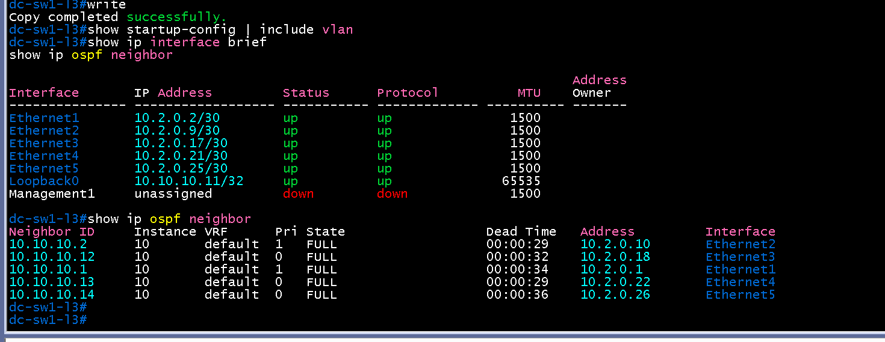
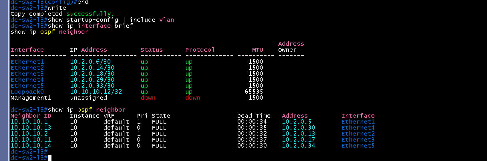

# L3 인터페이스 검증 (DC / distribution)

- Jira: KAN-10, KAN-14 선행
- 대상 장비: DC-SW1-L3, DC-SW2-L3, DC-SW3-L3, DC-SW4-L3
- 기준 문서: [ip-mapping.md](../../../docs/ip-mapping.md) 3절
- 검증일: 2026-10-11

| 장비 | 명령 | 기대 결과 | 실제 결과 | 판정 |
|---|---|---|---|---|
| DC-SW1-L3 | `show ip interface brief` | Et1~Et5, Lo0 up/up, IP 일치 | Ethernet1 10.2.0.2/30, Ethernet2 10.2.0.9/30, Ethernet3 10.2.0.17/30, Ethernet4 10.2.0.21/30, Ethernet5 10.2.0.25/30, Loopback0 10.10.10.11/32 모두 up/up. Vlan100 10.2.100.11/24는 down/lowerlayerdown(장비에 SVI 잔존) | 통과 |
| DC-SW2-L3 | `show ip interface brief` | Et1~Et5, Lo0 up/up, IP 일치 | Ethernet1 10.2.0.6/30, Ethernet2 10.2.0.14/30, Ethernet3 10.2.0.18/30, Ethernet4 10.2.0.29/30, Ethernet5 10.2.0.33/30, Loopback0 10.10.10.12/32 모두 up/up. Vlan100 10.2.100.12/24는 down/lowerlayerdown(장비에 SVI 잔존) | 통과 |
| DC-SW3-L3 | `show ip interface brief` | Et1~Et4, Lo0 IP 일치 | Ethernet1 10.2.0.22/30, Ethernet2 10.2.0.30/30, Ethernet3 10.2.0.38/30, Ethernet4 10.2.0.41/30, Loopback0 10.10.10.13/32, Vlan50 10.2.50.2/24, Vlan100 10.2.100.13/24 모두 up/up | 통과 |
| DC-SW4-L3 | `show ip interface brief` | Et1~Et4, Lo0 up/up, IP 일치 | Ethernet1 10.2.0.26/30, Ethernet2 10.2.0.34/30, Ethernet3 10.2.0.46/30, Ethernet4 10.2.0.50/30, Loopback0 10.10.10.14/32, Vlan50 10.2.50.3/24, Vlan100 10.2.100.14/24 모두 up/up | 통과 |

불일치 조치 완료(2026-10-14): `DC-SW1-L3`, `DC-SW2-L3` 장비에 남아 있던 `Vlan100` SVI와 `vlan 100`, `vlan 999` 정의를 `no interface vlan100`, `no vlan 100`, `no vlan 999`, `write`로 삭제. `show startup-config | include vlan` 결과 없음, `show ip interface brief`에 `Vlan100` 없음, OSPF 이웃 5개 FULL 유지.

비고: `DC-SW1-L3`, `DC-SW2-L3`는 VLAN 100에 속한 포트가 없어 MGMT SVI를 두지 않고 콘솔로 관리하기로 결정(vlan-design.md 1절).

DC-SW1-L3 INTERFACE

DC-SW2-L3 INTERFACE

DC-SW3-L3 INTERFACE

DC-SW4-L3 INTERFACE

DC-SW1-L3 Vlan100 삭제 후 확인

DC-SW2-L3 Vlan100 삭제 후 확인

