# MLAG 검증 (DC / distribution)

- Jira: KAN-37
- 대상 장비: DC-SW3-L3, DC-SW4-L3, DC-SW1-L2, DC-SW2-L2
- 기준 문서: [mlag-design.md](../../../docs/mlag-design.md)
- 검증일: 2026-10-18

## 장애 지점

빨간 선: DC-SW3-L3 Et7과 DC-SW1-L2 Et1 사이 링크(MLAG Po10 멤버). DC-SW3-L3 Et7 shutdown 후 복구.

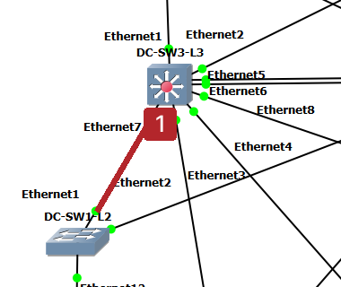

| 장비 | 명령 | 기대 결과 | 실제 결과 | 판정 |
|---|---|---|---|---|
| DC-SW3-L3, DC-SW4-L3 | `show mlag` | State Active, Negotiation Connected, peer-link `Po1` Up | 두 스위치 모두 domain-id `dc-mlag`, local-interface `Vlan4094`, peer-link `Port-Channel1`, state Active, negotiation status Connected, peer-link status Up, local-int status Up, peer-config consistent, system-id `0e:06:2e:cc:02:b8`. DC-SW3-L3 peer-address `10.2.254.2`, DC-SW4-L3 peer-address `10.2.254.1`. MLAG Ports는 Active-full 2(Po10, Po20), Inactive 0 | 통과 |
| DC-SW3-L3, DC-SW4-L3 | `show mlag detail` | Config sanity consistent | 두 스위치 모두 peer-config consistent. DC-SW3-L3는 State `primary`(Peer `secondary`), DC-SW4-L3는 State `secondary`(Peer `primary`), State changes 2, Failover False, Hardware ready True, UDP heartbeat alive True, Heartbeat timeout 0(Last heartbeat timeout never), Heartbeats sent/received 179/176(SW3), 168/170(SW4), Reload delay 300 seconds | 통과 |
| DC-SW3-L3, DC-SW4-L3 | `show port-channel dense` | `Po1`(peer-link) Up, `Po10`, `Po20` Up(MLAG 포트채널) | 두 스위치 모두 채널 3개 사용. `Po1(U)` LACP(a) Et5(PG+) Et6(PG+), `Po10(U)` Et7(PG+) PEt7(P), `Po20(U)` Et8(PG+) PEt8(P)(P 접두는 MLAG 피어 쪽 멤버) | 통과 |
| DC-SW1-L2, DC-SW2-L2 | `show port-channel dense` | 업링크 Et1, Et2가 `Po10`, `Po20`로 묶여 Up | DC-SW1-L2: `Po10(U)` LACP(a) Et1(PG+) Et2(PG+). DC-SW2-L2: `Po20(U)` LACP(a) Et1(PG+) Et2(PG+) | 통과 |
| DC-SW1-L2, DC-SW2-L2 | `show lacp peer` | 두 파트너(SW3, SW4)와 LACP 협상(파트너 시스템 ID가 MLAG system-id) | DC-SW1-L2 `Po10`: Et1, Et2 Bundled, 파트너 시스템 ID `8000,0e-06-2e-cc-02-b8`(MLAG system-id와 동일), 파트너 포트 `7`(SW3 Et7), `32775`(SW4 Et7), State `ALGs+CD`. DC-SW2-L2 `Po20`: Et1, Et2 Bundled, 같은 파트너 시스템 ID, 파트너 포트 `8`(SW3 Et8), `32776`(SW4 Et8), State `ALGs+CD` | 통과 |
| DC-DNS-1 | `ping -c 3 10.2.50.1`, `nslookup dc-r1.lab.local 10.2.50.10` | MLAG 적용 후에도 게이트웨이와 DNS 응답 유지 | ping 3/3 응답(0% 손실, 지연 최소 32ms, 평균 158ms, 최대 401ms), `nslookup`이 `10.10.10.1`로 응답 | 통과 |
| DC-SW3-L3 | `int et7`에서 `shutdown` 후 DC-DNS-1의 연속 `ping 10.2.50.1`, `show int et7` | 다른 쪽으로 트래픽 유지, 복구 후 정상화 | `Ethernet7 is administratively down`(`Member of Port-Channel10`, Down 35 seconds). 연속 ping에서 `icmp_seq=13` 한 개 손실, `seq=14`(912ms)와 `seq=15`(619ms)에서 지연이 튀었다가 `seq=16`부터 30~110ms로 안정(약 1초 단절). `no shutdown` 후 `Ethernet7 is up, line protocol is up (connected)`(Up 4 seconds), `show mlag`가 Active-full 2, Inactive 0으로 복구. 다운 중 `Active-partial` 캡처는 없음(3주 EtherChannel 실측 때 보충 가능) | 통과 |

vEOS-lab의 MLAG 지원 여부는 `show mlag`로 먼저 확인하고, 미지원이면 판정란에 한계를 기록.

DC-SW3-L3 show mlag

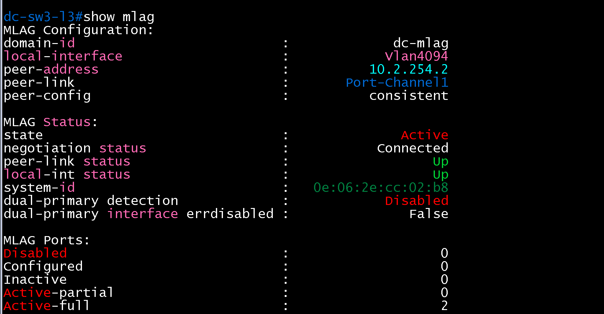

DC-SW3-L3 show port-channel dense

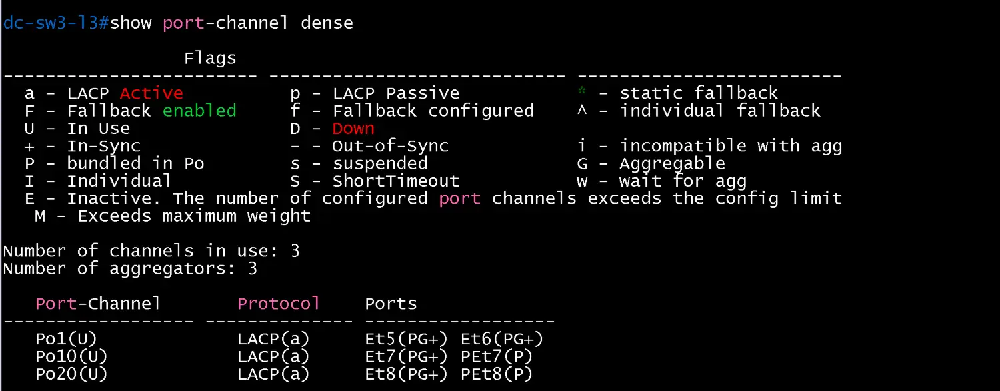

DC-SW4-L3 show mlag

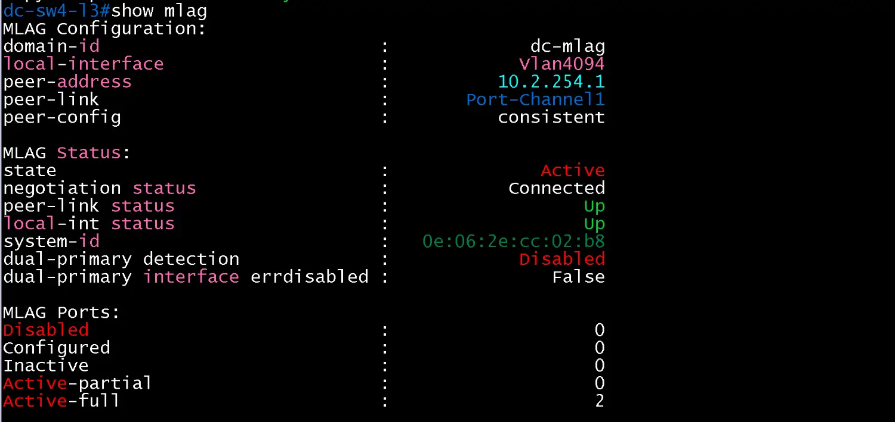

DC-SW4-L3 show port-channel dense

DC-SW1-L2 show port-channel dense

DC-SW1-L2 show lacp peer

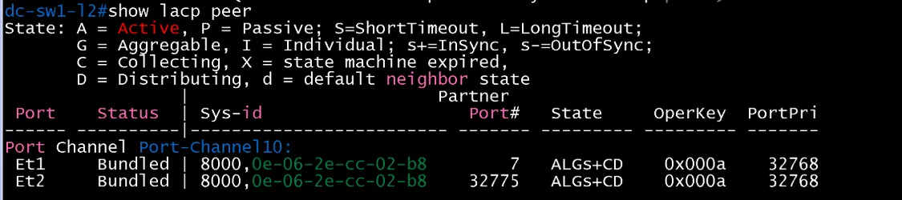

DC-SW2-L2 show port-channel dense

DC-SW2-L2 show lacp peer

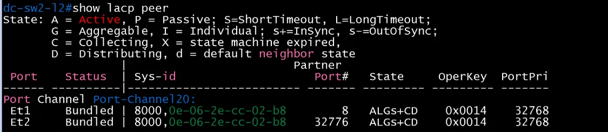

DC-DNS-1 ping 10.2.50.1

DC-DNS-1 nslookup

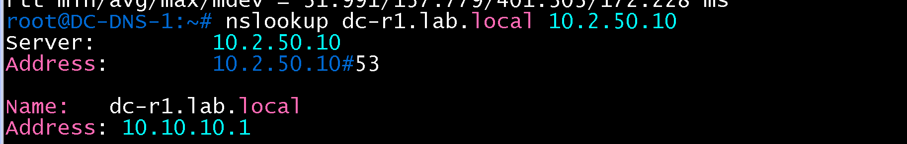

DC-DNS-1 연속 ping(SW3 Et7 다운 중)

DC-SW3-L3 show int et7(다운)

DC-SW3-L3 show int et7(복구)

DC-SW3-L3 show mlag(복구 후)

DC-SW3-L3 show mlag detail

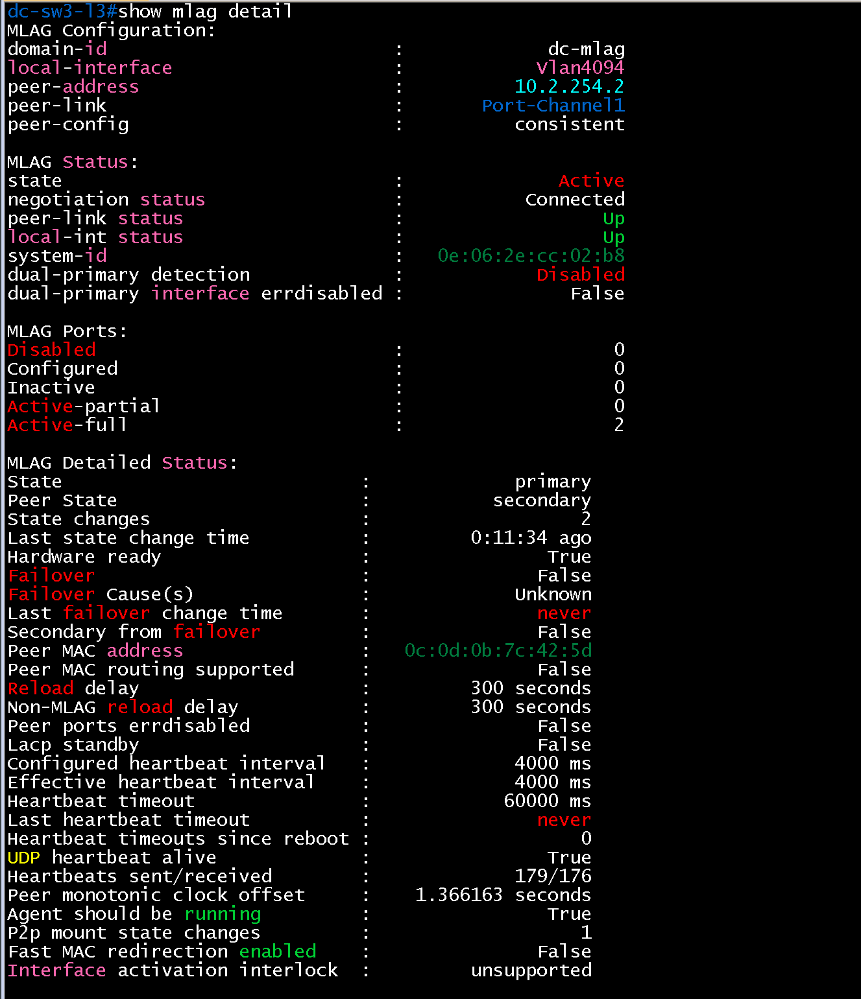

DC-SW4-L3 show mlag detail

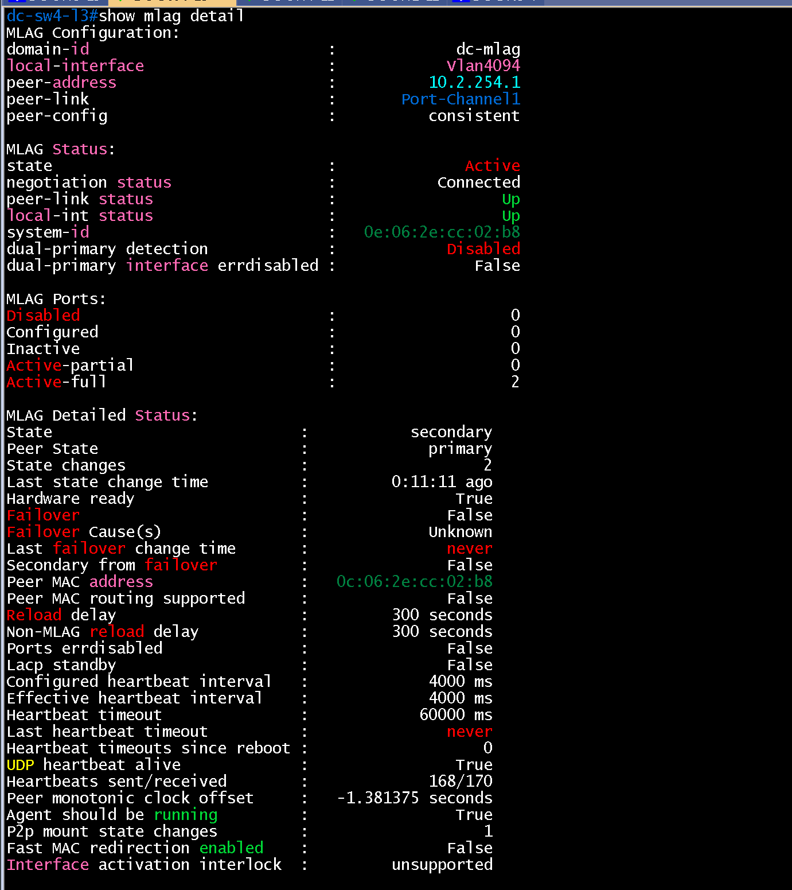

## Wireshark 확인(MLAG LACPDU)

- 검증일: 2026-10-19
- 캡처 링크 37: `DC-SW3-L3 Ethernet7 ↔ DC-SW1-L2 Ethernet1`, 링크 39: `DC-SW4-L3 Ethernet7 ↔ DC-SW1-L2 Ethernet2`(둘 다 Po10 멤버), 필터 `slow`

| 링크 | 보낸 쪽 | Actor System ID | Actor Key / Port | Partner System | Partner Key / Port |
|---|---|---|---|---|---|
| 37 | DC-SW3-L3(`0c:06:2e:4d:00:07`) | `0e:06:2e:cc:02:b8` | 10 / 7 | `0c:00:a4:35:1b:54`(DC-SW1-L2) | 10 / 1 |
| 37 | DC-SW1-L2(`0c:00:a4:e2:00:01`) | `0c:00:a4:35:1b:54` | 10 / 1 | `0e:06:2e:cc:02:b8` | 10 / 7 |
| 39 | DC-SW4-L3(`0c:0d:0b:5d:00:07`) | **`0e:06:2e:cc:02:b8`** | 10 / 32775 | `0c:00:a4:35:1b:54`(DC-SW1-L2) | 10 / 2 |
| 39 | DC-SW1-L2 | `0c:00:a4:35:1b:54` | 10 / 2 | `0e:06:2e:cc:02:b8` | 10 / 32775 |

- **핵심**: DC-SW3-L3과 DC-SW4-L3이 서로 다른 장비인데도 DC-SW1-L2에 **같은 Actor System ID `0e:06:2e:cc:02:b8`와 같은 Key 10**을 광고함. DC-SW1-L2는 두 스위치를 하나의 파트너로 보고 Eth1, Eth2를 하나의 LAG(Po10)로 묶음.
- Actor Port 값만 다름(DC-SW3-L3 `7`, DC-SW4-L3 `32775`)으로 두 MLAG 피어의 포트가 구분됨.
- 상태 `0x3d`(`**DCSG*A**`): LACP Activity, Aggregation, Synchronization, Collecting, Distributing. Partner 상태도 같음.
- 전송 간격: 링크 39에서 0, 33.06, 63.08, 97.11, 127.14초로 약 30초 간격(LACP slow).
- 장애 시 재분산(멤버 `shutdown`)은 이 캡처에 포함하지 않음.

링크 37 Wireshark(`slow`)

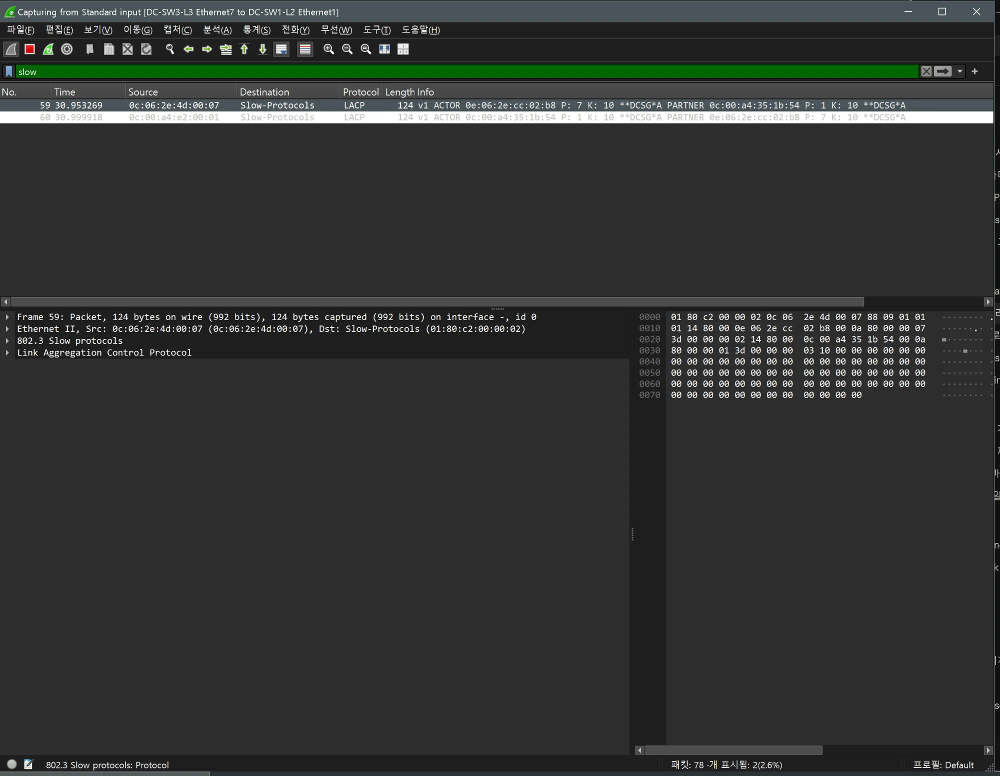

링크 37 LACPDU 상세(DC-SW3-L3)

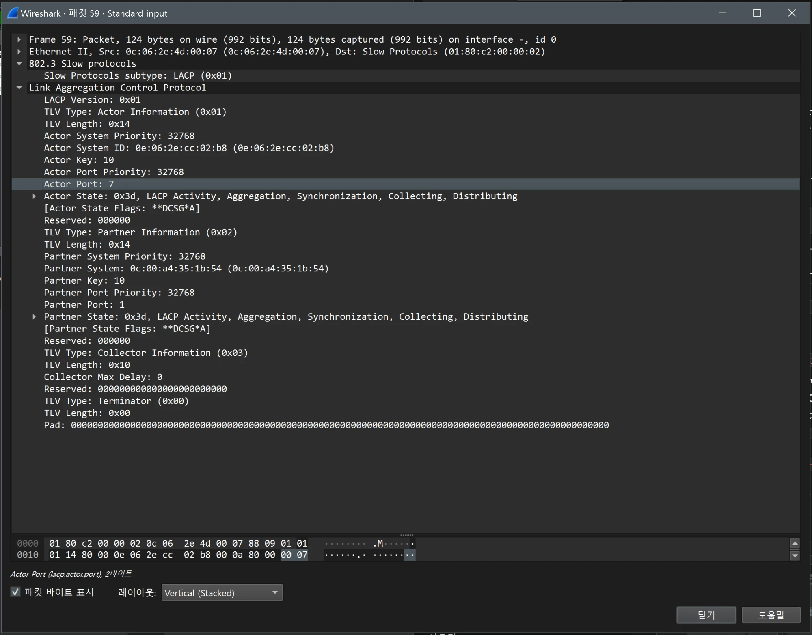

링크 39 Wireshark(`slow`): 30초 간격

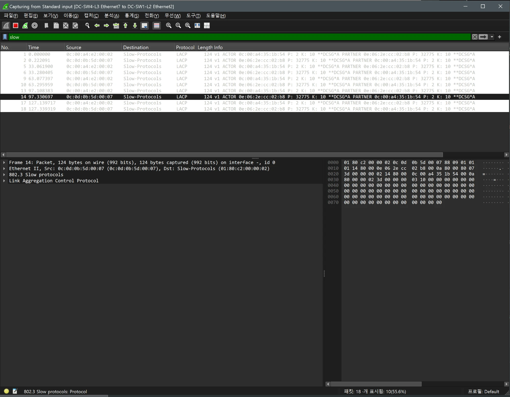

링크 39 LACPDU 상세(DC-SW4-L3, 같은 Actor System ID)

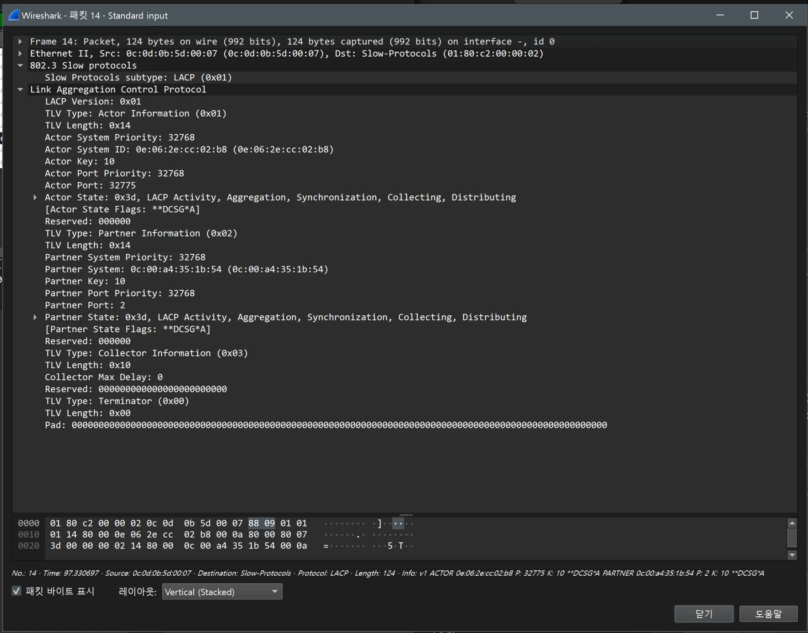

## Wireshark 확인(MLAG 피어링, VLAN 4094)

- 검증일: 2026-10-19
- 캡처 링크: `DC-SW3-L3 Ethernet6 ↔ DC-SW4-L3 Ethernet6`(peer-link Po1 멤버), 필터 `vlan.id == 4094`

| 항목 | 결과 |
|---|---|
| VLAN | 모든 프레임이 `802.1Q ID: 4094`(MLAG 피어 전용 VLAN), 출발지·목적지 `10.2.254.1`(DC-SW3-L3) ↔ `10.2.254.2`(DC-SW4-L3). 112개 캡처 중 77개 표시 |
| TCP 세션 | 포트 **4432**(`45040 → 4432`, `4432 → 58348` 등) ACK가 계속 오감. `[TCP Keep-Alive]`와 `Dup ACK`도 섞여 보임 |
| 데이터 TCP | `4432 → 58348 [PSH, ACK]` Len=9(프레임 72), 약 4초 간격(20.02, 24.02, 28.03초). 페이로드 `4040daaced74f041f2` |
| UDP | `4432 → 4432` Len=79(프레임 74), 약 4초 간격(20.05, 24.01, 28.02초, 직전 프레임과 4.04초 간격). 페이로드 79바이트(`02247215924e2000756470486561727…`) |
| IP/QoS | TTL 255, `DSCP: CS7`(제어 트래픽 최우선), 802.1Q Priority 7, Don't fragment, DC-SW3-L3 MAC `0c:06:2e:cc:02:b8`(MLAG system-id와 같은 값 계열) |

- MLAG 피어링이 별도 VLAN 4094와 TCP·UDP 4432로 이루어지고, 제어 트래픽이 CS7, Priority 7로 표시되어 QoS 정책(`cm-control`이 `cs6`을 분류)과 별개의 최우선 등급으로 전송됨.
- Arista MLAG 프로토콜은 Wireshark가 해석하지 못해(`Data`로 표시) 페이로드 의미는 확인하지 못함. UDP 4초 주기는 피어 하트비트로 추정(확인하지 못함).
- `Dup ACK`와 `Keep-Alive`가 보이는 원인은 확인하지 못함.

피어 VLAN 목록

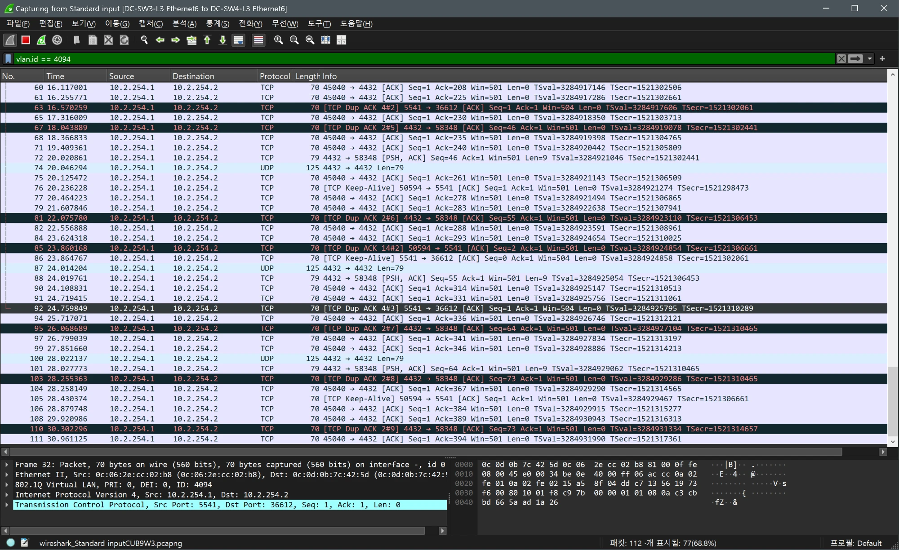

UDP 4432(프레임 74)

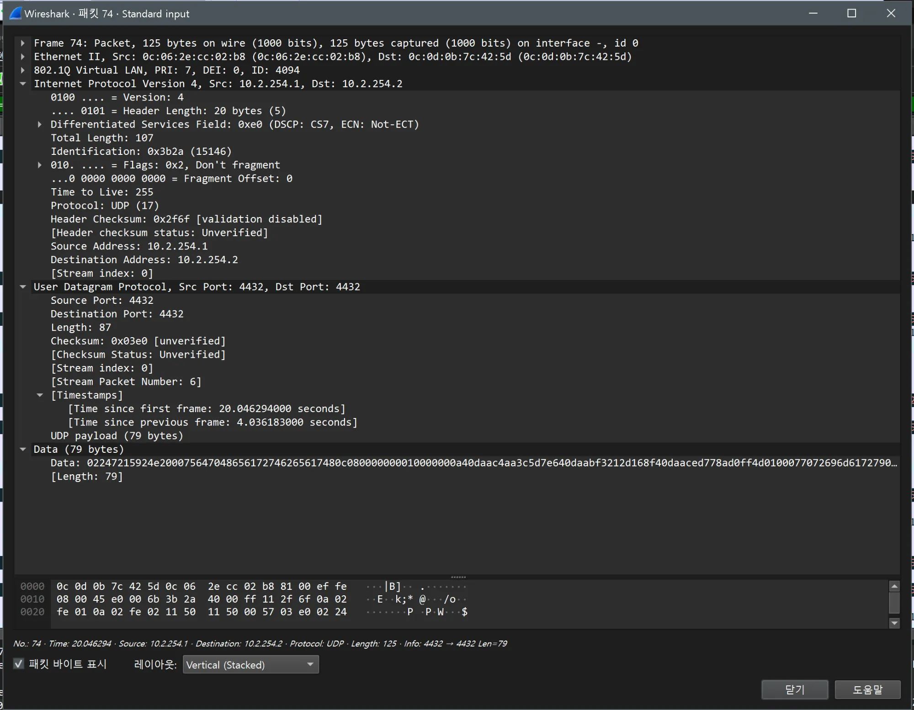

TCP 4432 데이터(프레임 72)

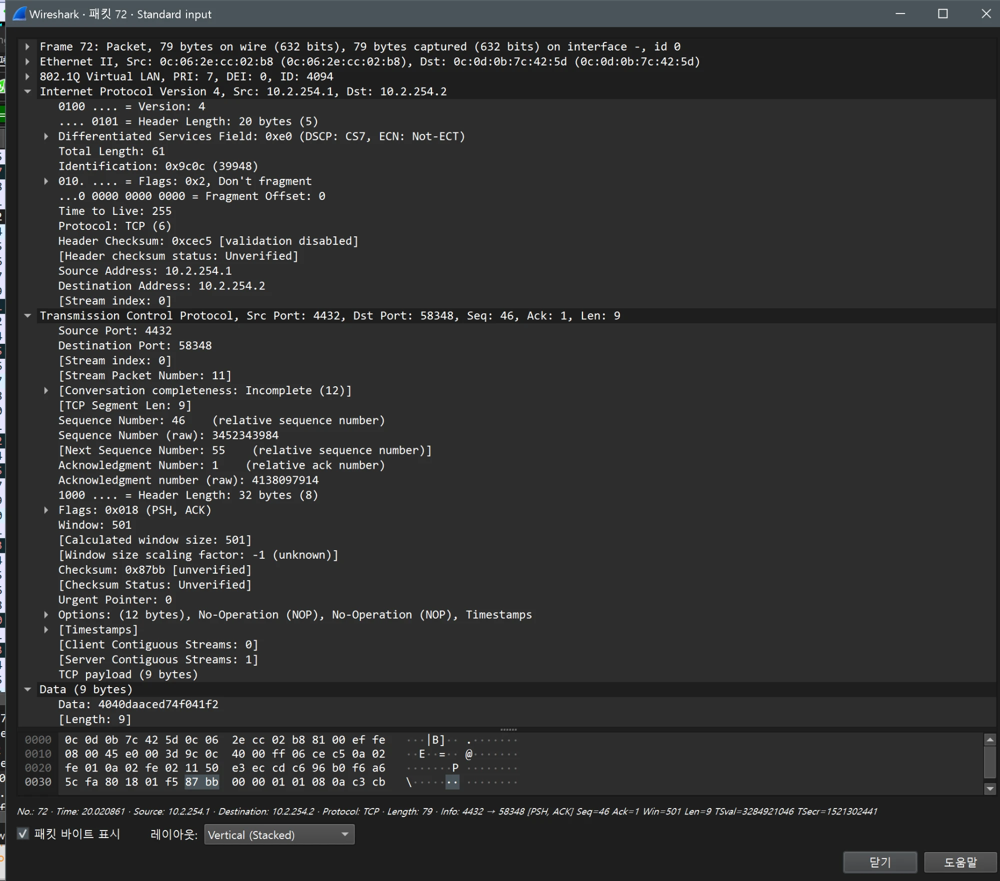
