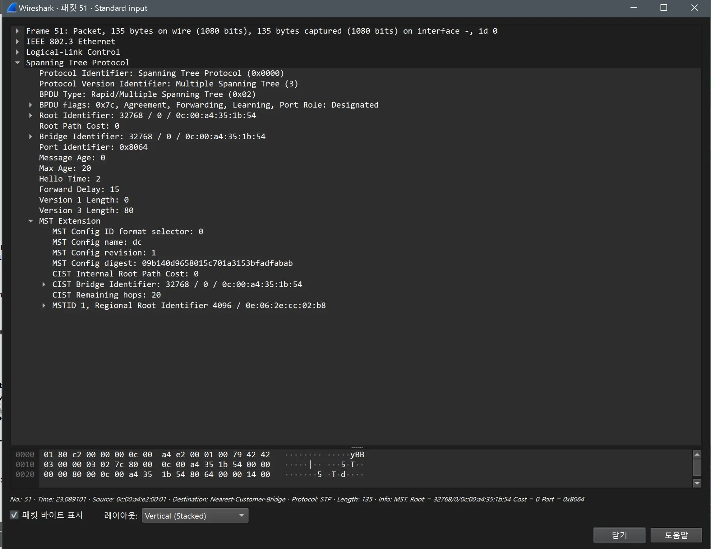

# STP(MST) 검증 (DC / distribution)

- Jira: KAN-11
- 대상 장비: DC-SW3-L3, DC-SW4-L3
- 기준 문서: [vrrp-mstp-design.md](../../../docs/vrrp-mstp-design.md) 3절
- 검증일: 2026-10-11

| 장비 | 명령 | 기대 결과 | 실제 결과 | 판정 |
|---|---|---|---|---|
| DC-SW3-L3 | `show spanning-tree mst 1` | 루트(priority 4096), 모든 포트 designated | Bridge `0c06.2ecc.02b8` priority 4097, "this switch for MST1", Et7 Et8 Po1 designated forwarding | 통과 |
| DC-SW4-L3 | `show spanning-tree mst 1` | 보조 루트(8192), Po1 root | Bridge `0c0d.0b7c.425d` priority 8193, Root 4097(DC-SW3-L3), Po1 root FWD, Et7 Et8 designated FWD | 통과 |

DC-SW3-L3 MSTP

DC-SW4-L3 MSTP

## Wireshark 확인(MST BPDU)

- 검증일: 2026-10-19
- 캡처 링크: `DC-SW3-L3 Ethernet7 ↔ DC-SW1-L2 Ethernet1`, 필터 `stp`(프레임 51, DC-SW1-L2가 전송)

| 항목 | 값 |
|---|---|
| 프로토콜 | `Multiple Spanning Tree (3)`, 플래그 `0x7c`(Agreement, Forwarding, Learning), Port Role: Designated |
| Root, Bridge ID | `32768 / 0 / 0c:00:a4:35:1b:54`(DC-SW1-L2가 자신을 CIST 루트로 광고) |
| 타이머 | Max Age 20, Hello Time 2, Forward Delay 15 |
| MST Config | name **`dc`**, revision **1**, digest `09b140d9658015c701a3153bfadfabab` |
| CIST | Internal Root Path Cost 0, Remaining hops 20 |
| 인스턴스 1 | MSTID 1, Regional Root Identifier **4096** / `0e:06:2e:cc:02:b8` |

- 인스턴스 1 루트가 우선순위 4096이고 MAC이 **MLAG 공용 system-id `0e:06:2e:cc:02:b8`**(LACP Actor System ID와 같은 값)임. DC-SW3-L3, DC-SW4-L3가 MLAG 한 장치로 보이는 증거.
- digest가 HQ와 BR1과 다른 값(`09b140d9…`): DC는 VLAN 50, 100 매핑이라 digest가 다름.

