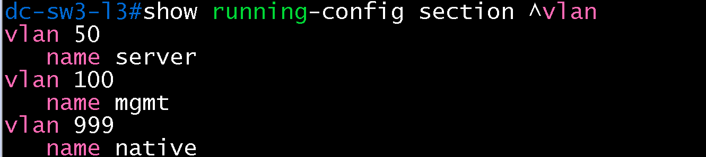
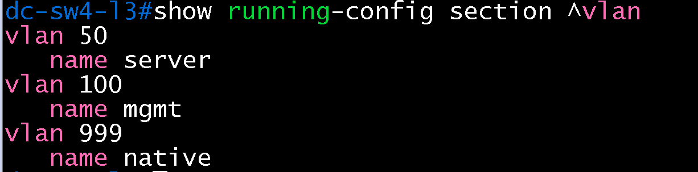
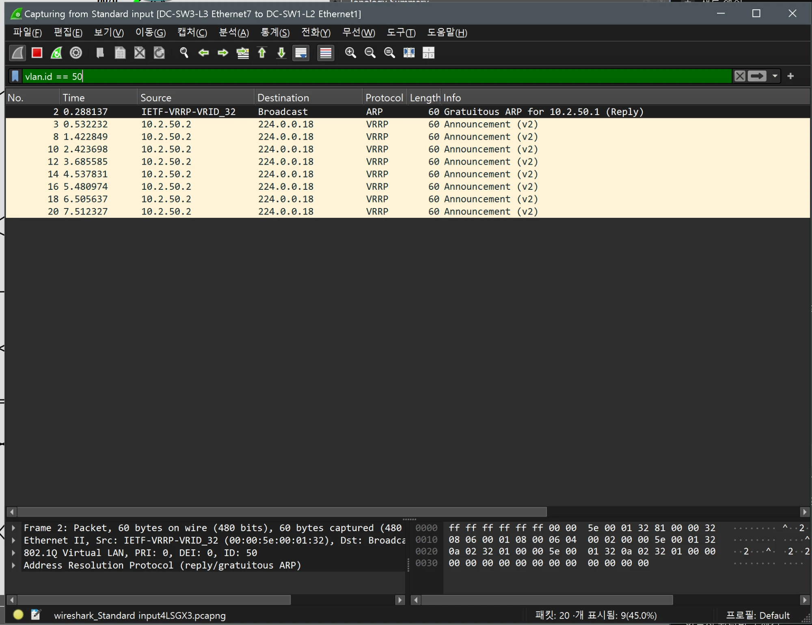
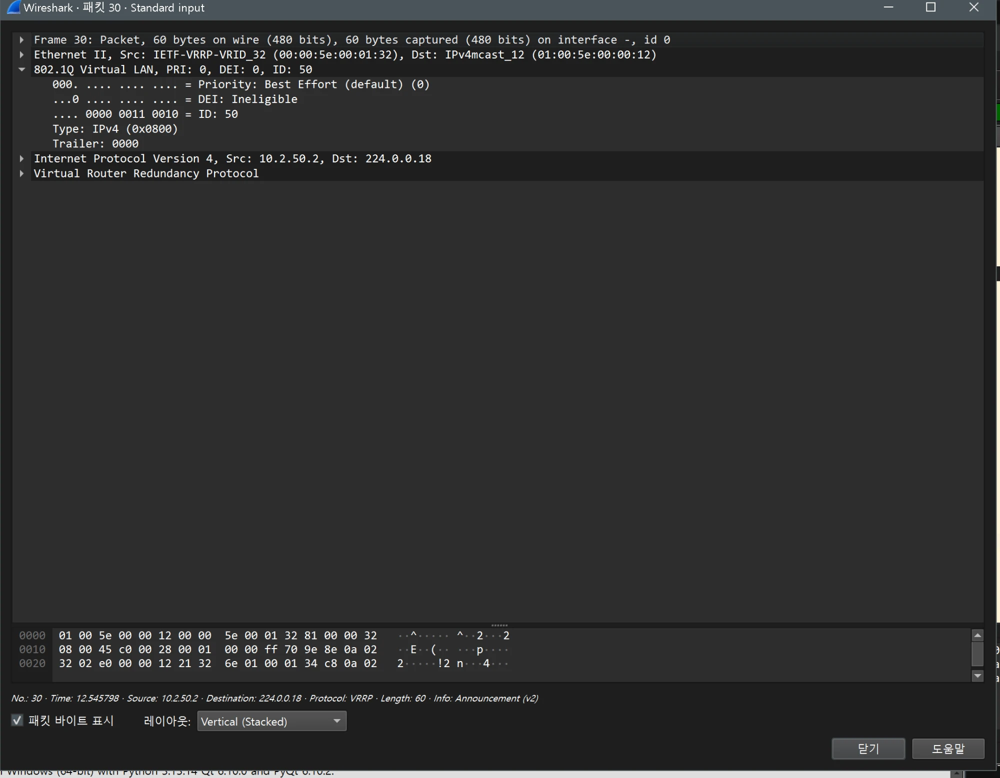

# VLAN, 트렁크 검증 (DC / distribution)

- Jira: KAN-10
- 대상 장비: DC-SW3-L3, DC-SW4-L3
- 기준 문서: [vlan-design.md](../../../docs/vlan-design.md) 1, 5절
- 검증일: 2026-10-11

| 장비 | 명령 | 기대 결과 | 실제 결과 | 판정 |
|---|---|---|---|---|
| DC-SW3-L3 | `show running-config \| grep -E "native vlan\|allowed vlan"` | Po1, Et7, Et8에 native 999, 허용 50,100, mode trunk 각 3줄 | native 999 3줄, allowed 50,100 3줄, mode trunk 3줄, `no switchport` 4줄(Et1~Et4), `access vlan` 없음 | 통과 |
| DC-SW3-L3, DC-SW4-L3 | `show interfaces trunk` | Et7, Et8, Po1 trunking, 허용 50,100 | SW3, SW4 모두 Et7, Et8, Po1 trunking, native 999, 허용·active·STP forwarding 50,100 | 통과 |
| DC-SW3-L3 | `show running-config section ^vlan` | VLAN 50 server, 100 mgmt, 999 native 정의 | vlan 50 name server, vlan 100 name mgmt, vlan 999 name native 일치 | 통과 |
| DC-SW4-L3 | `show running-config section ^vlan` | VLAN 50 server, 100 mgmt, 999 native 정의 | vlan 50 name server, vlan 100 name mgmt, vlan 999 name native 일치 | 통과 |

DC-SW3-L3

DC-SW4-L3

DC-SW3-L3 VLAN

DC-SW4-L3 VLAN

## Wireshark 확인(802.1Q 태그)

- 검증일: 2026-10-19
- 캡처 링크: `DC-SW3-L3 Ethernet7 ↔ DC-SW1-L2 Ethernet1`(MLAG 트렁크 VLAN 50·100, native 999), 필터 `vlan.id == 50`

| 항목 | 결과 |
|---|---|
| 프레임 | Gratuitous ARP `10.2.50.1`(VIP) 1개와 VRRP Announcement(v2) 8개(전체 20개 중 9개), 약 1초 간격 |
| 802.1Q | `PRI: 0, DEI: 0, ID: 50`(`ID` 비트 `0000 0011 0010` = 50) |
| 출발지 | Ethernet `00:00:5e:00:01:32`(VRRP 가상 MAC, VRID 50), IP `10.2.50.2`(DC-SW3-L3) → `224.0.0.18` |

- 트렁크에서 VLAN 50이 802.1Q 태그로 구분됨. VIP `10.2.50.1`의 Gratuitous ARP가 VRRP 가상 MAC으로 광고됨.

