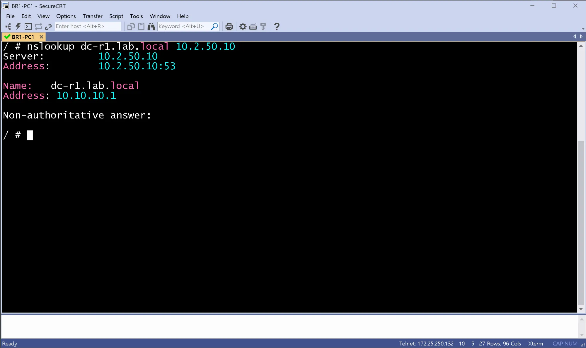
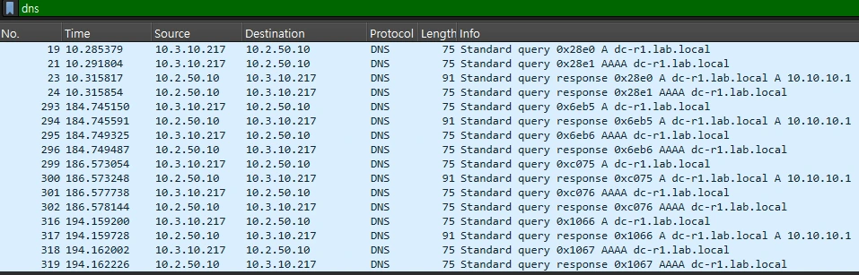

# DNS 서버 검증 (DC / host)

- Jira: KAN-24
- 대상 장비: DC-DNS-1, DC-DNS-2
- 기준 문서: [dhcp-dns-design.md](../../../docs/dhcp-dns-design.md) 2절
- 검증일: 2026-10-13

| 장비       | 명령                                               | 기대 결과        | 실제 결과                                                                              | 판정  |
| -------- | ------------------------------------------------ | ------------ | ---------------------------------------------------------------------------------- | --- |
| DC-DNS-1 | `nslookup dc-r1.lab.local 10.2.50.10`            | 10.10.10.1   | 10.2.50.10:53 수신(`netstat -lun`), dnsmasq running, `dc-r1.lab.local` 응답 10.10.10.1 | 통과  |
| DC-DNS-2 | `nslookup dc-r1.lab.local 10.2.50.11`            | 10.10.10.1   | 10.2.50.11:53 수신(`netstat -lun`), dnsmasq running, `dc-r1.lab.local` 응답 10.10.10.1 | 통과  |
| 호스트 | `nslookup dc-r1.lab.local 10.2.50.11`(주 서버 중지 후) | 백업 서버가 같은 응답 | DC-DNS-1 중지 상태에서 10.2.50.10 조회는 connection timed out, 10.2.50.11 조회는 dc-r1.lab.local 10.10.10.1 응답. DC-DNS-2 콘솔 기준이며 호스트 resolv.conf 자동 전환은 2주차에 추가 확인 | 통과 |
| DC-DNS-1 | dnsmasq 로그(`log-queries`) | 질의 기록 | /var/log/dnsmasq.log에 read /etc/hosts.lab - 31 addresses, query[A] dc-r1.lab.local from 10.2.50.10, /etc/hosts.lab dc-r1.lab.local is 10.10.10.1 기록. 서버 자체 조회 기준이며 호스트 조회 로그는 2주차에 추가 | 통과 |

서버 콘솔 출력(텍스트)으로 확인. 서버 자체 조회까지이며 사이트 간 조회(HQ, BR 호스트)는 DMVPN 이후.

DC-DNS-1 구동확인

DC-DNS-2 구동확인

DC-DNS-1 DOWN시 DC-DNS-2 정상동작 확인

DC-DNS-1 LOG

## Wireshark 확인(DNS 질의와 응답)

- 검증일: 2026-10-19
- 캡처 링크: `DC-SW1-L2 Ethernet12 ↔ DC-DNS-1 eth0`(링크 41), 필터 `dns`
- 트리거: BR1-PC1에서 `nslookup dc-r1.lab.local 10.2.50.10`
- BR1-PC1은 DHCP로 `10.3.10.217`을 받았고, DNS 서버 주소(`10.2.50.10`, `.11`)는 DHCP 옵션 6으로 받은 값.

| 시각(초) | 출발지 → 목적지 | 메시지 |
|---|---|---|
| 10.285 | `10.3.10.217` → `10.2.50.10` | Standard query `0x28e0` A `dc-r1.lab.local` |
| 10.292 | `10.3.10.217` → `10.2.50.10` | Standard query `0x28e1` AAAA `dc-r1.lab.local` |
| 10.316 | `10.2.50.10` → `10.3.10.217` | Standard query response `0x28e0` A **`10.10.10.1`**(91바이트) |
| 10.316 | `10.2.50.10` → `10.3.10.217` | Standard query response `0x28e1` AAAA(75바이트, 응답 레코드 없음) |
| 184.745 | `10.3.10.217` → `10.2.50.10` | 같은 A 질의 `0x6eb5`, 응답 `10.10.10.1` |

- 같은 질의를 반복 실행한 구간이 184.745, 186.573, 194.159초에 있음(캡처에서 총 16패킷).
- 첫 번째 A 질의의 응답 시간은 약 30ms(10.285 → 10.316초), 반복 A 질의는 0.44ms(184.745 → 184.746), 0.19ms(186.573), 0.53ms(194.159). 서버가 캐시에서 응답한 것으로 추정하나 확인하지 못함.
- `nslookup` 출력은 `Server: 10.2.50.10`, `Address: dc-r1.lab.local → 10.10.10.1`(Non-authoritative answer).
- 질의 출발지가 DHCP로 받은 주소(`10.3.10.217`)라 DHCP(주소와 DNS 서버 알림) → DNS(이름 응답)의 흐름이 이어짐. 주소를 할당하는 것은 DHCP 서버이고 DNS 서버는 질의에 응답만 함.

BR1-PC1 `nslookup`

링크 41 Wireshark(`dns`)

