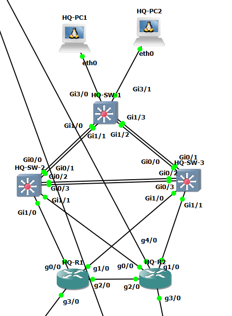

# HQ 검증 개요

GNS3 토폴로지(검증 대상 장비와 포트). 상세 결과는 아래 문서 링크에서 확인.

## 핵심 결과

- VRRP 장애 전환(Cisco): 약 1초, `ping` 손실 1개 → [vrrp-failover](../scenarios/vrrp-failover.md)
- EtherChannel Po1 링크 다운: 손실 1개(약 1초) → [etherchannel-link-down](../scenarios/etherchannel-link-down.md)
- ISP-1 장애: BGP hold-time(9초) 뒤 약 9.7초에 세션 종료 → [isp1-failure](../scenarios/isp1-failure.md)
- QoS: DNS 분류와 af31 표시 확인 → [qos-verification](../scenarios/qos-verification.md)

## 계층별 검증 문서

| 계층 | 항목 | Jira | 문서 |
|---|---|---|---|
| access(L2) | L3 인터페이스 검증 | KAN-8 | [access/l3-interface.md](access/l3-interface.md) |
| access(L2) | EtherChannel 검증 | KAN-8, KAN-9 | [access/po-channel.md](access/po-channel.md) |
| access(L2) | STP | KAN-9 | [access/stp.md](access/stp.md) |
| access(L2) | VLAN, 트렁크 검증 | KAN-8 | [access/vlan-trunk.md](access/vlan-trunk.md) |
| core | DMVPN Spoke 검증 | KAN-33 | [core/dmvpn.md](core/dmvpn.md) |
| core | ISP 연결 검증 | KAN-18 | [core/isp-link.md](core/isp-link.md) |
| core | L3 인터페이스 검증 | KAN-7 | [core/l3-interface.md](core/l3-interface.md) |
| core | OSPF 검증 | KAN-14 | [core/ospf.md](core/ospf.md) |
| core | QoS 검증 | KAN-25 | [core/qos.md](core/qos.md) |
| distribution | DHCP 검증 | KAN-14 | [distribution/dhcp.md](distribution/dhcp.md) |
| distribution | L3 인터페이스 검증 | KAN-8, KAN-9 | [distribution/l3-interface.md](distribution/l3-interface.md) |
| distribution | OSPF 검증 | KAN-14 | [distribution/ospf.md](distribution/ospf.md) |
| distribution | EtherChannel 검증 | KAN-8, KAN-9 | [distribution/po-channel.md](distribution/po-channel.md) |
| distribution | STP | KAN-9 | [distribution/stp.md](distribution/stp.md) |
| distribution | VLAN, 트렁크 검증 | KAN-8 | [distribution/vlan-trunk.md](distribution/vlan-trunk.md) |
| distribution | VRRP 검증 | KAN-9 | [distribution/vrrp.md](distribution/vrrp.md) |

상세 서식과 상태는 [검증 README](../README.md) 참조.
