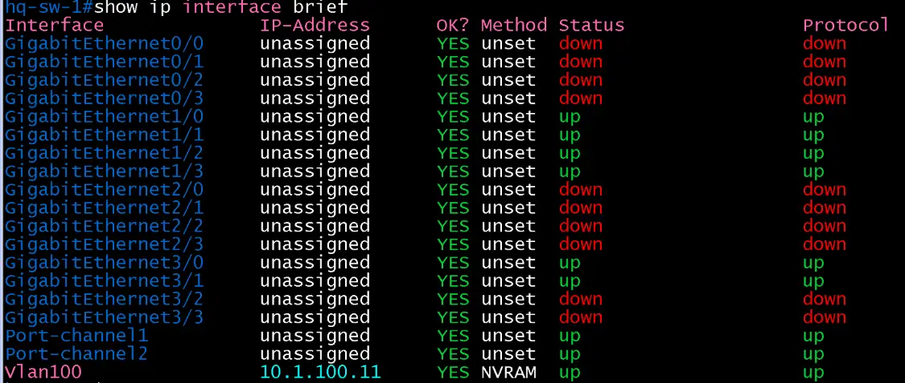

# L3 인터페이스 검증 (HQ / access)

- Jira: KAN-8
- 대상 장비: HQ-SW-1
- 기준 문서: [ip-mapping.md](../../../docs/ip-mapping.md) 3절
- 검증일: 2026-10-12

| 장비 | 항목 | 명령 | 기대 결과 | 실제 결과 | 판정 |
|---|---|---|---|---|---|
| HQ-SW-1 | MGMT SVI(Vlan100) | `show ip interface brief` | 10.1.100.11, up/up | Vlan100 10.1.100.11 up/up | 통과 |
| HQ-SW-1 | lo0 | `show ip interface brief` | 없음(L2 스위치로 설계상 없음) | 출력에 Loopback 없음 | 통과 |
| HQ-SW-1 | 업링크 Po1, Po2와 멤버 Gi1/0-Gi1/3 | `show ip interface brief` | up/up | Port-channel1, Port-channel2, Gi1/0-Gi1/3 모두 up/up | 통과 |
| HQ-SW-1 | 호스트 포트 Gi3/0, Gi3/1 | `show ip interface brief` | up/up | Gi3/0, Gi3/1 up/up(미사용 Gi0/x, Gi2/x, Gi3/2, Gi3/3은 down) | 통과 |

`show ip interface brief`는 서브넷 길이(/30, /24)를 보여 주지 않으므로 마스크는 컨피그 파일과 `show running-config interface`로 확인.

HQ-SW-1 INTERFACE

