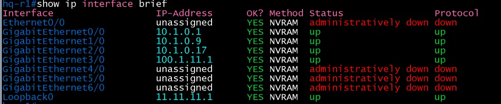
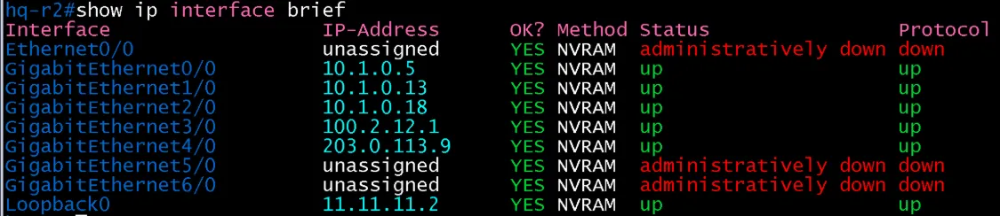

# L3 인터페이스 검증 (HQ / core)

- Jira: KAN-7
- 대상 장비: HQ-R1, HQ-R2
- 기준 문서: [ip-mapping.md](../../../docs/ip-mapping.md) 3절
- 검증일: 2026-10-12

| 장비 | 항목 | 명령 | 기대 결과 | 실제 결과 | 판정 |
|---|---|---|---|---|---|
| HQ-R1 | 사이트 내부 링크 Gi0/0, Gi1/0, Gi2/0 | `show ip interface brief` | 10.1.0.1, 10.1.0.9, 10.1.0.17, up/up | Gi0/0 10.1.0.1, Gi1/0 10.1.0.9, Gi2/0 10.1.0.17 up/up | 통과 |
| HQ-R1 | ISP-1 링크 Gi3/0 | `show ip interface brief` | 100.1.11.1, up/up | Gi3/0 100.1.11.1 up/up | 통과 |
| HQ-R1 | lo0 | `show ip interface brief` | 11.11.11.1, up/up | Loopback0 11.11.11.1 up/up | 통과 |
| HQ-R1 | 미사용 포트 | `show ip interface brief` | administratively down | Et0/0, Gi4/0~Gi6/0 administratively down | 통과 |
| HQ-R2 | 사이트 내부 링크 Gi0/0, Gi1/0, Gi2/0 | `show ip interface brief` | 10.1.0.5, 10.1.0.13, 10.1.0.18, up/up | Gi0/0 10.1.0.5, Gi1/0 10.1.0.13, Gi2/0 10.1.0.18 up/up | 통과 |
| HQ-R2 | ISP-2 링크 Gi3/0 | `show ip interface brief` | 100.2.12.1, up/up | Gi3/0 100.2.12.1 up/up | 통과 |
| HQ-R2 | PI 링크 Gi4/0(DMVPN 터널 소스) | `show ip interface brief` | 203.0.113.9, up/up | Gi4/0 203.0.113.9 up/up | 통과 |
| HQ-R2 | lo0 | `show ip interface brief` | 11.11.11.2, up/up | Loopback0 11.11.11.2 up/up | 통과 |
| HQ-R2 | 미사용 포트 | `show ip interface brief` | administratively down | Et0/0, Gi5/0, Gi6/0 administratively down | 통과 |

`show ip interface brief`는 서브넷 길이(/30, /24)를 보여 주지 않으므로 마스크는 컨피그 파일과 `show running-config interface`로 확인.

HQ-R1 INTERFACE

HQ-R2 INTERFACE

