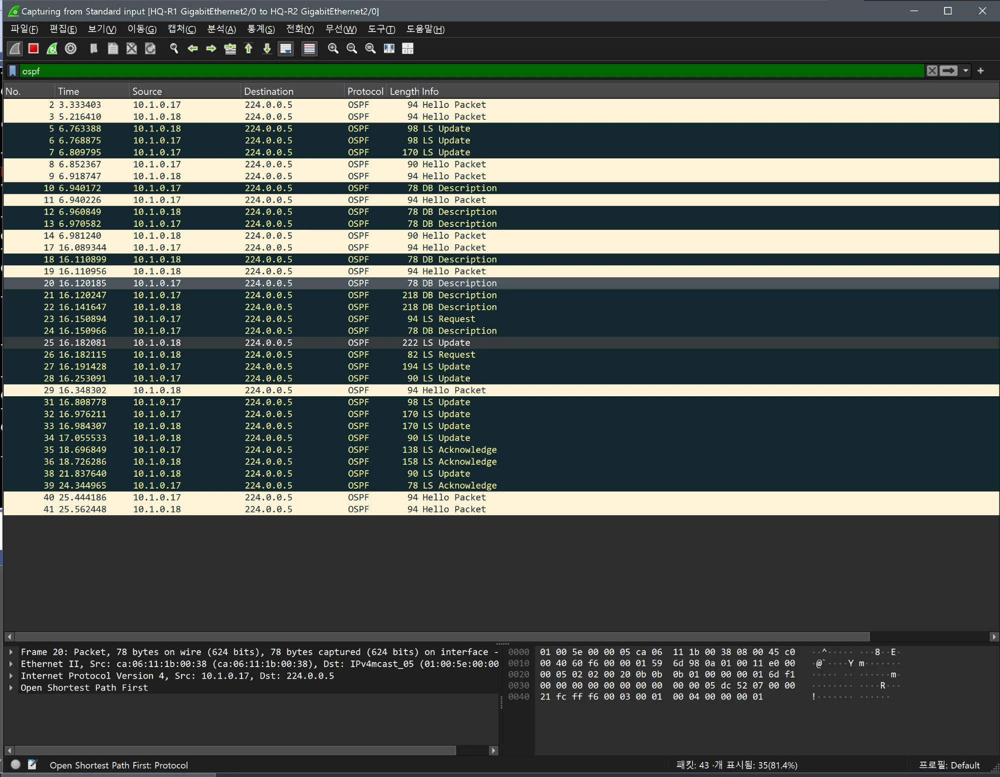
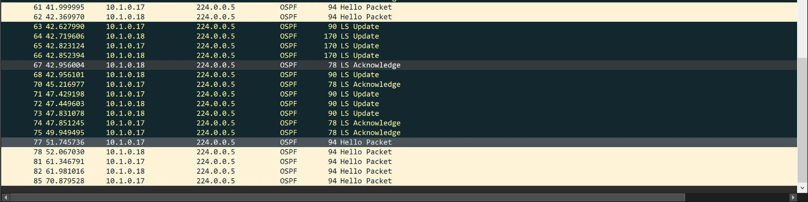
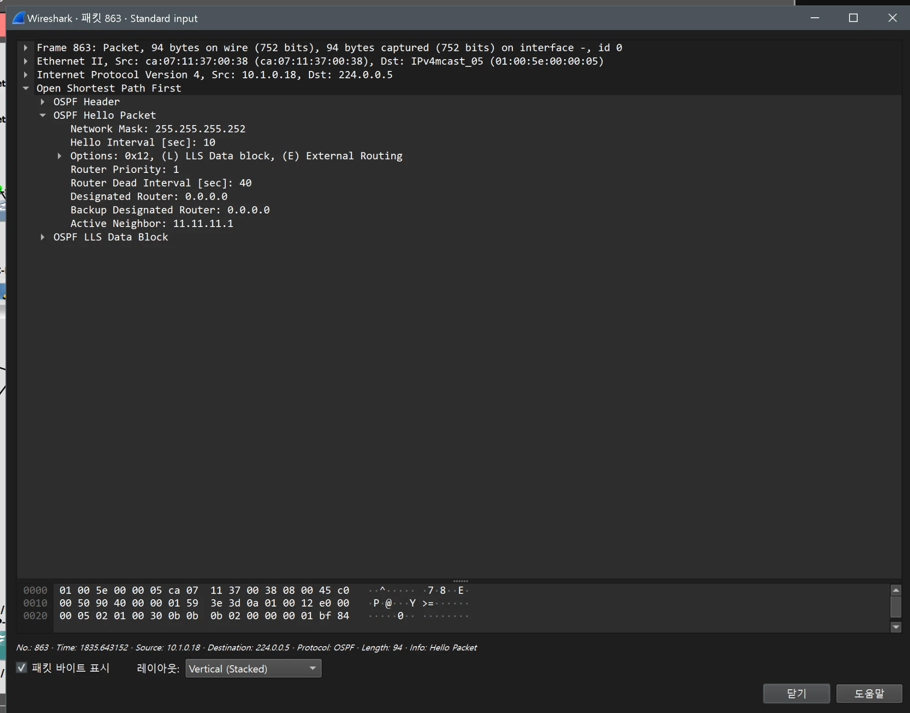

# OSPF 검증 (HQ / core)

- Jira: KAN-14
- 대상 장비: HQ-R1(11.11.11.1), HQ-R2(11.11.11.2, ABR)
- 기준 문서: [ospf-design.md](../../../docs/ospf-design.md) 2~4절
- 검증일: 2026-10-12

| 장비                                        | 명령                      | 기대 결과                                            | 실제 결과 | 판정  |
| ----------------------------------------- | ----------------------- | ------------------------------------------------ | ----- | --- |
| HQ-R1(11.11.11.1), HQ-R2(11.11.11.2, ABR) | `show ip ospf neighbor` | 모든 이웃 FULL, 네트워크 타입 point-to-point | HQ-R1, HQ-R2 각 3개(HQ-SW-2, HQ-SW-3, 상대 라우터) 모두 FULL(P2P) | 통과 |
| HQ-R1(11.11.11.1), HQ-R2(11.11.11.2, ABR) | `show ip route ospf` | 사이트 /30 링크, 사용자·서버 VLAN, 다른 장비 `lo0` 학습(프로세스 11) | 사용자 VLAN 10.1.10.0/24, 10.1.20.0/24, 직접 연결되지 않은 /30 링크, 다른 장비 lo0(11.11.11.12, 11.11.11.13, 상대 라우터) 학습, 7개 서브넷. DMVPN 전이라 타 사이트 경로 없음 | 통과 |

프로세스 11, Area 1, Router ID는 장비의 `lo0`.

HQ-R1 OSPF

HQ-R2 OSPF

## Wireshark 확인(이웃 수립 과정과 Hello)

- 검증일: 2026-10-19
- 캡처 링크: `HQ-R1 Gi2/0 ↔ HQ-R2 Gi2/0`(`10.1.0.17` = HQ-R1, `10.1.0.18` = HQ-R2), 필터 `ospf`
- 이웃 재수립 과정을 처음부터 캡처(트리거 명령은 기록하지 못함).

| 시각(초) | 패킷 | 내용 |
|---|---|---|
| 3.33, 5.22 | Hello(94바이트) | 양쪽 Hello, 목적지 멀티캐스트 `224.0.0.5` |
| 6.85, 6.98 | Hello(90바이트) | 이웃 목록이 비어 있는 Hello(94바이트보다 4바이트 작음). 이웃 수립이 다시 시작된 것으로 보임 |
| 6.94 ~ 6.97 | DB Description(78바이트) | 빈 DBD로 Master/Slave 협상 |
| 16.09 ~ 16.12 | Hello, DB Description | 이웃 목록이 있는 Hello(94바이트) 후 DBD 교환 |
| 16.12 ~ 16.14 | DB Description(218바이트) | LSA 헤더 목록 교환 |
| 16.15, 16.18 | LS Request | 필요한 LSA 요청 |
| 16.18 ~ 17.06 | LS Update(222, 194, 170바이트 등) | 요청한 LSA 전달 |
| 18.70, 18.73 | LS Acknowledge(138, 158바이트) | LSA 확인 응답 |
| 25.44, 25.56 | Hello(94바이트) | 수립 후 Hello 재개(이후 약 10초 간격) |

- Hello 간격: 이웃 수립 후 `10.1.0.17`의 Hello가 41.99, 51.75, 61.35, 70.88초(약 9.5~10초 간격), `10.1.0.18`이 42.37, 52.07, 61.98초로 설계의 10초와 일치(아래 첫 번째 캡처).
- 이웃 상태 `FULL`은 패킷이 아니라 `show ip ospf neighbor` 출력(위 표)으로 확인. Hello 패킷 안의 값은 아래 "Hello 패킷 상세" 참조.

Wireshark(`ospf`): 이웃 수립 과정(Hello → DBD → LSR → LSU → LSAck)

Wireshark(`ospf`): 수립 후 Hello 10초 간격, LS Update, LS Acknowledge

### Hello 패킷 상세(프레임 863, HQ-R2 `10.1.0.18` → `224.0.0.5`)

| 항목 | 값 | 의미 |
|---|---|---|
| Network Mask | `255.255.255.252` | `/30` 링크 |
| Hello Interval | 10초 | 설계와 일치 |
| Router Dead Interval | 40초 | Hello의 4배, 설계와 일치 |
| Router Priority | 1 | 기본값 |
| Designated Router / Backup DR | `0.0.0.0` / `0.0.0.0` | DR 선출이 없는 point-to-point 네트워크 |
| Active Neighbor | `11.11.11.1`(HQ-R1) | HQ-R2가 HQ-R1을 이웃으로 인식(양방향) |
| Options | `0x12`, (L) LLS Data block, (E) External Routing | |
| Router ID, Area ID(패킷 바이트에서 해석) | `11.11.11.2`(`0b 0b 0b 02`), `0.0.0.1`(`00 00 00 01`) | HQ-R2, Area 1 |

- Area ID는 `OSPF Header`를 펼친 화면이 아니라 패킷 바이트에서 읽은 값.

Wireshark(`ospf.msg.hello`): Hello 패킷 상세

