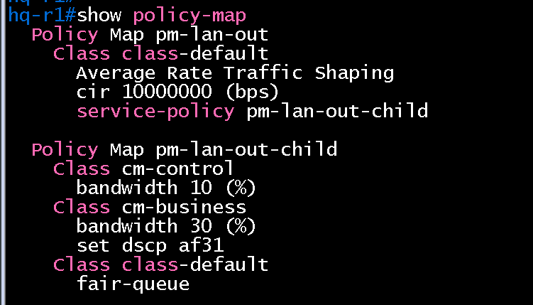
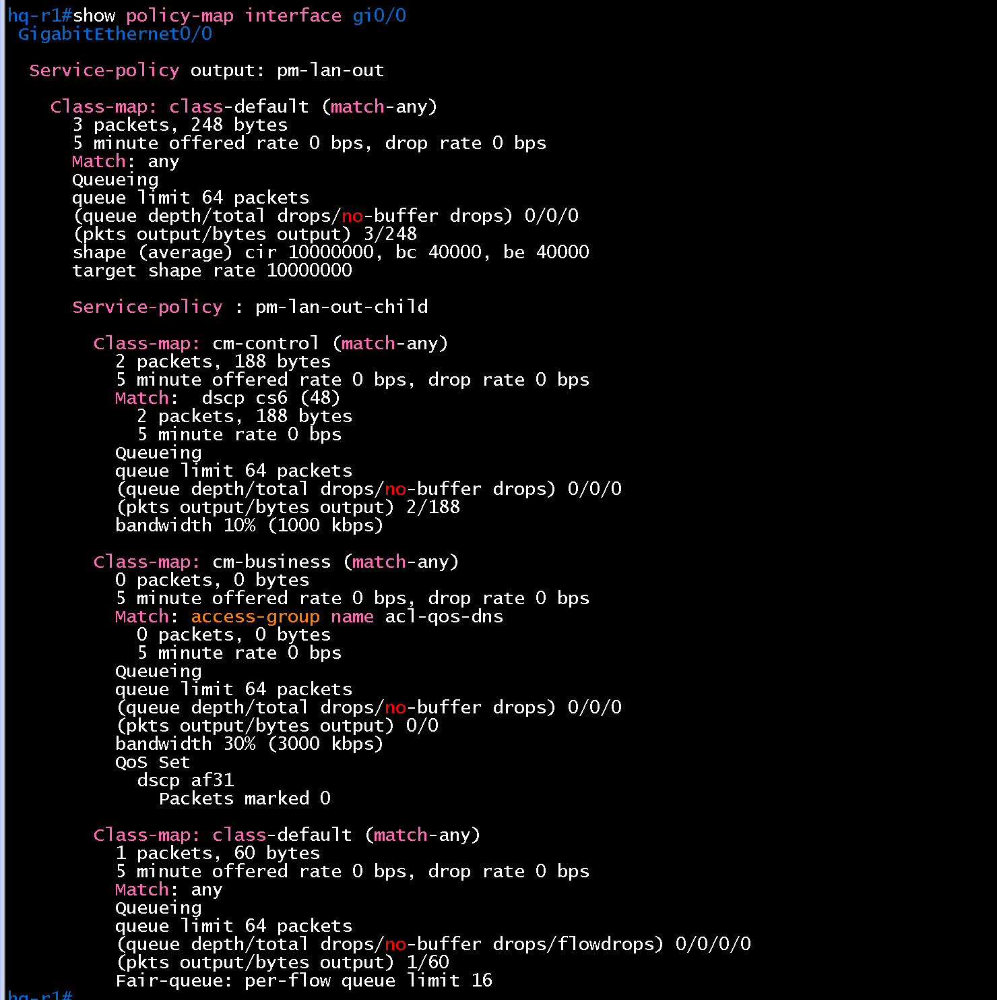
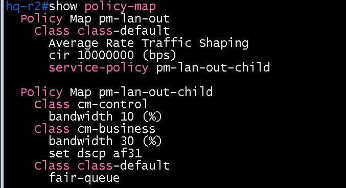
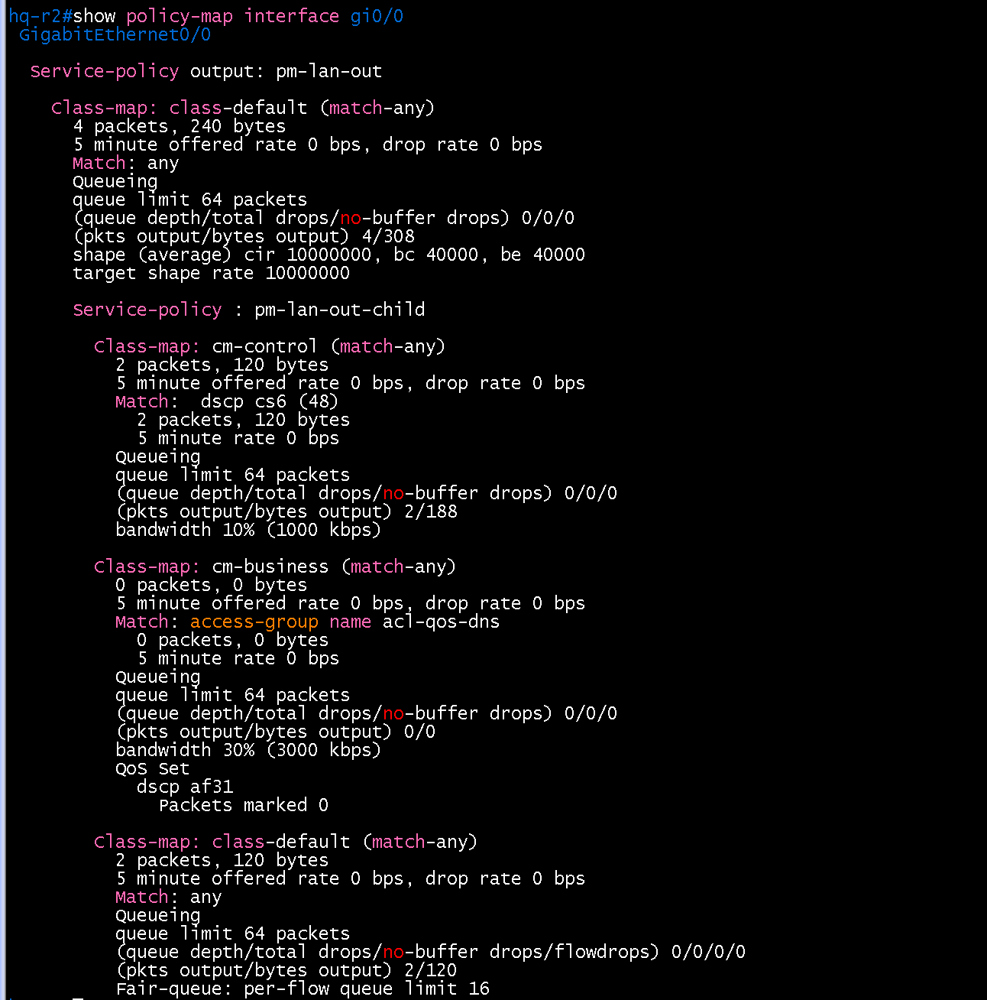
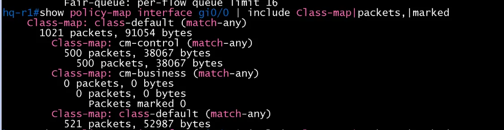
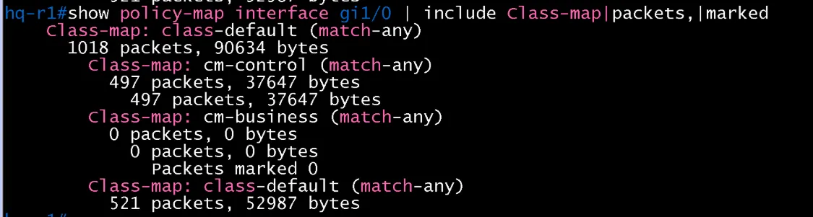
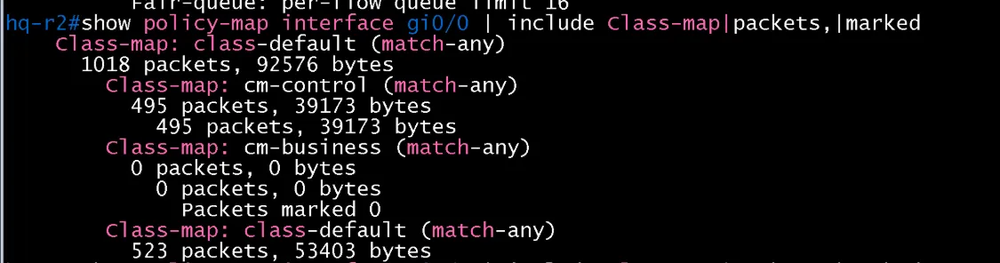
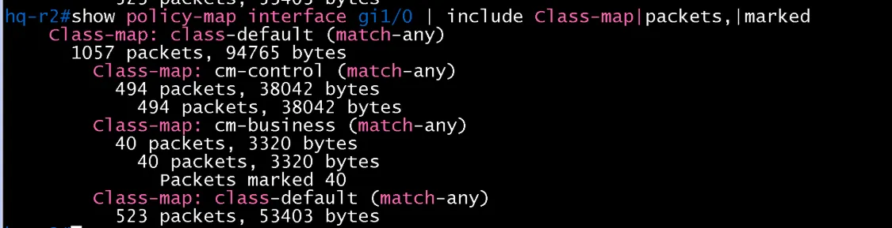
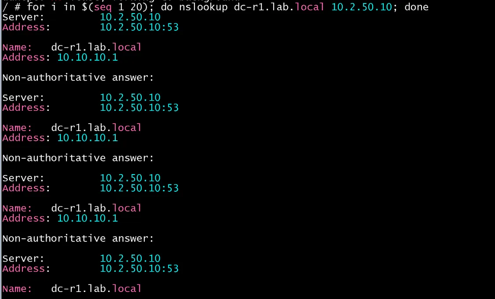

# QoS 검증 (HQ / core)

- Jira: KAN-25
- 대상 장비: HQ-R1, HQ-R2
- 기준 문서: [qos-design.md](../../../docs/qos-design.md), [cisco-router.md](../../../docs/config-guide/cisco-router.md) 3.7절
- 검증일: 2026-10-18

| 장비 | 명령 | 기대 결과 | 실제 결과 | 판정 |
|---|---|---|---|---|
| HQ-R1, HQ-R2 | `show policy-map` | 정책 `pm-lan-out`, `pm-lan-out-child` 정의, 클래스 `cm-control`, `cm-business`, `class-default` | 두 장비 모두 `pm-lan-out`(class-default `shape average cir 10000000`, `service-policy pm-lan-out-child`)과 `pm-lan-out-child`(`cm-control` bandwidth 10%, `cm-business` bandwidth 30%와 `set dscp af31`, `class-default` fair-queue) 정의 | 통과 |
| HQ-R1, HQ-R2 | `show policy-map interface gi0/0`, `gi1/0` | `pm-lan-out` 출력 방향 적용, 클래스 3개 표시 | HQ-R1, HQ-R2의 `gi0/0`, `gi1/0` 모두 클래스 3개(`cm-control`, `cm-business`, `class-default`)의 카운터가 표시되어 `pm-lan-out` 적용 확인 | 통과 |
| 호스트(HQ-PC1) | `nslookup dc-r1.lab.local 10.2.50.10` 20회 반복 후 HQ-R1, HQ-R2 `show policy-map interface gi0/0`, `gi1/0` | `cm-business` 매치 패킷 증가 | HQ-R2 `gi1/0`(HQ-SW-3 방향)에서 `cm-business` 40 packets, 3320 bytes, `Packets marked 40`(20회 질의의 응답 2패킷씩). HQ-R1 `gi0/0`, `gi1/0`과 HQ-R2 `gi0/0`의 `cm-business`는 0이라 응답은 HQ-R2의 `gi1/0`으로 나감 | HQ-R2 통과 |
| 호스트(HQ-PC1) | 큰 트래픽(`ping -s 1400`) 후 `show policy-map interface` | `class-default`에 drop 발생, `cm-business` 보장 | 사이트별 개별 시험은 하지 않고 BR1-PC1 → DC-R2 `gi0/0` 대표 시험으로 대체. 같은 `pm-lan-out` 정책이므로 DC-R2에서 `class-default` drop +755(578에서 1333), `cm-business` drop 0/0/0을 확인(`verification/dc/core/qos.md`). HQ-PC1 경로 시험은 생략 | 통과(대표 시험) |
| HQ-R1, HQ-R2 | `show policy-map interface gi2/0`(해당 시) | 정책 미적용(제외 대상) | HQ-R1, HQ-R2 모두 `gi2/0`(HQ-R1↔R2 라우터 간 링크)의 출력이 비어 있어 정책 미적용 | 통과 |

HQ-R1 show policy-map

HQ-R1 show policy-map interface gi0/0

HQ-R2 show policy-map

HQ-R2 show policy-map interface gi0/0

HQ-R1 gi0/0 (DNS 질의 후, cm-business 0)

HQ-R1 gi1/0 (cm-business 0)

HQ-R2 gi0/0 (cm-business 0)

HQ-R2 gi1/0 (DNS 질의 후, cm-business 40)

HQ-PC1 nslookup 20회 반복

HQ-R1 show policy-map interface gi2/0 (정책 미적용)

HQ-R2 show policy-map interface gi2/0 (정책 미적용)

