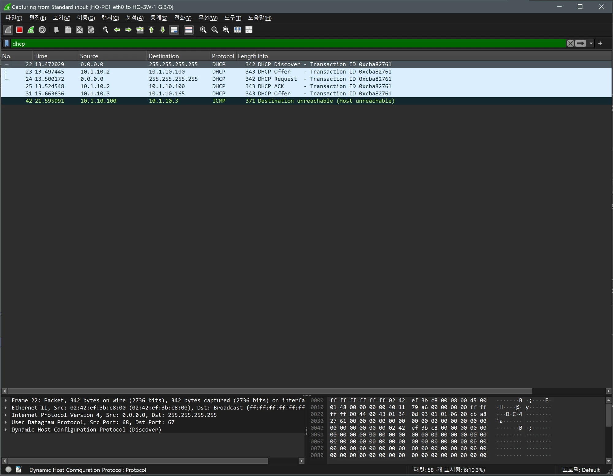
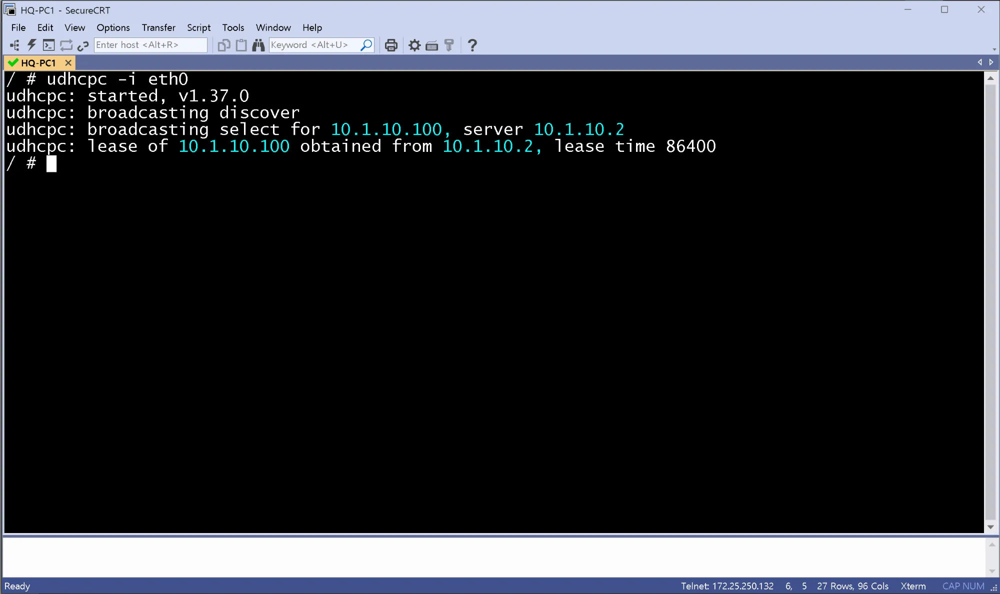
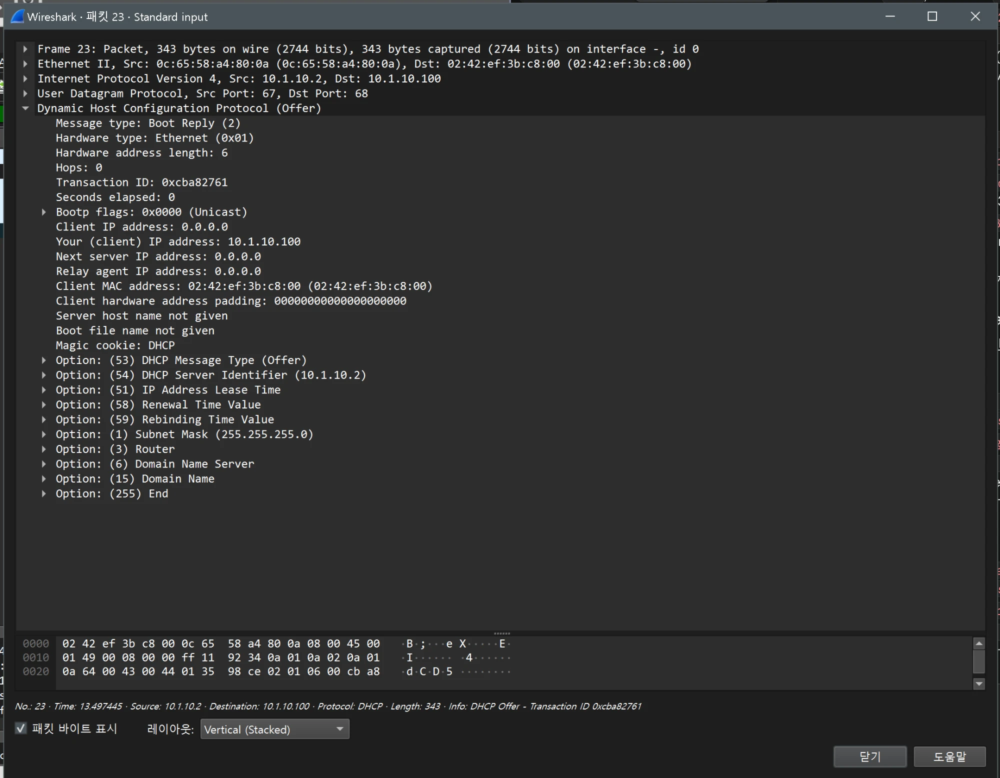
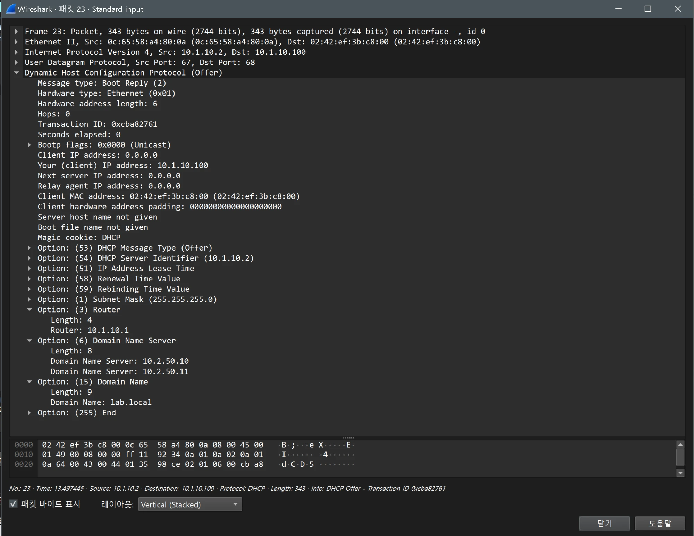

# DHCP 검증 (HQ / distribution)

- Jira: KAN-14
- 대상 장비: HQ-SW-2(Active), HQ-SW-3(Standby)
- 기준 문서: [dhcp-dns-design.md](../../../docs/dhcp-dns-design.md) 3절
- 검증일: 2026-10-13

| 장비                                | 명령                        | 기대 결과                                            | 실제 결과 | 판정  |
| --------------------------------- | ------------------------- | ------------------------------------------------ | ----- | --- |
| HQ-SW-2(Active), HQ-SW-3(Standby) | `show ip dhcp pool` | 풀 범위 Active `.100`-`.163`, Standby `.164`-`.227` | 두 스위치 모두 풀 hq-public, hq-private, 각 Total 254, Excluded 190(사용 가능 64개), 제외 구간 설정 반영. 캡처 시점에는 임대 0 | 통과 |
| HQ-SW-2(Active), HQ-SW-3(Standby) | `show ip dhcp binding` | 호스트에 풀 범위 주소 임대, 게이트웨이 VIP, DNS 10.2.50.10 / .11 | HQ-SW-2에 10.1.10.100(Vlan10, HQ-PC1), HQ-SW-3에 10.1.20.164(Vlan20, HQ-PC2) 임대. 클라이언트 ID가 호스트 MAC과 일치, 임대 만료 24시간 후 | 통과 |
| 호스트 | `udhcpc -i eth0`, `ip addr`, `cat /etc/resolv.conf` | 풀 범위 주소와 `resolv.conf` DNS 두 대 | HQ-PC1 10.1.10.100(서버 10.1.10.2, Active 범위), HQ-PC2 10.1.20.164(서버 10.1.20.3, Standby 범위), lease time 86400. 기본 경로 10.1.10.1, 10.1.20.1(VIP), resolv.conf search lab.local, nameserver 10.2.50.10과 10.2.50.11 | 통과 |

HQ-SW-2 DHCP POOL

HQ-SW-2 DHCP BINDING

HQ-SW-3 DHCP POOL

HQ-SW-3 DHCP BINDING

HQ-PC1

HQ-PC2

## Wireshark DORA 확인

- 검증일: 2026-10-19
- 캡처 링크: `HQ-PC1 eth0 ↔ HQ-SW-1 Gi3/0`, 필터 `dhcp`. HQ-PC1에서 `udhcpc -i eth0`.
- 서버: HQ-SW-2(`10.1.10.2`, Active 풀), HQ-SW-3(`10.1.10.3`, Standby 풀)

| 시각(초) | 출발지 → 목적지 | 메시지 | 내용 |
|---|---|---|---|
| 13.472 | `0.0.0.0` → `255.255.255.255` | Discover | 브로드캐스트, 트랜잭션 ID `0xcba82761` |
| 13.497 | `10.1.10.2` → `10.1.10.100` | Offer | HQ-SW-2가 먼저 응답 |
| 13.500 | `0.0.0.0` → `255.255.255.255` | Request | 서버 `10.1.10.2`의 제안 선택 |
| 13.525 | `10.1.10.2` → `10.1.10.100` | ACK | `10.1.10.100` 임대 확정 |
| 15.664 | `10.1.10.3` → `10.1.10.165` | Offer | HQ-SW-3의 Offer가 약 2.2초 뒤 도착, 사용되지 않음 |
| 21.596 | `10.1.10.100` → `10.1.10.3` | ICMP Destination unreachable | 늦은 Offer에 대한 PC의 응답으로 보이며 원인은 확인하지 못함(BR2에서도 같은 현상) |

- `udhcpc` 출력: `lease of 10.1.10.100 obtained from 10.1.10.2, lease time 86400`(설계의 `lease 1`, 1일과 일치).
- Active 서버(HQ-SW-2)가 먼저 응답해 Active 풀 주소(`.100`)를 받음. Standby의 Offer는 늦게 도착(`.165`, Standby 풀).

HQ-PC1 Wireshark(`dhcp`): Discover, Offer, Request, ACK

HQ-PC1 `udhcpc -i eth0`

### Offer 패킷 상세(프레임 23, HQ-SW-2 `10.1.10.2` → `10.1.10.100`)와 Aruba 비교

| 항목 | HQ(Cisco, 프레임 23) | BR1(Aruba, 프레임 611) |
|---|---|---|
| Offer 길이 | 343바이트 | 349바이트 |
| Next server IP address | `0.0.0.0` | 서버 주소(`10.3.10.2`) |
| 옵션 구성과 순서 | 53, 54, 51, 58, 59, 1, 3, 6, 15 | 53, 54, 51, 58, 59, 1, **28**, 3, **15, 6** |
| Option 28(Broadcast Address) | 없음 | 있음(`10.3.10.255`) |
| Server Identifier(54) | `10.1.10.2` | `10.3.10.2` |
| Subnet Mask(1) | `255.255.255.0` | `255.255.255.0` |

- Cisco와 Aruba 모두 게이트웨이(3), DNS(6), 도메인(15)을 Offer로 전달함. HQ(Cisco)의 값: Router `10.1.10.1`, Domain Name Server `10.2.50.10`과 `10.2.50.11`, Domain Name `lab.local`(옵션 순서는 3, 6, 15).
- 같은 설계 값을 주지만 벤더별로 옵션 구성(Aruba는 Option 28 포함)과 Next server 필드가 다름.

Offer 프레임 23(HQ-SW-2, Cisco)

Offer 옵션 3, 6, 15 펼친 화면(프레임 23)

