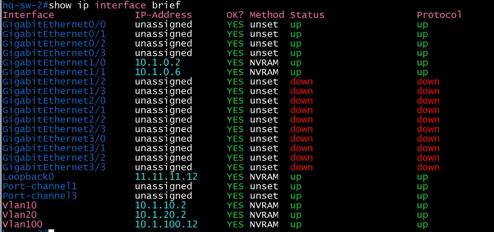
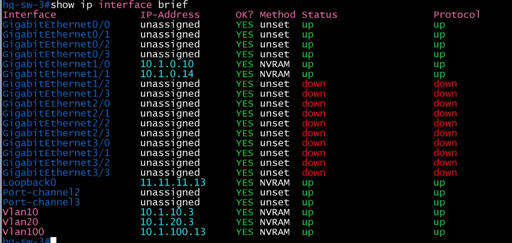

# L3 인터페이스 검증 (HQ / distribution)

- Jira: KAN-8, KAN-9
- 대상 장비: HQ-SW-2, HQ-SW-3
- 기준 문서: [ip-mapping.md](../../../docs/ip-mapping.md) 3절
- 검증일: 2026-10-12

| 장비 | 항목 | 명령 | 기대 결과 | 실제 결과 | 판정 |
|---|---|---|---|---|---|
| HQ-SW-2 | MGMT SVI(Vlan100) | `show ip interface brief` | 10.1.100.12, up/up | Vlan100 10.1.100.12 up/up | 통과 |
| HQ-SW-2 | lo0 | `show ip interface brief` | 11.11.11.12, up/up | Loopback0 11.11.11.12 up/up | 통과 |
| HQ-SW-2 | 라우티드 포트 Gi1/0, Gi1/1 | `show ip interface brief` | 10.1.0.2, 10.1.0.6, up/up | GigabitEthernet1/0 10.1.0.2, GigabitEthernet1/1 10.1.0.6 up/up | 통과 |
| HQ-SW-2 | 사용자 SVI Vlan10, Vlan20(VRRP) | `show ip interface brief` | 10.1.10.2, 10.1.20.2, up/up | Vlan10 10.1.10.2, Vlan20 10.1.20.2 up/up | 통과 |
| HQ-SW-2 | EtherChannel Po와 멤버 Gi0/0-Gi0/3 | `show ip interface brief` | up/up | Port-channel1, Port-channel3와 Gi0/0-Gi0/3 up/up | 통과 |
| HQ-SW-3 | MGMT SVI(Vlan100) | `show ip interface brief` | 10.1.100.13, up/up | Vlan100 10.1.100.13 up/up | 통과 |
| HQ-SW-3 | lo0 | `show ip interface brief` | 11.11.11.13, up/up | Loopback0 11.11.11.13 up/up | 통과 |
| HQ-SW-3 | 라우티드 포트 Gi1/0, Gi1/1 | `show ip interface brief` | 10.1.0.10, 10.1.0.14, up/up | GigabitEthernet1/0 10.1.0.10, GigabitEthernet1/1 10.1.0.14 up/up | 통과 |
| HQ-SW-3 | 사용자 SVI Vlan10, Vlan20(VRRP) | `show ip interface brief` | 10.1.10.3, 10.1.20.3, up/up | Vlan10 10.1.10.3, Vlan20 10.1.20.3 up/up | 통과 |
| HQ-SW-3 | EtherChannel Po와 멤버 Gi0/0-Gi0/3 | `show ip interface brief` | up/up | Port-channel2, Port-channel3와 Gi0/0-Gi0/3 up/up | 통과 |

`show ip interface brief`는 서브넷 길이(/30, /24)를 보여 주지 않으므로 마스크는 컨피그 파일과 `show running-config interface`로 확인.

HQ-SW-2 INTERFACE

HQ-SW-3 INTERFACE

