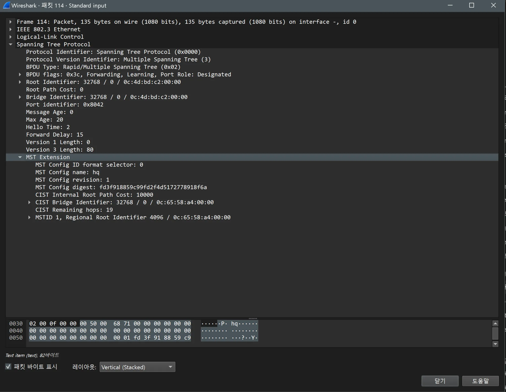

# STP(MST) 검증 (HQ / distribution)

- Jira: KAN-9
- 대상 장비: HQ-SW-2, HQ-SW-3
- 기준 문서: [vrrp-mstp-design.md](../../../docs/vrrp-mstp-design.md) 3절
- 검증일: 2026-10-11

| 장비 | 명령 | 기대 결과 | 실제 결과 | 판정 |
|---|---|---|---|---|
| HQ-SW-2 | `show spanning-tree mst 1` | 루트(priority 4096), Po1·Po3 designated, `Bound(RSTP)` 없음 | Bridge `0c65.58a4` priority 4097, "this switch for MST1", Po1 Desg FWD, Po3 Desg FWD | 통과 |
| HQ-SW-3 | `show spanning-tree mst 1` | 보조 루트(8192), Po3 Root FWD, Po2 Desg FWD | Bridge `0c9e.b2e0` priority 8193, Root `0c65.58a4` 4097(HQ-SW-2), Po3 Root FWD, Po2 Desg FWD | 통과 |

HQ-SW-2 MSTP

HQ-SW-3 MSTP

## Wireshark 확인(MST BPDU)

- 검증일: 2026-10-19
- 캡처 링크: `HQ-SW-2 Gi0/2 ↔ HQ-SW-3 Gi0/2`, 필터 `stp`(프레임 114)

| 항목 | 값 |
|---|---|
| 프로토콜 | `Multiple Spanning Tree (3)`, BPDU Type Rapid/Multiple, 플래그 `0x3c`, Port Role: Designated |
| Root, Bridge ID | `32768 / 0 / 0c:4d:bd:c2:00:00`(CIST 루트) |
| 타이머 | Message Age 0, Max Age 20, Hello Time 2, Forward Delay 15 |
| MST Config | name **`hq`**, revision **1**, digest `fd3f918859c99fd2f4d5172778918f6a` |
| CIST | Internal Root Path Cost 10000, Bridge `32768 / 0 / 0c:65:58:a4:00:00`(HQ-SW-2), Remaining hops 19 |
| 인스턴스 1 | MSTID 1, Regional Root Identifier **4096** / `0c:65:58:a4:00:00` |

- 인스턴스 1 루트가 우선순위 4096인 HQ-SW-2(설정 `spanning-tree mst 1 priority 4096`)로 확인됨.
- digest `fd3f9188…8f6a`는 BR1(Aruba)과 DC 이외의 값이 아니라 **BR1과 같은 값**(`FD3F918859C99FD2F4D5172778918F6A`). 인스턴스 1이 VLAN 10, 20, 100을 매핑한 구성이 같아 MST digest(VLAN 매핑만으로 계산)가 같은 것으로 추정되며 이름이 달라도 digest는 같을 수 있음.

