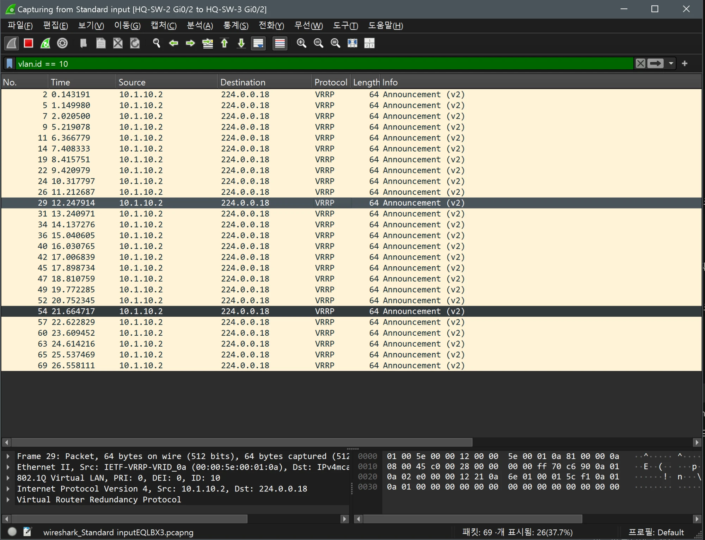
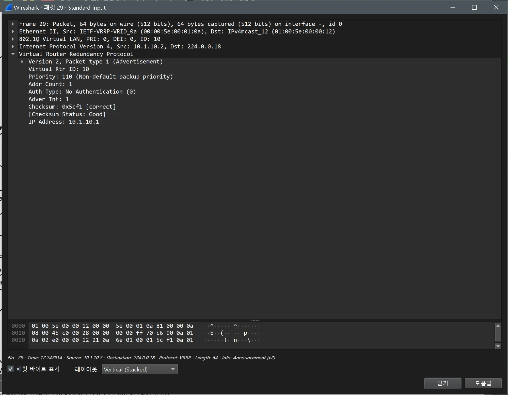

# VLAN, 트렁크 검증 (HQ / distribution)

- Jira: KAN-8
- 대상 장비: HQ-SW-2, HQ-SW-3
- 기준 문서: [vlan-design.md](../../../docs/vlan-design.md) 1, 5절
- 검증일: 2026-10-11

| 장비 | 명령 | 기대 결과 | 실제 결과 | 판정 |
|---|---|---|---|---|
| HQ-SW-2 | `show interfaces trunk` | Po1, Po3 trunking, native 999, 허용 10,20,100 | Po1, Po3 802.1q trunking, native 999, 허용·active 10,20,100 | 통과 |
| HQ-SW-3 | `show interfaces trunk` | Po2, Po3 trunking, native 999, 허용 10,20,100 | Po2, Po3 802.1q trunking, native 999, 허용·active·STP forwarding 10,20,100 | 통과 |
| HQ-SW-2 | `show vlan brief` | VLAN 10 hq-public, 20 hq-private, 100 mgmt, 999 native active | 4개 VLAN 모두 active, 이름 일치 | 통과 |
| HQ-SW-3 | `show vlan brief` | VLAN 10 hq-public, 20 hq-private, 100 mgmt, 999 native active | 4개 VLAN 모두 active, 이름 일치 | 통과 |

HQ-SW-2 TRUNK

HQ-SW-3 TRUNK

HQ-SW-2 VLAN

HQ-SW-3 VLAN

## Wireshark 확인(802.1Q 태그)

- 검증일: 2026-10-19
- 캡처 링크: `HQ-SW-2 Gi0/2 ↔ HQ-SW-3 Gi0/2`(Po3 멤버, 트렁크 VLAN 10·20·100, native 999), 필터 `vlan.id == 10`
- 같은 Po3의 `Gi0/3` 링크에서는 VLAN 10 프레임이 0개였음(포트채널이 흐름을 해시해 멤버 하나로 보내므로 `Gi0/2`에서만 보임).

| 항목 | 결과 |
|---|---|
| 프레임 | VRRP Announcement(v2) 26개 표시(전체 69개 중), 약 1초 간격 |
| 802.1Q | `PRI: 0, DEI: 0, ID: 10` |
| 출발지 | Ethernet `00:00:5e:00:01:0a`(VRRP 가상 MAC, VRID 10), IP `10.1.10.2`(HQ-SW-2) → `224.0.0.18` |
| VRRP | Version 2, Virtual Rtr ID 10, Priority 110, Addr Count 1, Adver Int 1, IP Address `10.1.10.1`(VIP), Checksum Good |

- 트렁크에서 VLAN 10이 802.1Q 태그로 구분되고, VRRP 광고가 설계 값(그룹 10, 우선순위 110, VIP `10.1.10.1`)과 일치함.

