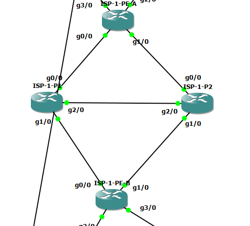

# ISP-1 검증 개요

GNS3 토폴로지(검증 대상 장비와 포트). 상세 결과는 아래 문서 링크에서 확인.

## 핵심 결과

- ISP-1 장애 시 BGP 세션 종료와 기본 경로 전환, 복구 약 1.6초 → [isp1-failure](../scenarios/isp1-failure.md)
- Hub 장애 시 ISP 경유 MPLS 레이블 스택(12004 + 14007), PHP, LDP 이웃 소실 → [mpls-label-path](../scenarios/mpls-label-path.md)

## 계층별 검증 문서

| 계층 | 항목 | Jira | 문서 |
|---|---|---|---|
| core | BGP 검증 | KAN-15, KAN-16(iBGP), KAN-17(PE 정책), KAN-18(사이트 eBGP) | [core/bgp.md](core/bgp.md) |
| core | MPLS 검증 | KAN-34(LDP), KAN-35(VRF, vpnv4) | [core/mpls.md](core/mpls.md) |

상세 서식과 상태는 [검증 README](../README.md) 참조.
