# BGP 검증(iBGP RR, 사이트 eBGP) (ISP1 / core)

- Jira: KAN-15, KAN-16(iBGP), KAN-17(PE 정책), KAN-18(사이트 eBGP)
- 대상 장비: ISP-1-PE-A, P1, P2, PE-B
- 기준 문서: [bgp-design.md](../../../docs/bgp-design.md) 2~6절
- 검증일: 2026-10-17

## 1. ISP 내부 OSPF와 iBGP (KAN-15, 16, 3주 수)

| 장비 | 명령 | 기대 결과 | 실제 결과 | 판정 |
|---|---|---|---|---|
| ISP-1-PE-A, PE-B, P1, P2 | `show ip ospf neighbor` | ISP 내부 이웃 Full(point-to-point), Loopback0 `100.100.100.1~4` 도달 | 모두 FULL/ -(Pri 0). P1은 100.100.100.1(PE-A), .4(PE-B), .3(P2) 3개, P2는 .1, .4, .2 3개, PE-A와 PE-B는 P1, P2 2개 | 통과 |
| ISP-1-P1, P2 | `show ip bgp summary` | AS 65100, PE-A, PE-B, 상대 RR과 Established(3세션) | AS 65100, P1(router-id 100.100.100.2)과 P2(100.100.100.3) 모두 이웃 3개(100.100.100.1, .3 또는 .2, .4)가 Up/Down 약 1시간 28분 이상 유지, State/PfxRcd 숫자(Established) | 통과 |
| ISP-1-PE-A, PE-B | `show ip bgp summary` | P1, P2와 iBGP Established(AS 65100) | PE-A(100.100.100.1)와 PE-B(100.100.100.4) 모두 P1(100.100.100.2), P2(100.100.100.3) 2세션 Established | 통과 |
| ISP-1-P1, P2 | `show ip bgp neighbors \| include Reflector` | PE-A, PE-B가 Route-Reflector Client | P1, P2 모두 `Route-Reflector Client` 2건(PE-A, PE-B). 대소문자를 구분하므로 `Reflector`로 필터 | 통과 |
| ISP-1 전체 | `show ip bgp neighbors \| include hold` | iBGP 세션 timers 3/9 | P1, P2는 이웃 3개, PE-A, PE-B는 이웃 2개 모두 `Configured hold time is 9, keepalive interval is 3 seconds` | 통과 |

ISP-1-P1 OSPF neighbor

ISP-1-PE-A OSPF neighbor

ISP-1-PE-B OSPF neighbor

ISP-1-P2 OSPF neighbor

ISP-1-P1 BGP summary

ISP-1-P2 BGP summary

ISP-1-PE-A BGP summary

ISP-1-PE-B BGP summary

ISP-1-P1 BGP neighbors Reflector

ISP-1-P2 BGP neighbors Reflector

ISP-1-P1 BGP neighbors hold

ISP-1-PE-A BGP neighbors hold

ISP-1-PE-B BGP neighbors hold

ISP-1-P2 BGP neighbors hold

## 2. 사이트 eBGP 세션 (KAN-18, 2주 월)

- 사이트 쪽 확인은 `*/core/isp-link.md`. 이 절은 PE 쪽 확인(VRF `corp` 안의 세션, `docs/mpls-design.md` 3절).

| 장비               | 명령                                                                | 기대 결과                                                    | 실제 결과 | 판정  |
| ---------------- | ----------------------------------------------------------------- | -------------------------------------------------------- | ----- | --- |
| ISP-1-PE-A | `show ip bgp vpnv4 vrf corp summary` | HQ-R1(100.1.11.1), DC-R3(100.1.21.1)와 eBGP Established | HQ-R1(100.1.11.1, AS 65001) Up/Down 00:42:03, DC-R3(100.1.21.1, AS 65002) Up/Down 00:12:45 모두 Established, PfxRcd 각 1 | 통과 |
| ISP-1-PE-B       | `show ip bgp vpnv4 vrf corp summary`                              | BR1-R1(100.1.31.1), BR2-R1(100.1.41.1)와 eBGP Established | BR1-R1(100.1.31.1, AS 65003) Up/Down 00:00:47, BR2-R1(100.1.41.1, AS 65004) Up/Down 00:00:33 모두 Established, PfxRcd 각 1 | 통과 |
| ISP-1-PE-A, PE-B | `show ip bgp vpnv4 vrf corp neighbors <사이트 주소> advertised-routes` | 사이트에는 기본 경로만 전달(`default-originate`, `pl-deny-all`) | PE-A는 HQ-R1, DC-R3 모두 `Originating default network 0.0.0.0`만 전송(일반 prefix 0개). PE-B는 BR1-R1, BR2-R1 모두 `Originating default network 0.0.0.0`만 전송(일반 prefix 0개) | 통과 |
| ISP-1-PE-A, PE-B | `show ip bgp vpnv4 vrf corp neighbors <사이트 주소> routes` | 해당 사이트 /16만 수신(`pl-<사이트>-in`) | PE-A는 HQ-R1 이웃에서 `10.1.0.0/16`(Path 65001 i), DC-R3 이웃에서 `10.2.0.0/16`(Path 65002 i) 각 1개만 수신, RD 65100:1. PE-B는 BR1-R1 이웃에서 `10.3.0.0/16`(Path 65003 i), BR2-R1 이웃에서 `10.4.0.0/16`(Path 65004 i) 각 1개만 수신, RD 65100:1 | 통과 |
| ISP-1-PE-A, PE-B | `show ip bgp vpnv4 vrf corp neighbors <사이트 주소> \| include hold`   | eBGP 세션 timers 3/9                                       | PE-A는 HQ-R1, DC-R3 이웃 모두 hold time 9, keepalive 3초(Configured도 동일). PE-B는 BR1-R1, BR2-R1 이웃 모두 hold time 9, keepalive 3초(Configured도 동일) | 통과 |

ISP-1-PE-A VRF summary

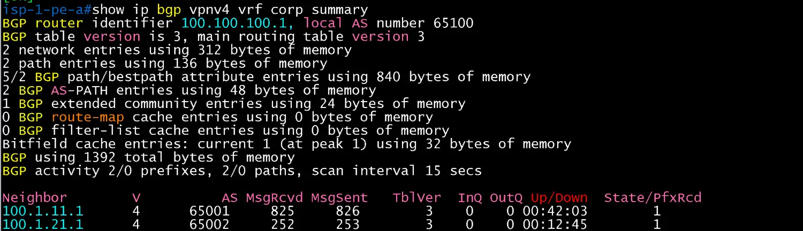

ISP-1-PE-A HQ-R1 routes

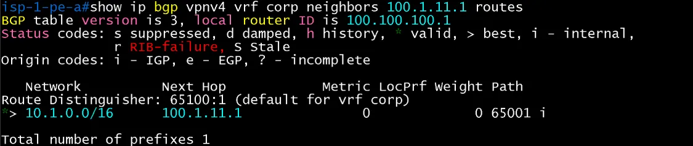

ISP-1-PE-A HQ-R1 advertised-routes

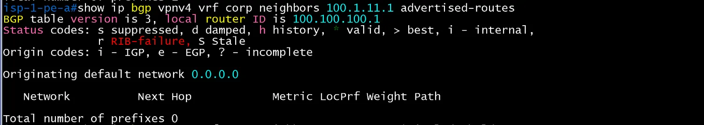

ISP-1-PE-A HQ-R1 hold

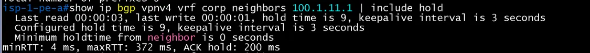

ISP-1-PE-A DC-R3 routes

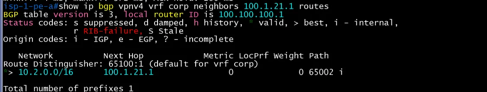

ISP-1-PE-A DC-R3 advertised-routes

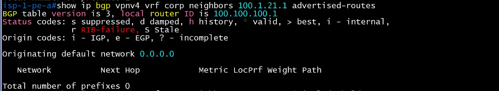

ISP-1-PE-A DC-R3 hold

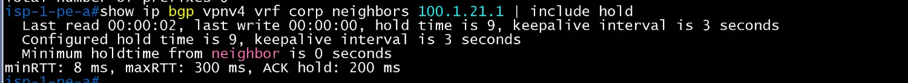

ISP-1-PE-B VRF summary

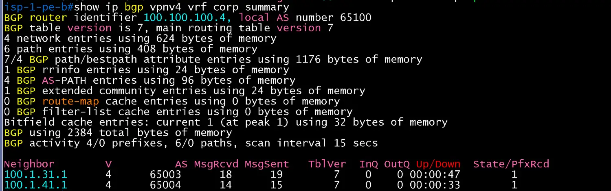

ISP-1-PE-B BR1-R1 routes

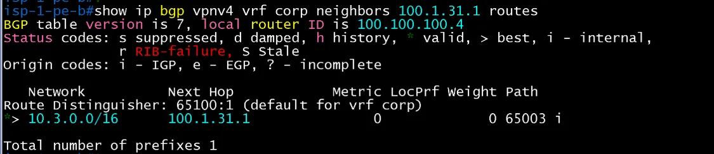

ISP-1-PE-B BR1-R1 advertised-routes

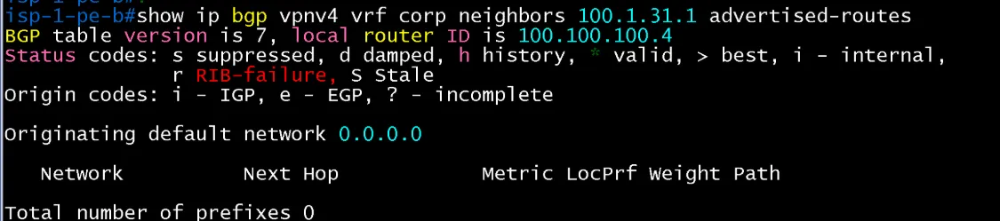

ISP-1-PE-B BR1-R1 hold

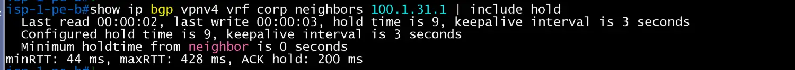

ISP-1-PE-B BR2-R1 routes

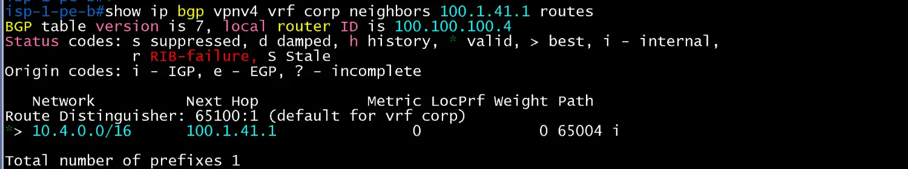

ISP-1-PE-B BR2-R1 advertised-routes

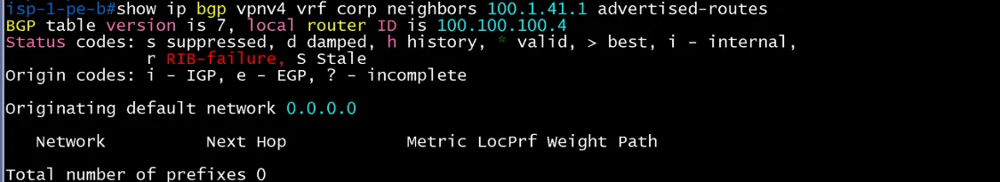

ISP-1-PE-B BR2-R1 hold

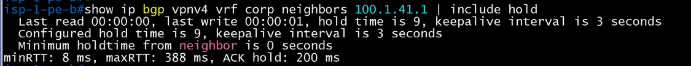

## 3. PE 정책과 사이트 간 경로 (KAN-17, 3주 목)

| 장비               | 명령                      | 기대 결과                                                                                     | 실제 결과 | 판정  |
| ---------------- | ----------------------- | ----------------------------------------------------------------------------------------- | ----- | --- |
| ISP-1-PE-A, PE-B | `show ip bgp vpnv4 all` | 사이트 /16을 eBGP로 수신하고 상대 PE의 사이트 /16을 RR 경유로 수신(next-hop은 상대 PE Loopback0, `next-hop-self`) | PE-A는 HQ-R1(100.1.11.1)과 DC-R3(100.1.21.1)에서 eBGP로 `10.1.0.0/16`, `10.2.0.0/16`을 수신(`*>`, Path 65001, 65002). 상대 PE-B의 `10.3.0.0/16`, `10.4.0.0/16`은 iBGP로 수신(Next Hop 100.100.100.4, LocPrf 100, P1과 P2 경유 2경로 중 `*>i` 선택). PE-B는 BR1-R1(100.1.31.1)과 BR2-R1(100.1.41.1)에서 eBGP로 `10.3.0.0/16`, `10.4.0.0/16`을 수신. 상대 PE-A의 `10.1.0.0/16`, `10.2.0.0/16`은 iBGP로 수신(Next Hop 100.100.100.1, LocPrf 100, 2경로 중 `*>i` 선택) | 통과 |
| ISP-1-P1, P2 | `show ip bgp vpnv4 all` | 모든 사이트 /16 반사, `Originator`, `Cluster list` 표시 | P1(100.100.100.2)과 P2(100.100.100.3) 모두 `10.1.0.0/16`, `10.2.0.0/16`(Next Hop 100.100.100.1), `10.3.0.0/16`, `10.4.0.0/16`(Next Hop 100.100.100.4)을 모두 `*>i`로 보유, RD 65100:1. 상세(`show ip bgp vpnv4 all 10.1.0.0`)에서 P1, P2 모두 `Received from a RR-client`, Next Hop 100.100.100.1(metric 2), RT 65100:1, 레이블 in/out nolabel/11006. PE-B는 P1(100.100.100.2), P2(100.100.100.3) 양쪽에서 2경로를 수신(`best #2`), 두 경로 모두 `Originator: 100.100.100.1`, `Cluster list: 1.1.1.1`. PE-A는 eBGP 경로(`external`, table corp, 레이블 in/out 11006/nolabel) | 통과 |

ISP-1-P1 vpnv4 all

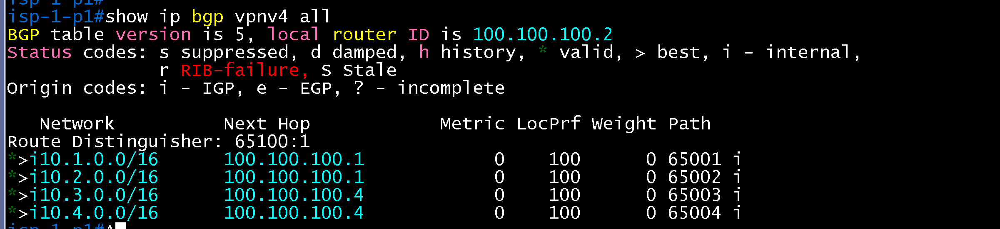

ISP-1-P2 vpnv4 all

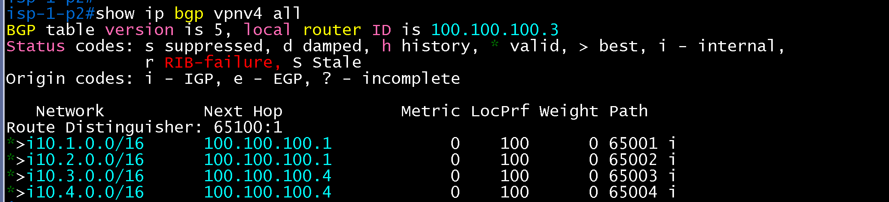

ISP-1-PE-A vpnv4 all

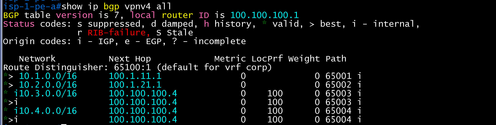

ISP-1-PE-B vpnv4 all

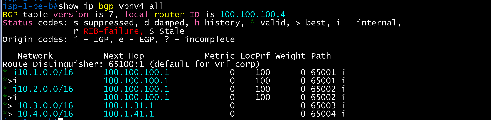

ISP-1-P1 vpnv4 all 10.1.0.0 상세

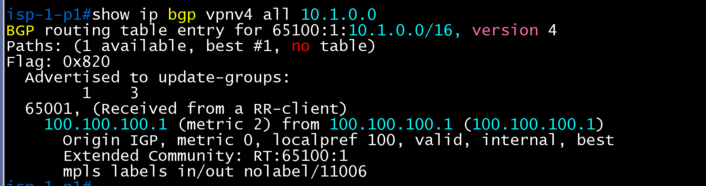

ISP-1-P2 vpnv4 all 10.1.0.0 상세

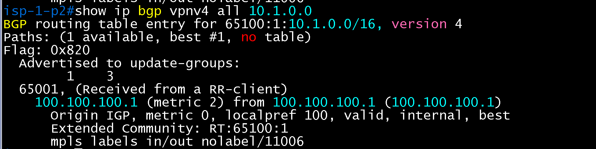

ISP-1-PE-A vpnv4 all 10.1.0.0 상세

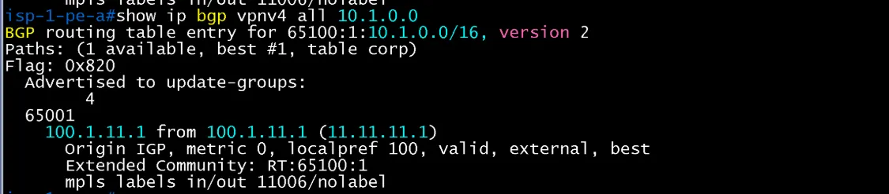

ISP-1-PE-B vpnv4 all 10.1.0.0 상세

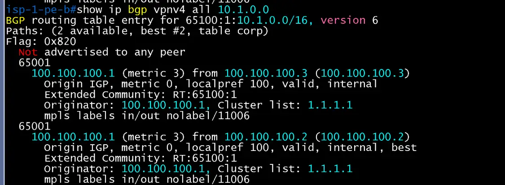

## Wireshark 확인(사이트 eBGP 세션 수립)

- 검증일: 2026-10-19
- 캡처 링크: `HQ-R1 Gi3/0 ↔ ISP-1-PE-A Gi2/0`(링크 6, HQ-R1 `100.1.11.1`, PE-A `100.1.11.2`), 필터 `bgp`
- 트리거: 세션 초기화(`clear ip bgp` 계열, 정확한 명령은 기록하지 못함)

| 시각(초) | 출발지 → 목적지 | 메시지 | 내용 |
|---|---|---|---|
| 0 ~ 18.43 | 양방향 | KEEPALIVE(73바이트) | 양쪽이 약 3초 간격(HQ-R1 2.39, 5.45, 8.51초 / PE-A 0, 3.06, 6.16초). Hold-time 9초의 1/3 |
| 22.27 | `100.1.11.1` → `100.1.11.2` | OPEN(107바이트) | HQ-R1이 먼저 OPEN 전송 |
| 22.31 | `100.1.11.2` → `100.1.11.1` | OPEN(107바이트) | PE-A 응답 OPEN |
| 22.31 ~ 22.35 | 양방향 | KEEPALIVE | OPEN 확인 |
| 22.34 | `100.1.11.1` → `100.1.11.2` | UPDATE(107바이트) | HQ-R1이 사이트 경로 광고 |
| 23.55, 23.56 | `100.1.11.2` → `100.1.11.1` | UPDATE(105, 89바이트) | PE-A가 경로(기본 경로 포함) 전달, 이어서 KEEPALIVE |
| 24.91 이후 | 양방향 | KEEPALIVE | 약 3초 간격 재개 |

- OPEN 이후 UPDATE 교환 완료까지 약 1.3초(22.27 ~ 23.56초).
- 펼친 화면은 아래 "OPEN, UPDATE 상세" 참조. 광고 UPDATE의 펼친 화면은 아래 "광고 UPDATE 상세" 참조. OPEN 이전 `NOTIFICATION`도 이 화면에는 없음.

Wireshark(`bgp`): KEEPALIVE 3초 간격, OPEN, UPDATE

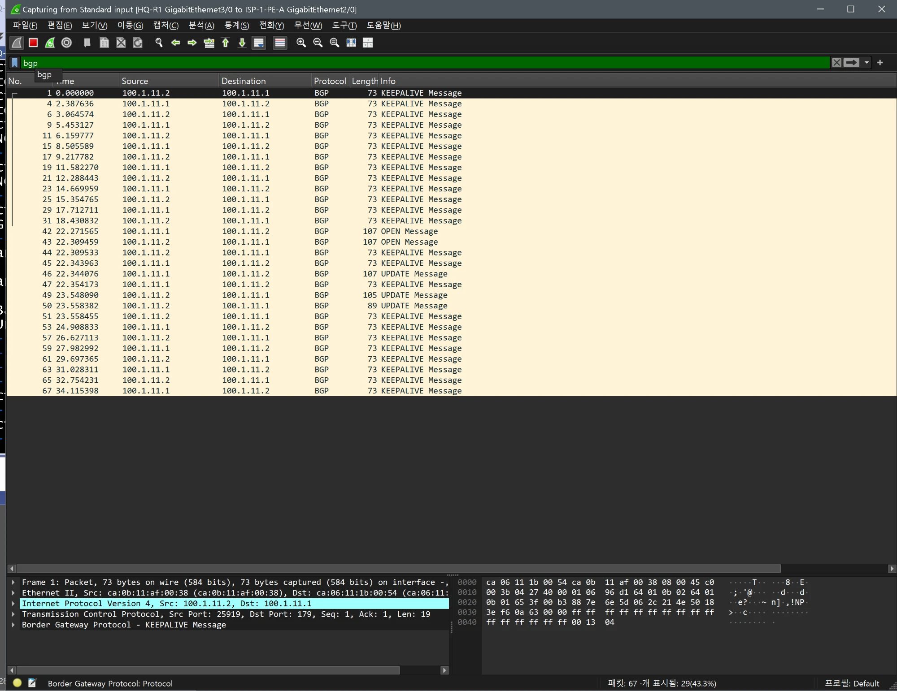

## Wireshark 확인(iBGP vpnv4, ISP-1-PE-A ↔ P1)

- 검증일: 2026-10-19
- 캡처 링크: `ISP-1-PE-A Gi0/0 ↔ ISP-1-P1 Gi0/0`(링크 71). iBGP는 Loopback0 주소(PE-A `100.100.100.1`, P1 `100.100.100.2`)로 맺음.
- 트리거: PE-A에서 `clear ip bgp 100.100.100.2`(세션 초기화)

| 시각(초) | 패킷 | 확인한 내용 |
|---|---|---|
| 100.25, 100.28 | OPEN(115바이트) 2개 | P1(`100.100.100.2`) → PE-A, PE-A → P1. 패킷 바이트에서 읽은 값: My AS `65100`(`fe 4c`), Hold Time `9`, BGP Identifier `100.100.100.1`(PE-A), Capability에 IPv4 unicast(AFI 1, SAFI 1)와 **vpnv4(AFI 1, SAFI 128)**, 4바이트 AS |
| 101.38 | UPDATE 3개(301바이트) | PE-A → P1. `MP_REACH_NLRI`(AFI 1, SAFI 128), 다음 홉 `100.100.100.1`, RD `65100:1`, VPN 레이블 `0x02aff1`(= 11007). 패킷 바이트에서 읽은 값이며 PE-A 전달 테이블의 `10.1.0.0/16 [V]` 로컬 레이블 11007과 일치 |
| 116.61 | UPDATE 4개(490바이트) | P1 → PE-A. RR가 다른 PE의 경로를 반사 |

- OPEN의 Hold Time 9는 사이트 eBGP와 같은 값이며 iBGP도 ISP AS `65100` 하나(내부 세션)임을 보여 줌.
- NLRI의 prefix 자체(`10.1.0.0/16`)는 패킷을 펼친 화면이 아니라 바이트로만 확인하여 펼친 화면이 있으면 보강.

Wireshark(`bgp.type == 1`): iBGP OPEN

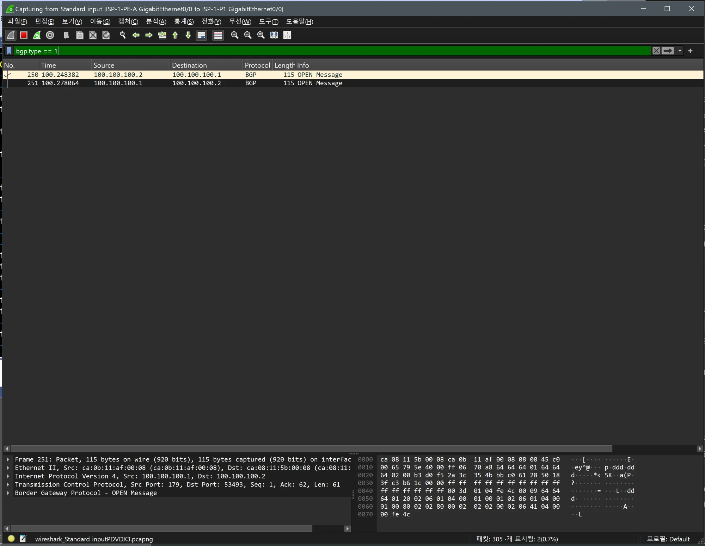

Wireshark(`bgp.type == 2`): vpnv4 UPDATE

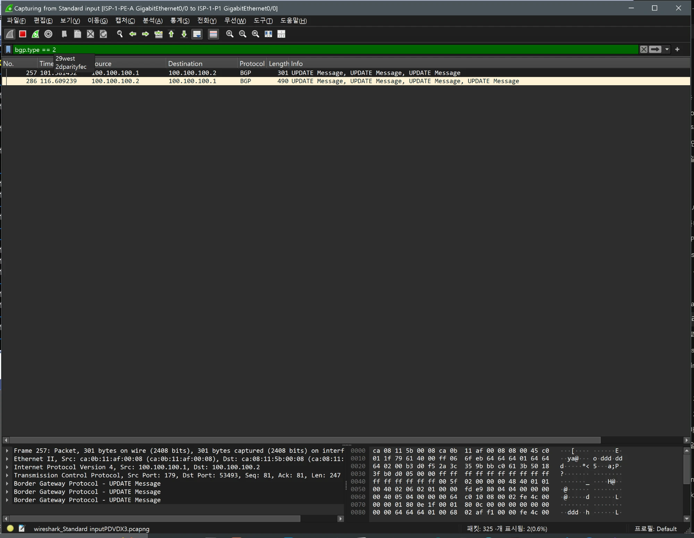

### iBGP UPDATE 패킷 바이트 해석(프레임 257, PE-A → P1)

한 TCP 세그먼트에 UPDATE 3개가 들어 있고, 패킷 바이트(아래 화면)에서 직접 해석한 값.

| UPDATE | 해석한 내용 |
|---|---|
| 1 | `MP_REACH_NLRI`(AFI 1, SAFI 128), 다음 홉 `100.100.100.1`, RD `65100:1`, VPN 레이블 11007(`02 af f1`), prefix `10.1.0.0/16`. AS_PATH `65001`(HQ), LOCAL_PREF 100, MED 0, Extended Community Route Target `65100:1` |
| 2 | 같은 형식, VPN 레이블 11006(`02 af e1`), prefix `10.2.0.0/16`, AS_PATH `65002`(DC). PE-A 전달 테이블의 `10.2.0.0/16 [V]` 레이블 11006과 일치 |
| 3 | `MP_UNREACH_NLRI`(AFI 1, SAFI 128)로 RD `65100:1`의 `10.3.0.0/16`, `10.4.0.0/16` 철회(세션 초기화 중 경로 재교환 과정) |

- Wireshark 상세 트리를 펼친 화면이 아니라 바이트에서 읽은 값. 레이블 값은 20비트 레이블 필드 `0x02aff1`을 4비트 오른쪽으로 이동해 계산(= 11007).

Wireshark 패킷 바이트(프레임 257): vpnv4 UPDATE

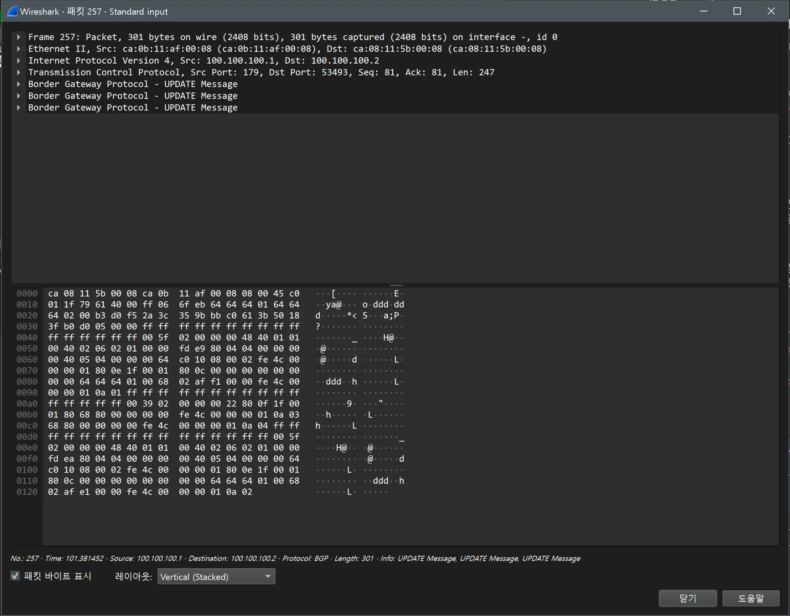

### OPEN, UPDATE 상세(PE-A → HQ-R1)

| 프레임 | 시각(초) | 내용 |
|---|---|---|
| 40 | 23.649 | PE-A(`100.1.11.2`) → HQ-R1(`100.1.11.1`) **OPEN**(107바이트): Version 4, **My AS 65100**, **Hold Time 9**, BGP Identifier `100.100.100.1`(PE-A Loopback), Optional Parameters Length 24(Capability) |
| 39 | 23.6 | HQ-R1(`100.1.11.1`) → PE-A(`100.1.11.2`) **OPEN**(107바이트): Version 4, **My AS 65001**, **Hold Time 9**, BGP Identifier `11.11.11.1`(HQ-R1 Loopback), Optional Parameters Length 24(Capability) |
| 48 | 25.285 | PE-A → HQ-R1 **UPDATE**(89바이트): Withdrawn Routes Length 12, Total Path Attribute Length 0. 경로 광고가 아니라 **철회만 담은 UPDATE**. 철회 prefix는 `10.3.0.0/16`, `10.2.0.0/16`, `10.4.0.0/16`, `10.1.0.0/16`(사이트 prefix 4개 전체) |

- 양쪽 OPEN으로 사이트 AS `65001`(HQ), ISP AS `65100`, Hold Time 9(설계 값)가 확정됨. 사이트 eBGP는 서로 다른 AS 사이의 세션(eBGP)임을 보여 줌.
- 프레임 48은 세션 초기화 직후 PE-A가 사이트 prefix 4개를 철회하는 UPDATE라서(재광고 전 단계로 보이나 확인하지 못함) `10.1.0.0/16`이나 기본 경로를 광고하는 UPDATE(앞선 목록의 105, 107바이트)는 아직 펼친 화면이 없음.

PE-A OPEN 상세(프레임 40)

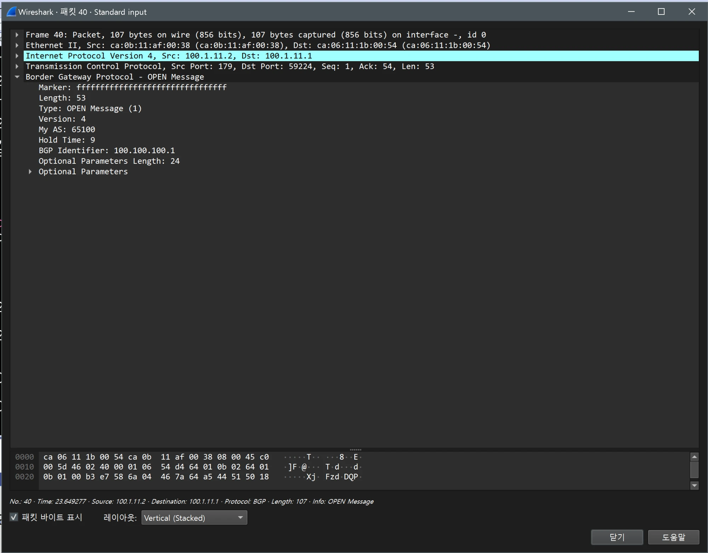

PE-A UPDATE 상세(프레임 48, 철회)

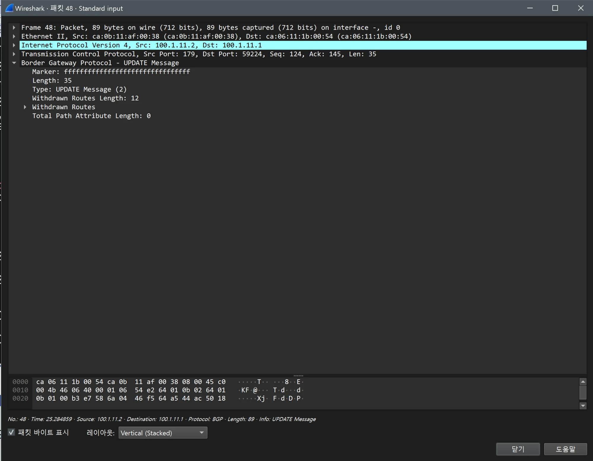

PE-A UPDATE 철회 prefix 펼친 화면(프레임 48)

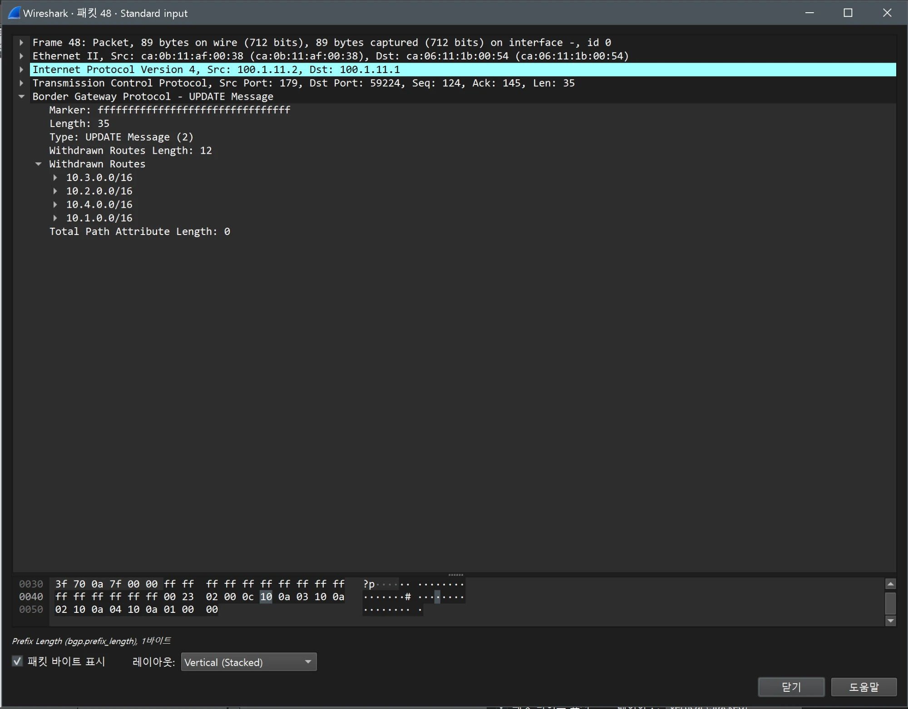

HQ-R1 OPEN 상세(프레임 39)

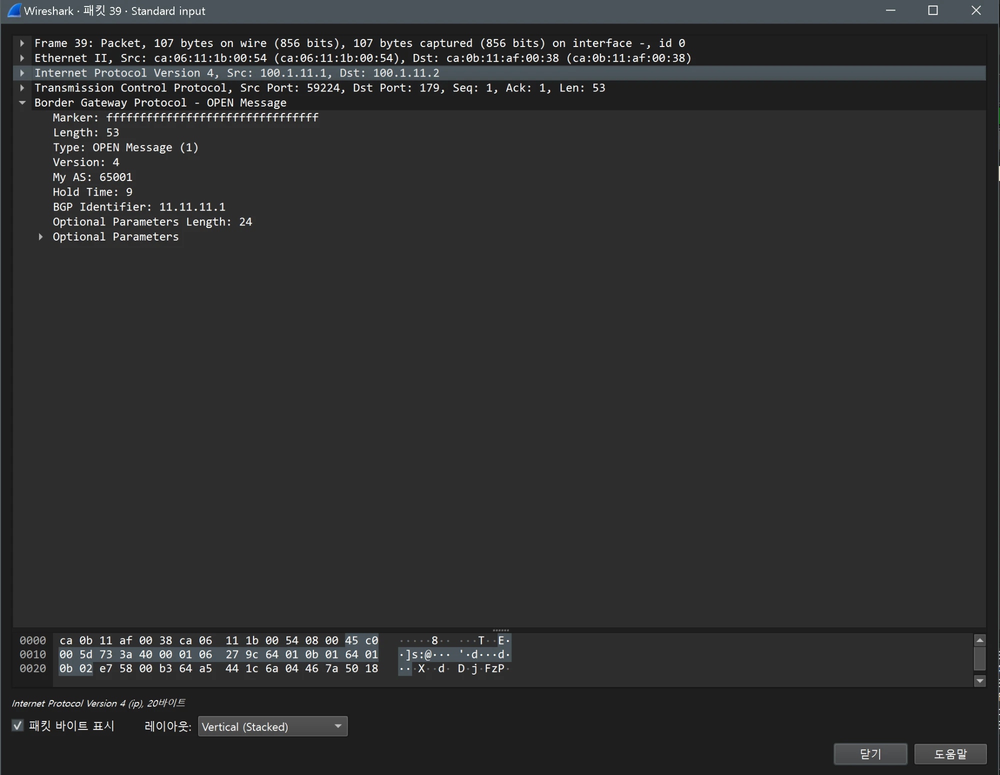

### 광고 UPDATE 상세(HQ-R1 ↔ PE-A)

| 프레임 | 시각(초) | 방향 | Origin | AS_PATH | NEXT_HOP | MED | NLRI |
|---|---|---|---|---|---|---|---|
| 42 | 22.690 | HQ-R1(`100.1.11.1`) → PE-A | IGP | **65001** | `100.1.11.1` | 0 | **`10.1.0.0/16`**(HQ 사이트 prefix) |
| 45 | 23.172 | PE-A(`100.1.11.2`) → HQ-R1 | IGP | **65100** | `100.1.11.2` | 0 | **`0.0.0.0/0`**(기본 경로) |

- 두 UPDATE 모두 Withdrawn Routes Length 0, Total Path Attribute Length 27로 철회 없이 광고만 담음. 속성은 ORIGIN(Well-known, Transitive), AS_PATH, NEXT_HOP, MULTI_EXIT_DISC.
- eBGP라서 광고하는 쪽이 자기 AS를 AS_PATH에 넣고 NEXT_HOP이 자기 링크 주소임. HQ-R1은 사이트 prefix `10.1.0.0/16`을, PE-A(ISP)는 기본 경로 `0.0.0.0/0`을 광고하는 것이 설계(PE의 `default-information originate`, 사이트의 `network 10.x.0.0/16`)와 일치.
- 세션 수립 순서: OPEN 교환(22.63, 22.66초) → 프레임 42(HQ-R1 광고, 22.69초) → 프레임 45(PE-A 광고, 23.17초) → 프레임 46(PE-A 철회, 23.17초).

HQ-R1 UPDATE(프레임 42)

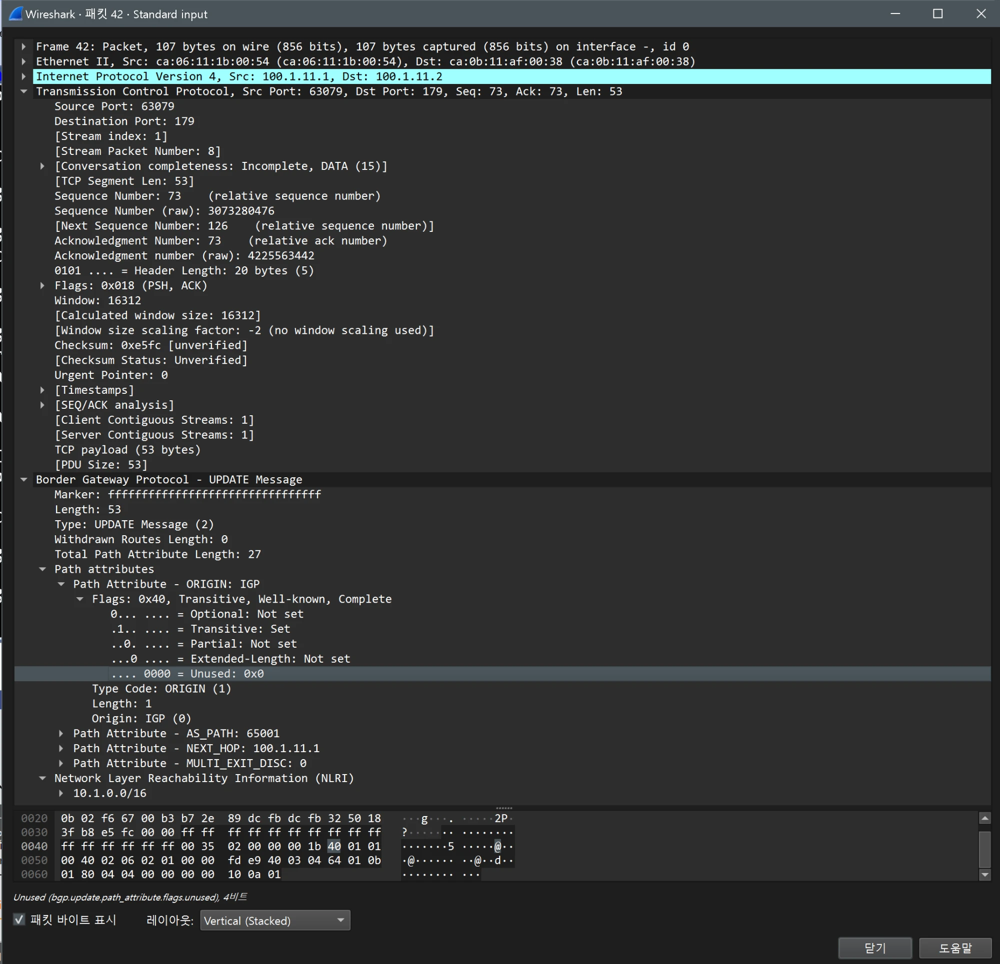

PE-A UPDATE(프레임 45)

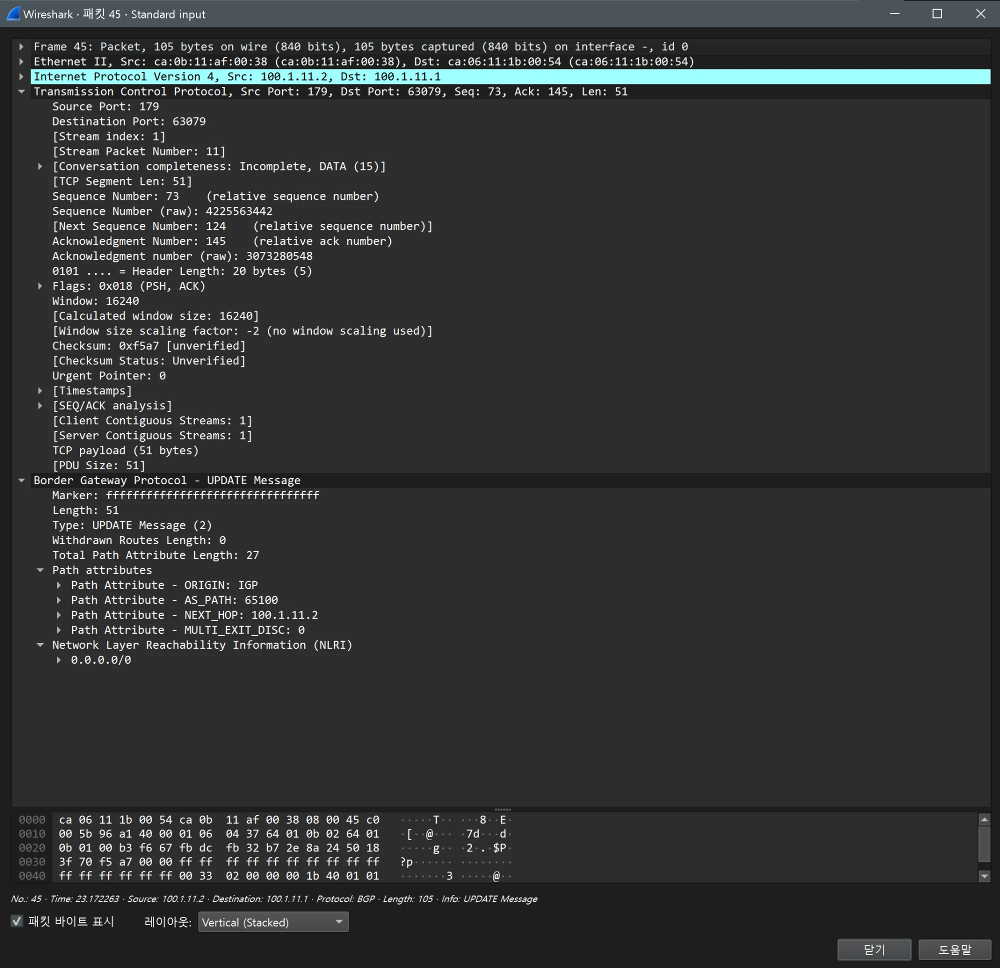
