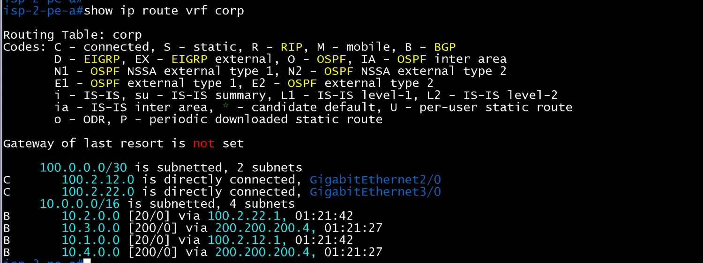
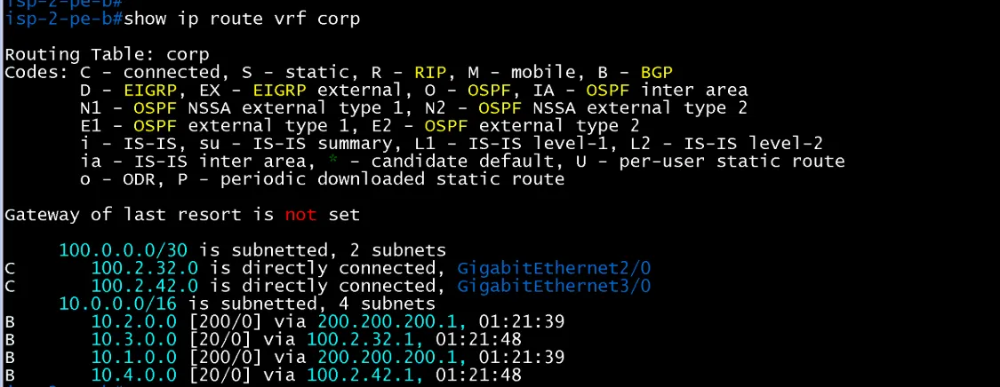
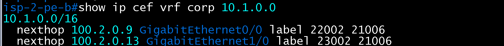
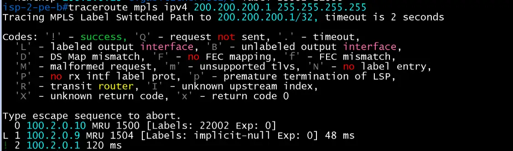

# MPLS 검증 (ISP2 / core)

- Jira: KAN-34(LDP), KAN-35(VRF, vpnv4)
- 대상 장비: ISP-2-PE-A, P1, P2, PE-B
- 기준 문서: [mpls-design.md](../../../docs/mpls-design.md) 2~4절, 6절
- 검증일: 2026-10-17

## 1. LDP (KAN-34)

| 장비 | 명령 | 기대 결과 | 실제 결과 | 판정 |
|---|---|---|---|---|
| ISP-2-PE-A, PE-B | `show mpls ldp neighbor` | P1, P2와 LDP 이웃 2개 Oper | PE-A는 P1(200.200.200.2, Gi0/0)과 P2(200.200.200.3, Gi1/0), PE-B는 P1(Gi0/0)과 P2(Gi1/0) 이웃 2개 Oper. Local LDP Ident는 Loopback0(PE-A 200.200.200.1, PE-B 200.200.200.4) | 통과 |
| ISP-2-P1, P2 | `show mpls ldp neighbor` | PE-A, PE-B, 상대 P와 LDP 이웃 3개 Oper | P1은 200.200.200.1(PE-A, Gi0/0), .3(P2, Gi2/0), .4(PE-B, Gi1/0), P2는 .1(PE-A, Gi0/0), .2(P1, Gi2/0), .4(PE-B, Gi1/0) 각 3개 Oper. Local LDP Ident는 Loopback0(P1 200.200.200.2, P2 200.200.200.3) | 통과 |
| ISP-2-PE-A, PE-B, P1, P2 | `show mpls interfaces` | 내부 링크만 LDP 활성(PE의 사이트 방향 포트는 제외) | PE-A, PE-B는 Gi0/0, Gi1/0, P1, P2는 Gi0/0, Gi1/0, Gi2/0이 `Yes (ldp)`, Operational Yes. PE의 사이트 방향 Gi2/0, Gi3/0은 목록에 없음 | 통과 |
| ISP-2-PE-A, PE-B, P1, P2 | `show mpls forwarding-table` | 상대 장비 Loopback0 `/32` 3개에 레이블 | 각 장비가 Loopback0 `/32` 3개에 레이블 보유(장비별 구간 값). PE-A 21003(.2), 21004(.3), 21005(.4), P1 22002(.1), 22003(.3), 22004(.4), P2 23002(.1), 23003(.2), 23004(.4), PE-B 24003(.1), 24004(.2), 24005(.3). 이웃으로 가는 경로는 Pop Label(PHP), PE-A와 PE-B 사이는 P1, P2 경유 이중 경로(예: 21005에서 22004, 23004) | 통과 |

ISP-2-PE-A LDP neighbor

ISP-2-PE-B LDP neighbor

ISP-2-P1 LDP neighbor

ISP-2-P2 LDP neighbor

ISP-2-PE-A MPLS interfaces

ISP-2-P1 MPLS interfaces

ISP-2-P2 MPLS interfaces

ISP-2-PE-B MPLS interfaces

ISP-2-PE-A MPLS forwarding-table

ISP-2-P1 MPLS forwarding-table

ISP-2-P2 MPLS forwarding-table

ISP-2-PE-B MPLS forwarding-table

## 2. VRF와 vpnv4 (KAN-35)

| 장비               | 명령                              | 기대 결과                                     | 실제 결과                                                                                                                                                                                                                                        | 판정  |
| ---------------- | ------------------------------- | ----------------------------------------- | -------------------------------------------------------------------------------------------------------------------------------------------------------------------------------------------------------------------------------------------- | --- |
| ISP-2-PE-A, PE-B | `show ip vrf`                   | `corp`, RD 65200:1                        | PE-A, PE-B 모두 VRF `corp`, Default RD 65200:1                                                                                                                                                                                                 | 통과  |
| ISP-2-PE-A, PE-B | `show ip vrf interfaces`        | 사이트 방향 포트 Gi2/0, Gi3/0이 `corp` 소속         | PE-A는 Gi2/0(100.2.12.2), Gi3/0(100.2.22.2), PE-B는 Gi2/0(100.2.32.2), Gi3/0(100.2.42.2)이 `corp` 소속, Protocol up, IP 유지                                                                                                                        | 통과  |
| ISP-2-P1, P2     | `show ip bgp vpnv4 all summary` | PE-A, PE-B, 상대 RR과 vpnv4 Established(3세션) | P1(router-id 200.200.200.2)은 PE-A(200.200.200.1), P2(200.200.200.3), PE-B(200.200.200.4), P2(router-id 200.200.200.3)는 PE-A(.1), P1(.2), PE-B(.4) 각 3개 vpnv4 이웃이 Established(AS 65200, State/PfxRcd 0). Up/Down이 23~41초로 vpnv4 추가 직후 재수립된 상태 | 통과  |
| ISP-2-PE-A, PE-B | `show ip bgp vpnv4 all summary` | P1, P2와 vpnv4 Established(2세션)            | PE-A(router-id 200.200.200.1)와 PE-B(200.200.200.4) 모두 P1(200.200.200.2), P2(200.200.200.3) 2개 vpnv4 이웃 Established(State/PfxRcd 0, 사이트 경로는 KAN-18 이후)                                                                                        | 통과  |

ISP-2-PE-A VRF

ISP-2-PE-B VRF

ISP-2-P1 VPNv4 summary

ISP-2-P2 VPNv4 summary

ISP-2-PE-A VPNv4 summary

ISP-2-PE-B VPNv4 summary

## 3. 사이트 경로와 레이블 경로 (사이트 eBGP 이후)

| 장비 | 명령 | 기대 결과 | 실제 결과 | 판정 |
|---|---|---|---|---|
| ISP-2-PE-A, PE-B | `show ip route vrf corp` | 사이트 /16(CE에서 eBGP, 상대 PE에서 vpnv4) | PE-A: `10.1.0.0`(via 100.2.12.1)와 `10.2.0.0`(via 100.2.22.1)은 `B [20/0]`(eBGP, 사이트 링크 주소), `10.3.0.0`, `10.4.0.0`은 `B [200/0]`(iBGP, via 200.200.200.4=PE-B Loopback0). PE-B: `10.3.0.0`(via 100.2.32.1)와 `10.4.0.0`(via 100.2.42.1)은 `B [20/0]`, `10.1.0.0`, `10.2.0.0`은 `B [200/0]`(via 200.200.200.1=PE-A Loopback0). 연결 경로 `C`는 사이트 링크 2개 | 통과 |
| ISP-2-PE-B | `show ip cef vrf corp 10.1.0.0`, `traceroute mpls ipv4 200.200.200.1 255.255.255.255` | 사이트 경로가 LDP 레이블과 VPN 레이블 2개로 전달되고, 코어 LSP가 PE-A까지 이어짐(일반 `traceroute vrf corp`는 코어 홉 응답이 돌아오지 않아 `* * *`로 표시되며, 출발 주소가 VRF 밖이라 응답 경로가 없는 것으로 추정) | `show ip cef vrf corp 10.1.0.0`: next-hop `100.2.0.9 Gi0/0 label 22002 21006`(P1 경유)와 `100.2.0.13 Gi1/0 label 23002 21006`(P2 경유). 바깥 LDP 레이블(22002, 23002)과 안쪽 VPN 레이블 21006의 2단 스택. `traceroute mpls ipv4 200.200.200.1/32`: `0 100.2.0.10 [Labels: 22002]` → `L 1 100.2.0.9 [Labels: implicit-null] 48ms` → `! 2 100.2.0.1 120ms`로 PE-B에서 P를 거쳐 PE-A까지 LSP 성공(P에서 PHP) | 통과 |

ISP-2-PE-A show ip route vrf corp

ISP-2-PE-B show ip route vrf corp

ISP-2-PE-B show ip cef vrf corp 10.1.0.0

ISP-2-PE-B traceroute mpls ipv4 200.200.200.1

