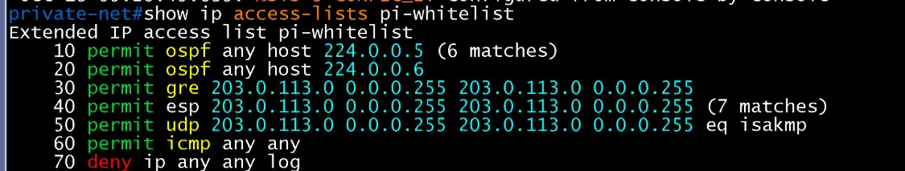
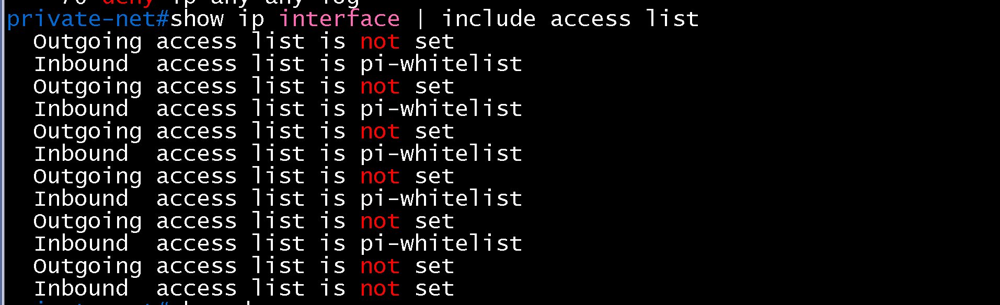
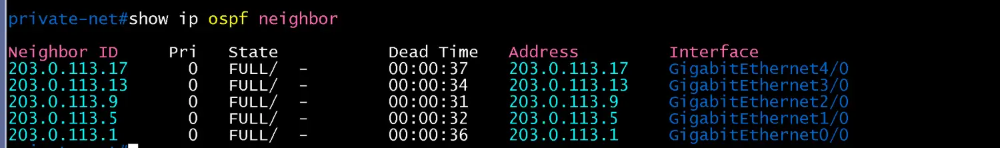
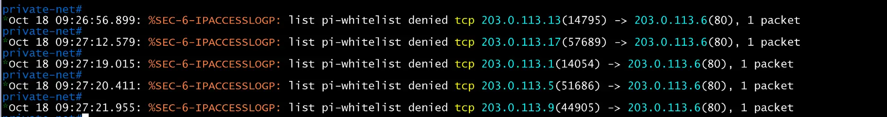
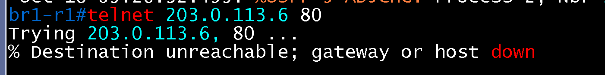
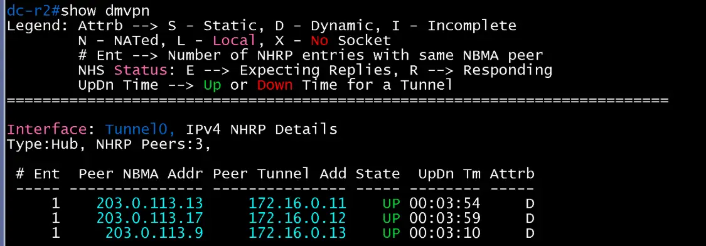

# Private Internet ACL 검증

- Jira: KAN-19
- 대상 장비: Private-net
- 기준 문서: [dmvpn-design.md](../../../docs/dmvpn-design.md) 5절
- 검증일: 2026-10-18

| 장비 | 명령 | 기대 결과 | 실제 결과 | 판정 |
|---|---|---|---|---|
| Private-net | `show ip access-lists pi-whitelist` | OSPF, GRE, ESP, UDP 500(isakmp), ICMP 허용 항목 카운트 증가 | 항목 10~70 구성 확인(`permit ospf` 224.0.0.5/224.0.0.6, `gre`, `esp`, `udp eq isakmp`, `icmp any any`, `deny ip any any log`). `ospf 224.0.0.5` 6 matches, `esp` 7 matches로 카운트 증가. GRE와 `isakmp`는 SA가 이미 수립된 상태라 이번 캡처에서는 0(재협상 시 증가 예상) | 통과 |
| Private-net | `show ip interface \| include access list` | 5개 링크 인터페이스에 `pi-whitelist` 입력 방향 적용 | 5개 인터페이스(Gi0/0~Gi4/0)에 `Inbound access list is pi-whitelist`, 6번째(Loopback0)는 not set. Outgoing은 모두 not set | 통과 |
| Private-net | `show ip ospf neighbor` | ACL 적용 후에도 사이트 5곳과 OSPF FULL | Gi0/0(203.0.113.1), Gi1/0(.5), Gi2/0(.9), Gi3/0(.13), Gi4/0(.17) 5개 이웃 모두 FULL | 통과 |
| DC-R2 | `show dmvpn` | ACL 적용 후에도 DMVPN 터널 유지 | Tunnel0 Type:Hub, NHRP Peers 3. 203.0.113.13(172.16.0.11), 203.0.113.17(172.16.0.12), 203.0.113.9(172.16.0.13) 모두 UP, Attrb D(Dynamic) | 통과 |
| 사이트 라우터 | `ping(차단 대상 프로토콜)` | 화이트리스트 외 트래픽 차단, 카운트 증가 | 5개 사이트 라우터(DC-R1, DC-R2, HQ-R2, BR1-R1, BR2-R2)에서 `telnet 203.0.113.6 80`(TCP 80)을 시도하면 모두 `% Destination unreachable; gateway or host down`으로 차단. Private-net에서 `%SEC-6-IPACCESSLOGP: list pi-whitelist denied tcp 203.0.113.{1,5,9,13,17}(포트) -> 203.0.113.6(80)` 로그 5건 확인 | 통과 |

`permit icmp any any`는 임시 항목이며 검증 후 제거.

Private-net show ip access-lists pi-whitelist

Private-net show ip interface | include access list

Private-net show ip ospf neighbor

Private-net deny 로그

DC-R1 telnet 차단

DC-R2 telnet 차단

HQ-R2 telnet 차단

BR1-R1 telnet 차단

BR2-R2 telnet 차단

DC-R2 show dmvpn (ACL 적용 후)

