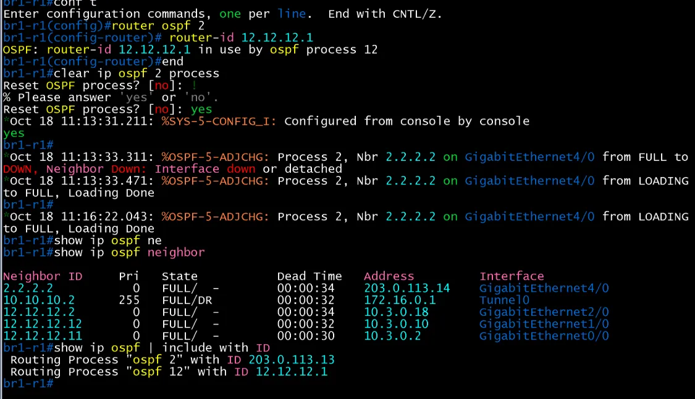

# Private Internet OSPF 검증

- Jira: KAN-20
- 대상 장비: Private-net, HQ-R2, DC-R1, DC-R2, BR1-R1, BR2-R2
- 기준 문서: [ospf-design.md](../../../docs/ospf-design.md) 5절
- 검증일: 2026-10-17

| 장비 | 명령 | 기대 결과 | 실제 결과 | 판정 |
|---|---|---|---|---|
| Private-net | `show ip ospf neighbor` | 프로세스 2, Area 100, 5개 링크 이웃 FULL | Gi0/0~Gi4/0 5개 이웃 모두 FULL/ -(P2P, Pri 0): 203.0.113.1(DC-R1), .5(DC-R2), .9(HQ-R2), .13(BR1-R1), .17(BR2-R2). 사이트 라우터의 Neighbor ID는 PI 인터페이스 IP로 표시(프로세스 2 router-id 재적용 전) | 통과 |
| DC-R1, DC-R2 | `show ip ospf neighbor` | Private-net과 FULL(프로세스 2) | DC-R1은 2.2.2.2(203.0.113.2, Gi2/0) FULL, DC-R2는 2.2.2.2(203.0.113.6, Gi2/0) FULL. 사이트 내부 이웃 10.10.10.11, 10.10.10.12도 FULL | 통과 |
| HQ-R2 | `show ip ospf neighbor` | Private-net과 FULL(프로세스 2) | 2.2.2.2(203.0.113.10, Gi4/0) FULL. 사이트 내부 이웃 11.11.11.1, .13, .12도 FULL | 통과 |
| BR1-R1 | `show ip ospf neighbor` | Private-net과 FULL(프로세스 2) | 2.2.2.2(203.0.113.14, Gi4/0) FULL. 사이트 내부 이웃 12.12.12.2, .12, .11도 FULL | 통과 |
| BR2-R2 | `show ip ospf neighbor` | Private-net과 FULL(프로세스 2) | 2.2.2.2(203.0.113.18, Gi4/0) FULL. 사이트 내부 이웃 13.13.13.1, .12, .11도 FULL | 통과 |
| BR1-R1 | `router ospf 2`에서 `router-id 12.12.12.1`(Loopback0, 사이트 프로세스 12와 같은 값) 입력 후 `clear ip ospf 2 process`, `show ip ospf \| include with ID` | 프로세스 2 Router ID를 Loopback0으로 변경 | `OSPF: router-id 12.12.12.1 in use by ospf process 12`로 거부되어 변경되지 않음. `Routing Process "ospf 2" with ID 203.0.113.13`(PI 연결 인터페이스 주소), `"ospf 12" with ID 12.12.12.1`. 같은 장비의 OSPF 프로세스는 Router ID를 겹쳐 쓸 수 없으므로 프로세스 2는 PI 인터페이스 주소를 명시해 사용(`docs/ospf-design.md` 2절) | 설계 변경(링크 주소 사용)으로 통과 |
| DC-R2 | `ping <상대 NBMA>` | DMVPN NBMA 주소(203.0.113.x) 간 도달 | 203.0.113.9(HQ-R2), 203.0.113.13(BR1-R1), 203.0.113.17(BR2-R2) 모두 5/5(100%), RTT 평균 82~92 ms | 통과 |

Private-net OSPF neighbor

DC-R1 OSPF neighbor

DC-R2 OSPF neighbor

HQ-R2 OSPF neighbor

BR1-R1 OSPF neighbor

BR2-R2 OSPF neighbor

DC-R2 NBMA ping(HQ-R2, BR1-R1, BR2-R2)

BR1-R1 프로세스 2 Router ID 거부(in use by ospf process 12)

