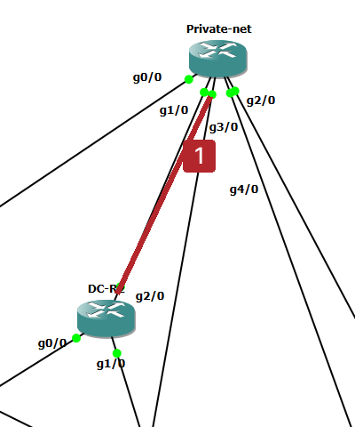
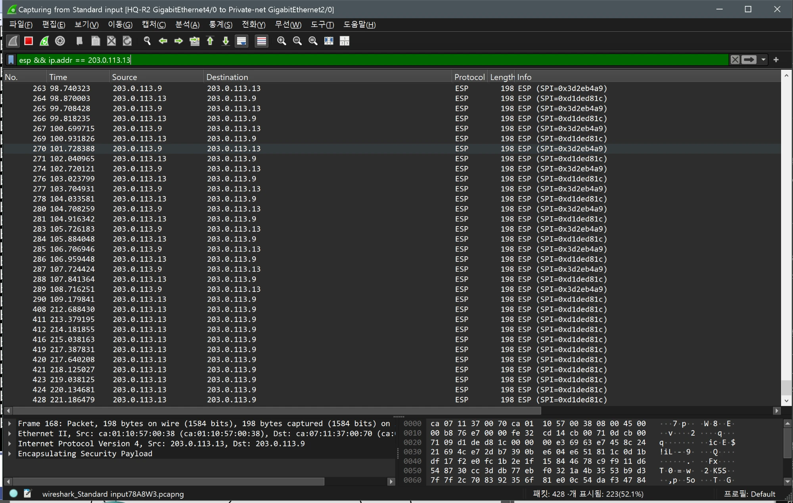
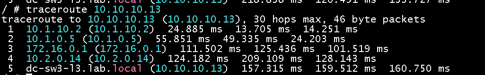
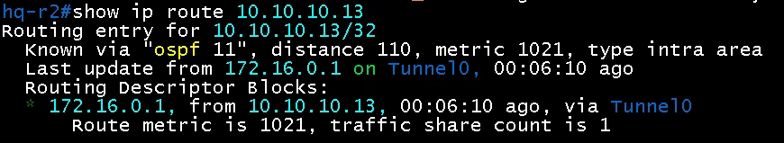
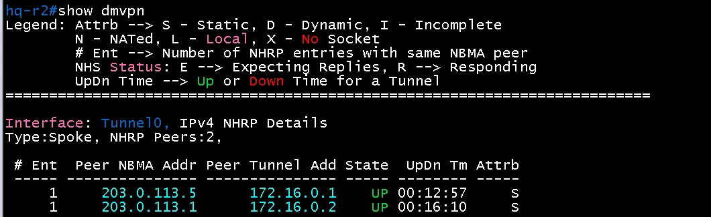
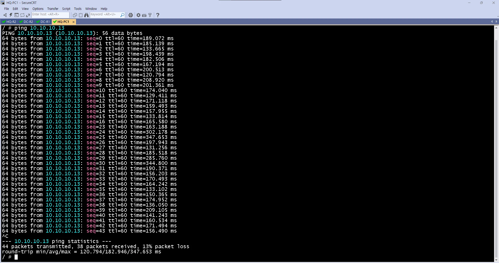
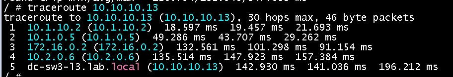
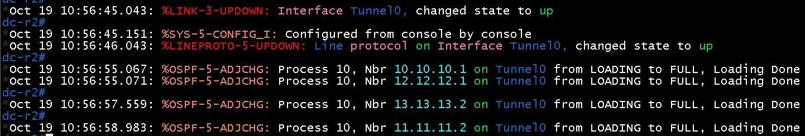
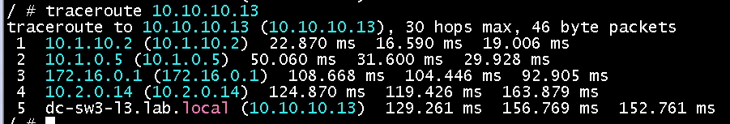

# DMVPN Hub 장애 시 동작

- Jira: KAN-30
- 대상 장비: DC-R2, HQ-R2, BR1-R1, BR2-R2
- 기준 문서: [dmvpn-design.md](../../docs/dmvpn-design.md)
- 검증일: 2026-10-18

## 장애 지점

빨간 선: DC-R2(Hub)와 Private-net 사이 링크, DC-R2 `interface tunnel 0` shutdown(언더레이 유지).

| 순서 | 동작 | 기대 결과 | 측정값 | 판정 |
|---|---|---|---|---|
| 1 | Hub(DC-R2) 중지 또는 Tunnel0 `shutdown` | Spoke의 NHRP 등록 끊김 | DC-R2 `interface tunnel 0` `shutdown` 후 `show ip interface tunnel 0`이 `administratively down`. DC-R2 `show dmvpn` 목록 비어 있음, `show ip ospf neighbor`에서 Tunnel0 이웃 3개 소실. HQ-R2 `show ip ospf neighbor`에서 Hub(`10.10.10.2`) 이웃 소실(`Dead timer expired`). Wireshark(HQ-R2 `Gi4/0` ↔ Private-net)에서 Hub(`203.0.113.5`) ESP 마지막 64.04초, 직후 64.35초 ISAKMP `Informational` | 통과 |
| 2 | Spoke 간 통신 | Hub 장애 후 Spoke 경로(OSPF)는 Dead 시간(약 40초) 뒤 소실되고 통신은 ISP(MPLS L3VPN) 경로로 우회 | 기존 shortcut(HQ-R2 `.9` ↔ BR1-R1 `.13`) ESP는 Hub 장애 후 약 44초(64.04 ~ 108.72초)만 유지된 뒤 중단. HQ-R2 `show ip route 10.3.10.0`은 `% Subnet not in table`. HQ-PC1 → BR1-PC1 `traceroute`가 `10.1.10.2 → 10.1.0.1 → 100.1.11.2 → 100.1.0.2 → 100.1.31.2 → 100.1.31.1 → 10.3.0.2 → 호스트`(8홉, ISP 경유), `ping` 응답 TTL 60에서 57로 변화, 294개 중 294개 응답(0%, 최대 1674.197 ms). 새 Spoke 쌍(BR2 ↔ BR1) 시험은 미실시 | 통과(기대 결과 수정), 새 Spoke 쌍 미실시 |
| 3 | Private Internet 경로 | Hub 장애와 무관하게 언더레이는 유지 | Hub 장애 중에도 Private-net 구간이 유지되어 HQ-R2 `Gi4/0`의 PI 이웃 `2.2.2.2`와 DC-R2 `Gi2/0`의 `2.2.2.2`가 `FULL` 유지, Spoke 간 ESP는 Private-net 링크로 계속 오감(약 44초) | 통과 |
| 4 | Hub 복구 | NHRP 재등록, OSPF 이웃 FULL 복귀 | `tunnel 0` `no shutdown` 후 `show ip interface tunnel 0`이 `up, line protocol up`. Wireshark에서 Hub가 168.88초에 IKE Main Mode로 응답, 169.53초에 Quick Mode 완료(장애 시작 64.35초 기준 약 105초). DC-R2 `show dmvpn`에 Spoke 3대 `UP`, DC-R2 `show ip ospf neighbor`에 Tunnel0 `FULL/DROTHER` 3개, HQ-R2 `show ip ospf neighbor`에 Hub `10.10.10.2` `FULL/DR` 복귀, `traceroute`가 다시 터널(`172.16.0.11`) 경유 | 통과 |

Hub가 하나뿐인 구조의 한계를 확인하는 시나리오.

## 시험 방법

- 장애: DC-R2에서 `interface tunnel 0` `shutdown`(Hub 터널만 내림, 언더레이는 유지).
- 연속 `ping`: HQ-PC1 → BR1-PC1 `10.3.10.217`. shortcut이 있는 상태에서 시작.
- Wireshark: HQ-R2 `Gi4/0` ↔ Private-net `Gi2/0`. 필터 `esp && ip.src == 203.0.113.5`(Hub ESP), `esp && ip.addr == 203.0.113.13`(shortcut ESP), `isakmp`.

## 관찰 정리

- Hub(`203.0.113.5`)의 마지막 ESP는 64.04초이고, 64.35초에 Hub가 ISAKMP `Informational`을 보냄.
- HQ-R2는 72.5초부터 10초 간격으로 Hub에 IKE Main Mode를 재시도했으나 응답을 받지 못함. 168.88초에 Hub가 응답해 169.53초에 Quick Mode 완료.
- shortcut ESP(`.9`↔`.13`)는 108.72초까지 오간 뒤 약 100초 동안 없다가, 212.69초부터 `.13`→`.9` 방향만 다시 보임(응답 방향이 터널로 돌아오는 비대칭 경로로 추정).
- Hub 중단 시간은 약 105초(64.35 ~ 168.88초). 설계 문서의 "기존 shortcut 유지"와 달리 약 44초 뒤 경로가 ISP로 넘어감.

## Hub 장애 중

DC-R2 `show ip interface tunnel 0`(administratively down)

DC-R2 `show dmvpn`(목록 비어 있음)

DC-R2 `show ip ospf neighbor`(Tunnel0 이웃 소실)

HQ-R2 `show ip ospf neighbor`(Hub 이웃 소실)

HQ-R2 `show ip route 10.3.10.0`

HQ-PC1 `traceroute` 10.3.10.217(ISP 경유)

Wireshark: Hub ESP(`ip.src == 203.0.113.5`)

Wireshark: shortcut ESP(`.9` ↔ `.13`) 유지 구간

Wireshark: shortcut ESP 중단 이후

HQ-PC1 `ping` 통계(0% 손실)

## 복구

DC-R2 `show ip interface tunnel 0`(up)

Wireshark(`isakmp`): 재시도와 복구(Main Mode, Quick Mode)

DC-R2 `show dmvpn`(Spoke 3대 UP)

DC-R2 `show ip ospf neighbor`(Tunnel0 FULL)

HQ-R2 `show ip ospf neighbor`(Hub FULL/DR)

HQ-PC1 `traceroute`(터널 경유 복귀)

## 백업 Hub(DC-R1) 전환 시험(2026-10-19)

Hub 이중화를 추가한 뒤의 시험. 설정은 [dmvpn-design.md](../../docs/dmvpn-design.md) 7절, 시험 목적지는 DC-SW3-L3 Loopback `10.10.10.13`(서버 VLAN은 DNS ACL로 ICMP가 막힘).

- 장애: DC-R2 `interface tunnel 0` `shutdown`(시각 `10:55:13` 이후), 복구: `no shutdown`(Tunnel0 up `10:56:45`).
- 연속 `ping`: HQ-PC1 → `10.10.10.13`.

| 순서 | 동작 | 기대 결과 | 측정값 | 판정 |
|---|---|---|---|---|
| 1 | 평상시 경로 | Spoke가 DC-R2(`172.16.0.1`)를 Hub로 사용 | HQ-PC1 `traceroute`의 3홉이 `172.16.0.1`. HQ-R2 `show ip route 10.10.10.13`이 OSPF 11, metric 1021, 다음 홉 `172.16.0.1`(Tunnel0). `show dmvpn`에 NHS `172.16.0.1`, `172.16.0.2` 모두 `UP`(`S`) | 통과 |
| 2 | DC-R2 Tunnel0 `shutdown` | 경로가 DC-R1(`172.16.0.2`)로 전환 | HQ-PC1 `traceroute`의 3홉이 `172.16.0.2`로 변경, 이후 홉은 `10.2.0.6` → `dc-sw3-l3`. ping 44개 전송, 38개 응답(손실 13%), 응답이 없던 구간은 `seq=17 ~ 22`(6개) | 통과 |
| 3 | Hub 복구 | DC-R2 Tunnel0 이웃 FULL 복귀, 평상시 경로로 복귀 | DC-R2 로그에서 Tunnel0 `up`(10:56:45-46) 후 OSPF 이웃 `10.10.10.1`, `12.12.12.1`, `13.13.13.2`, `11.11.11.2`가 `LOADING to FULL`(10:56:55 - 58). HQ-PC1 `traceroute`의 3홉이 다시 `172.16.0.1` | 통과 |

- 이전 시험(Hub 단일 구성)에서는 shortcut이 약 44초 뒤 중단되고 ISP(MPLS L3VPN) 경유 8홉으로 우회했으나, Hub 이중화 후에는 터널 안에서 DC-R1 경유로 전환되어 홉 수가 같은 5홉으로 유지됨.
- 손실 6개는 ping 간격(약 1초) 기준 약 6초에 해당. 이 값은 ping 출력에서 읽은 것이고, HQ-R2의 OSPF 이웃 소실 시각 로그는 확보하지 않아 전환 원인(OSPF Dead 시간, 타이머)은 확인하지 못함.
- 첫 시도에서는 DC-R1 Tunnel0에 `ip ospf cost 100`을 넣었으나 평상시에도 `172.16.0.2`가 선택됨(OSPF에서 전송망에서 라우터로 들어가는 비용이 0이라 Hub의 터널 비용이 Spoke 경로 비용에 반영되지 않음). 비용을 DC-R1의 DC 내부 링크(`gi0/0`, `gi1/0`)로 옮긴 뒤 평상시 경로가 `172.16.0.1`로 바뀜.
- DC-R1이 먼저 올라와 DR이 되었고 DC-R2는 BDR(`FULL/BDR`). 평상시 경로는 비용으로 결정되어 DR 역할과는 무관.

HQ-PC1 `traceroute 10.10.10.13`(평상시, 3홉 `172.16.0.1`)

HQ-R2 `show ip route 10.10.10.13`(평상시)

HQ-R2 `show dmvpn`(NHS 2개 UP)

DC-R2 `show clock`(장애 시작 직전)

HQ-PC1 `ping 10.10.10.13` 통계(장애 중, 13% 손실)

HQ-PC1 `traceroute 10.10.10.13`(장애 후, 3홉 `172.16.0.2`)

DC-R2 로그(Tunnel0 up과 OSPF 이웃 FULL 복귀)

HQ-PC1 `traceroute 10.10.10.13`(복구 후, 3홉 `172.16.0.1`)

