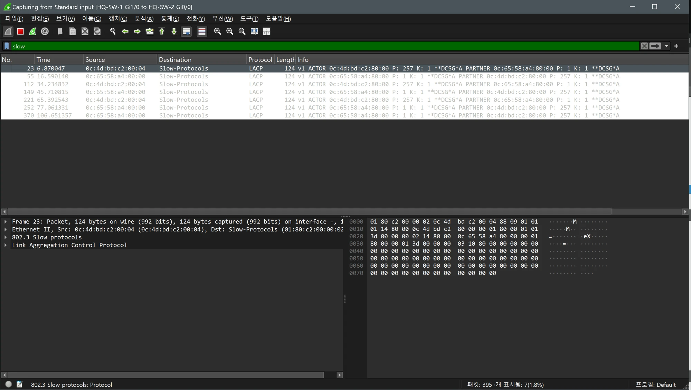
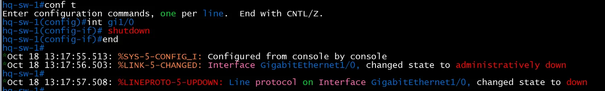
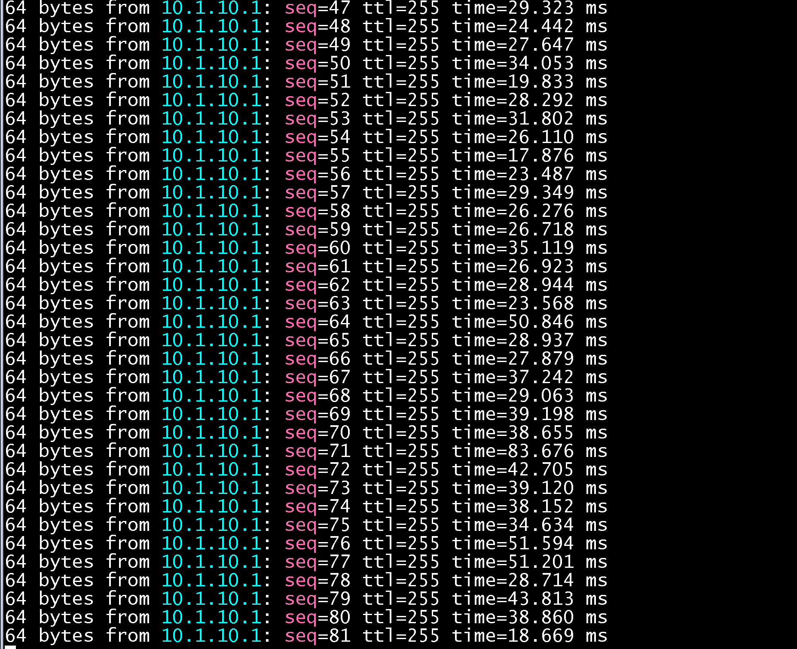
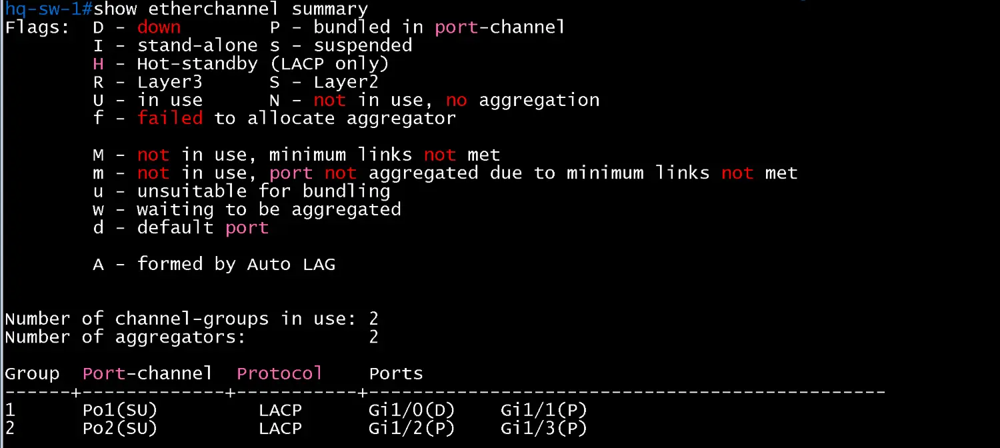
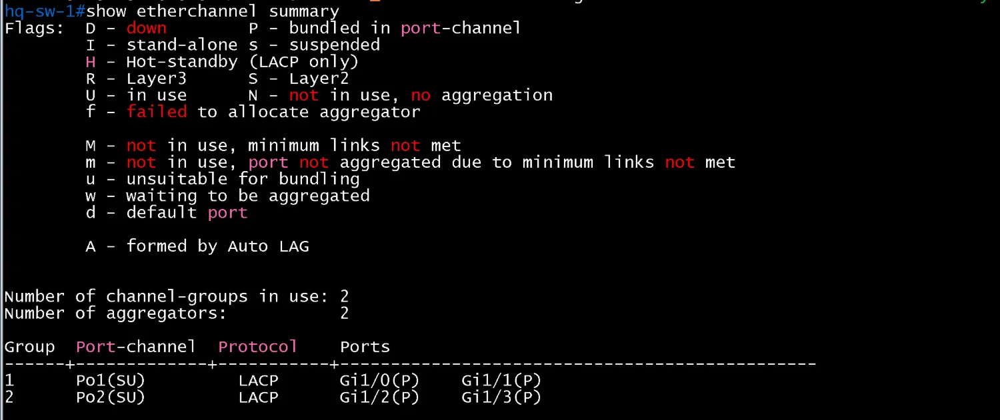
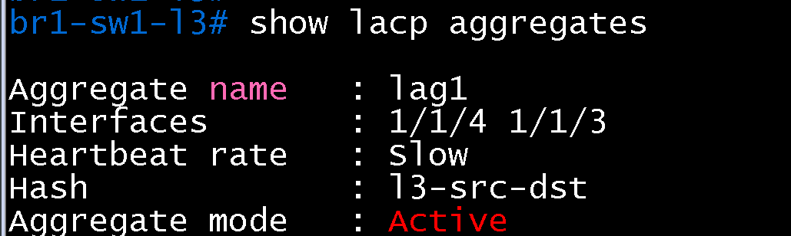
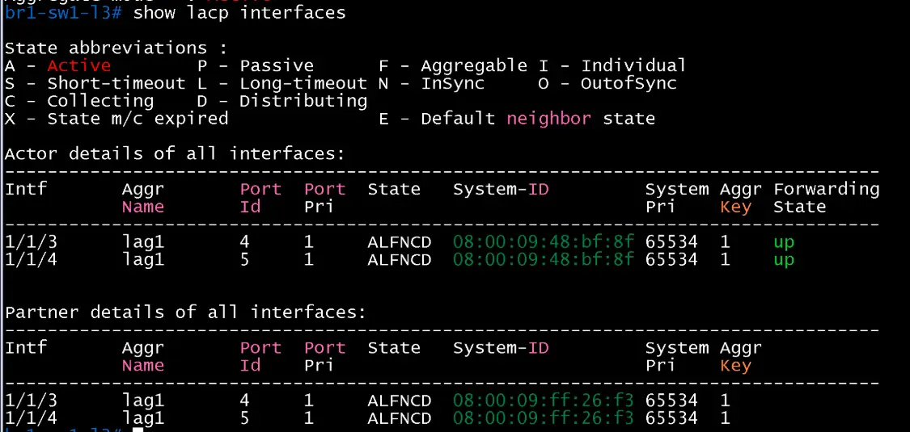
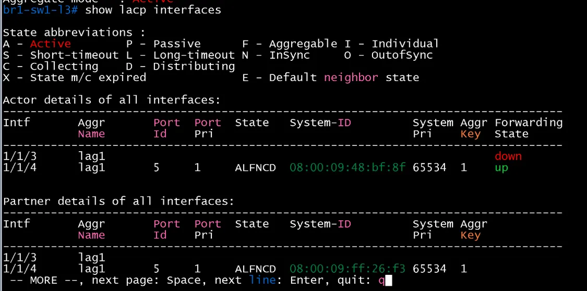
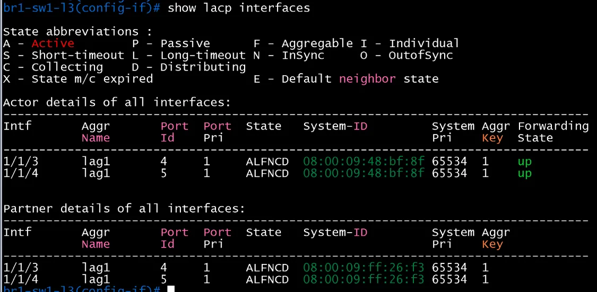

# EtherChannel 멤버 다운 실측

- Jira: KAN-28
- 대상 장비: HQ Po1~Po3, DC Po1, BR1 Po1, BR2 Po1
- 기준 문서: [vlan-design.md](../../docs/vlan-design.md) 4절
- 검증일: 2026-10-18

| 순서 | 동작 | 기대 결과 | 측정값 | 판정 |
|---|---|---|---|---|
| 1 | 트래픽(`ping`) 연속 실행 | 응답 정상 | HQ-PC1(VIP `10.1.10.1`), BR1-PC1(VIP `10.3.10.1`), DC-DNS-1(`10.2.50.1`)에서 모두 정상 응답 | 통과 |
| 2 | 채널 멤버 포트 하나 `shutdown` | 채널 유지(남은 멤버 `P`), 패킷 손실 최소 | Cisco(HQ Po1): 채널 유지, 손실 1개(94개 중). Aruba(BR1 LAG 1): LAG 유지, 손실 5개(49개 중), 최대 지연 5초. Arista(DC MLAG): 손실 1개 | 통과 |
| 3 | 나머지 멤버도 `shutdown` | 채널 다운, STP 재계산으로 대체 경로 사용 | 시험하지 않음(멤버 하나 다운과 복구까지를 대표 시험 범위로 정함) | 미실시 |
| 4 | 멤버 복구 | 채널 정상 복귀 | Cisco `Po1(SU)` `Gi1/0(P)`, `Gi1/1(P)` 복귀, Aruba `1/1/3`, `1/1/4` 모두 `ALFNCD`, `up` 복귀, Arista `Active-full 2` 복귀 | 통과 |

- DC MLAG 포트(`DC-SW3-L3` Et7 다운)에서의 결과는 [dc/distribution/mlag.md](../dc/distribution/mlag.md) 참조(연속 ping 1개 손실, 복구 후 Active-full 2).

## 시험 범위

- 벤더별 대표 시험: Cisco(HQ Po1), Aruba(BR1 LAG 1), Arista(DC MLAG `Po10`). 같은 Cisco 구성인 HQ Po2, Po3, BR2 Po1은 대표 시험으로 대체하고 개별 시험은 하지 않음.

## 사이트별 결과

### HQ Po1(HQ-SW-1 ↔ HQ-SW-2, 멤버 Gi1/0, Gi1/1)

| 순서 | 동작 | 측정값 | 판정 |
|---|---|---|---|
| 1 | HQ-PC1에서 VIP `10.1.10.1`로 연속 `ping` | 응답 정상(`ttl=255`, 17~50ms) | 통과 |
| 2 | Wireshark(`HQ-SW-1 Gi1/0 to HQ-SW-2 Gi0/0`, 필터 `slow`)로 시험 전 LACP 확인 | 양쪽 LACP PDU가 약 30초 간격(6.87, 16.59, 34.23, 45.71, 65.39, 77.06, 106.65초)으로 교환, 상태 플래그 `**DCSG*A`(Distributing, Collecting, Synchronization, Aggregation, Activity) | 통과 |
| 3 | HQ-SW-1 `Gi1/0` `shutdown` | 13:17:56.503 `administratively down`, 13:17:57.508 `Line protocol down`. `show etherchannel summary`에서 `Po1(SU)` 유지, `Gi1/0(D)`, `Gi1/1(P)`(`Po2(SU)`는 `Gi1/2(P)`, `Gi1/3(P)`로 영향 없음). ping은 94개 전송, 93개 응답, 손실 1개(1%), 최대 83.676ms(약 1초 단절) | 통과 |
| 4 | `Gi1/0` `no shutdown` 후 `Po1` 복귀 | `show etherchannel summary`에서 `Po1(SU)`에 `Gi1/0(P)`, `Gi1/1(P)`로 두 멤버 복귀, `Po2(SU)`도 `Gi1/2(P)`, `Gi1/3(P)` 유지 | 통과 |

HQ-SW-1 Gi1/0 ↔ HQ-SW-2 Gi0/0 LACP(시험 전)

HQ-SW-1 Gi1/0 shutdown 로그

HQ-PC1 연속 ping(seq 47~81)

HQ-PC1 ping 통계(94 전송, 93 응답)

HQ-SW-1 show etherchannel summary(Gi1/0 다운)

HQ-SW-1 show etherchannel summary(복구 후)

### BR1 LAG 1(BR1-SW1-L3 ↔ BR1-SW2-L3, Aruba, 멤버 1/1/3, 1/1/4)

| 순서 | 동작 | 측정값 | 판정 |
|---|---|---|---|
| 1 | `show lacp aggregates`, `show lacp interfaces`로 시험 전 상태 확인 | `lag1`(Interfaces `1/1/4`, `1/1/3`, Heartbeat rate Slow, Hash `l3-src-dst`, mode Active). `1/1/3`, `1/1/4` 모두 상태 `ALFNCD`, Forwarding `up`, 파트너 시스템 ID `08:00:09:ff:26:f3` | 통과 |
| 2 | BR1-PC1에서 VLAN 10 VIP `10.3.10.1`로 연속 `ping` 후 BR1-SW1-L3 `1/1/3` `shutdown` | `1/1/3` Forwarding `down`, `1/1/4`는 `ALFNCD`, `up` 유지(LAG 유지). ping은 49개 전송, 44개 응답, 손실 5개(10%), 응답 시간 최소 271.856ms, 평균 1392.107ms, 최대 5015.049ms(전환 중 트래픽이 약 5초 흔들림) | 통과 |
| 3 | `1/1/3` `no shutdown` 후 `lag1` 복귀 | `show lacp interfaces`에서 `1/1/3`, `1/1/4` 모두 `ALFNCD`, Forwarding `up`으로 복귀, 파트너도 `ALFNCD` | 통과 |

- Cisco(HQ Po1, 손실 1개, 약 1초)와 비교해 Aruba(가상 AOS-CX)는 손실 5개와 최대 지연 5초로 전환이 더 오래 걸림. 원인은 이 시험만으로 확정하지 못함(가상 이미지의 전환 처리, 호스트 부하 등).

BR1-SW1-L3 show lacp aggregates

BR1-SW1-L3 show lacp interfaces(시험 전)

BR1-SW1-L3 show lacp interfaces(1/1/3 다운)

BR1-PC1 ping 통계(49 전송, 44 응답)

BR1-SW1-L3 show lacp interfaces(복구 후)

