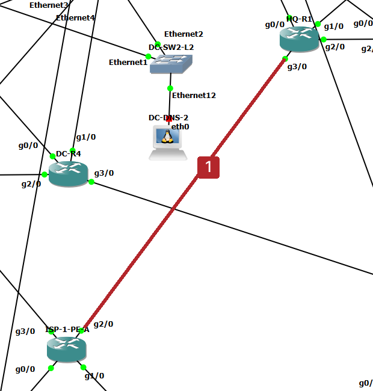
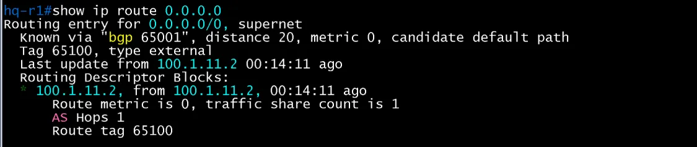

# ISP-1 장애 시 ISP-2, DMVPN 전환

- Jira: KAN-29
- 대상 장비: ISP-1 PE-A, HQ-R1, DC-R3, BR1, BR2 및 DMVPN
- 기준 문서: [bgp-design.md](../../docs/bgp-design.md), [ospf-design.md](../../docs/ospf-design.md) 6절
- 검증일: 2026-10-18

## 장애 지점

빨간 선: HQ-R1 g3/0과 ISP-1-PE-A g2/0 사이 링크(링크 6). ISP-1 PE 쪽 인터페이스를 shutdown.

| 순서 | 동작 | 기대 결과 | 측정값 | 판정 |
|---|---|---|---|---|
| 1 | ISP-1 장애 유발(링크 `shutdown` 또는 PE-A 중지) | BGP hold-time(9초) 이내에 세션 다운 감지 | ISP-1 PE 쪽 인터페이스 `shutdown`(PE-A `Gi2/0` 등). Wireshark(HQ-R1 `Gi3/0` ↔ ISP-1-PE-A `Gi2/0`, `bgp`)에서 시험 전 Keepalive는 양쪽 약 3초 간격. PE-A(`100.1.11.2`)의 마지막 Keepalive 464.93초, HQ-R1(`100.1.11.1`)의 `NOTIFICATION` 474.61초로 약 9.7초 뒤 세션 종료(패킷 바이트상 오류 코드 4, Hold Timer Expired) | 통과 |
| 2 | 사이트 엣지 라우터의 BGP 세션, 기본 경로 | PE와 세션 Down, BGP 기본 경로 `B*` 제거 | HQ-R1 `show ip bgp summary`에서 `100.1.11.2`가 `Idle`, DC-R3 `100.1.21.2`가 `Active`. HQ-R1의 기본 경로는 BGP가 아니라 OSPF로 바뀜(3행) | 통과 |
| 3 | 기본 경로 광고 | `default-information originate`가 ISP-2 쪽(metric 200)으로 전환 | HQ-R2 `show ip route 0.0.0.0`: BGP 65001, AD 20, 다음 홉 `100.2.12.2`(ISP-2-PE-A, tag 65200). HQ-R1은 OSPF 11 외부 경로 E1, metric 201(다음 홉 `10.1.0.18`, HQ-R2 `11.11.11.2` 광고)로 기본 경로를 학습 | 통과 |
| 4 | 사이트 간 통신 | DMVPN(Private Internet) 경로로 유지 | 시험 전 `traceroute`(HQ-PC1 → BR1-PC1)가 `10.1.10.2 → 10.1.0.5 → 172.16.0.11(터널) → 10.3.0.2`로 처음부터 DMVPN 경로. 장애 중 HQ-PC1 → BR1-PC1 `ping` 6개 중 6개 응답(0%), 시험 중 다른 `ping` 61개 중 61개 응답(0%). HQ-R2 `show dmvpn`에서 Hub(`203.0.113.5`, `S`) UP 유지(시험 전 있던 BR1-R1 shortcut `D` 항목은 목록에서 사라졌으며 ISP-1 장애와의 관계는 확인하지 못함, 트래픽 없는 상태로 추정) | 통과 |
| 5 | 복구 | ISP-1 경로로 복귀 | `no shutdown` 후 Wireshark에서 HQ-R1 `OPEN` 596.49초, PE-A `OPEN` 596.52초, PE-A `UPDATE` 598.10초로 약 1.6초 안에 세션 수립과 경로 교환 완료. 복구 후 HQ-R1 `show ip route 0.0.0.0`이 다시 BGP 65001, AD 20, 다음 홉 `100.1.11.2`(tag 65100)로 복귀 | 통과 |

## 시험 방법

- 장애: ISP-1 PE 쪽 인터페이스를 `shutdown`(사이트 라우터 쪽은 up 유지). 사이트 라우터는 hold-time 만료로 세션 단절을 감지함.
- 시험 시간: 약 122초(PE-A 마지막 Keepalive 464.93초 ~ 복구 후 OPEN 596.49초).
- 한계: 장애 중 BR1-R1, BR2-R1 화면은 확보하지 못함.

## 시험 전(기준값)

HQ-R1 `show ip bgp summary`

HQ-R1 `show ip route 0.0.0.0`

DC-R3 `show ip bgp summary`

DC-R3 `show ip route 0.0.0.0`

BR1-R1 `show ip bgp summary`

BR1-R1 `show ip route 0.0.0.0`

BR2-R2(ISP-2 연결) `show ip bgp summary`

BR2-R2 `show ip route 0.0.0.0`

HQ-R2 `show dmvpn`(BR1-R1 shortcut 포함)

DC-R2 `show dmvpn`(Hub, Spoke 3대)

`traceroute` HQ-PC1 → BR1-PC1(DMVPN 터널 경유)

Wireshark(`bgp`) 시험 전 Keepalive

## 장애 중

Wireshark: PE-A 마지막 Keepalive 후 HQ-R1 `NOTIFICATION`

HQ-R1 `show ip bgp summary`(Idle)

HQ-R1 `show ip route 0.0.0.0`(OSPF E1 201)

HQ-R2 `show ip route 0.0.0.0`(ISP-2 BGP 경로)

DC-R3 `show ip bgp summary`(Active)

HQ-R2 `show dmvpn`(Hub UP)

HQ-PC1 → BR1-PC1 `ping`(장애 중)

HQ-PC1 → BR1-PC1 `ping` 통계

## 복구

Wireshark: `no shutdown` 후 `OPEN`, `UPDATE`

복구 후 HQ-R1 `show ip route 0.0.0.0`(BGP 경로 복귀)

