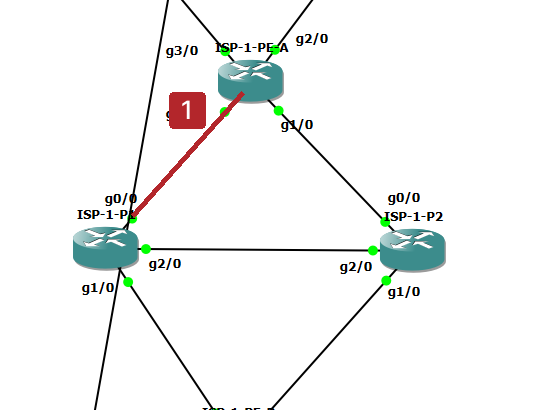
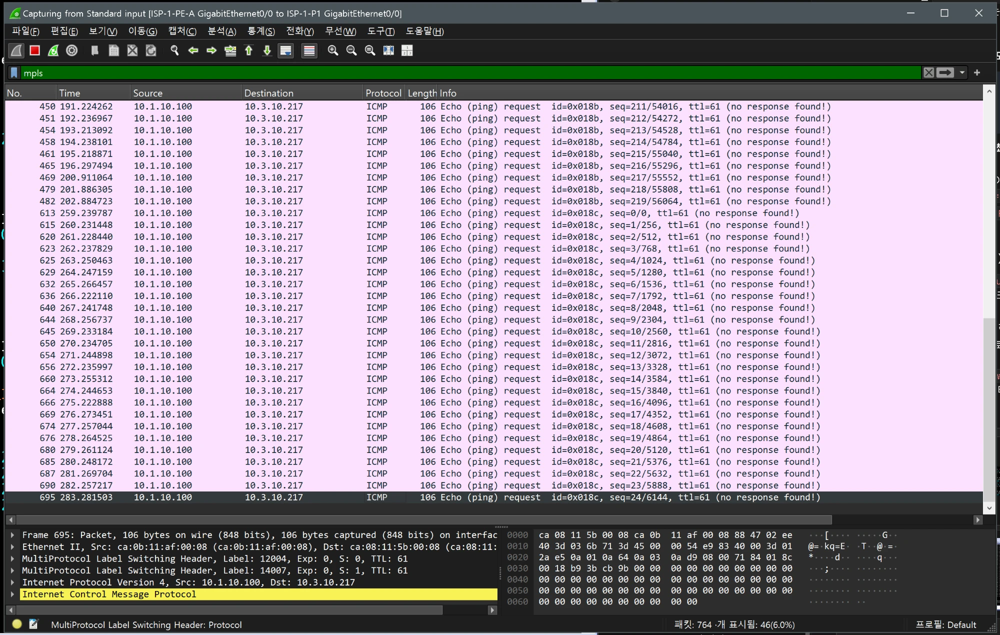

# MPLS 레이블 경로 실측 (Hub 장애로 ISP 경유 유도)

- Jira: KAN-34, KAN-35 보강(Wireshark로 레이블 스택 확인)
- 대상 장비: ISP-1-PE-A, ISP-1-P1, DC-R2(Hub), HQ-PC1, BR1-PC1
- 기준 문서: [mpls-design.md](../../docs/mpls-design.md), [isp1/core/mpls.md](../isp1/core/mpls.md)
- 검증일: 2026-10-19
- 캡처 링크: `ISP-1-PE-A Gi0/0 ↔ ISP-1-P1 Gi0/0`(링크 71), `ISP-1-PE-B Gi0/0 ↔ ISP-1-P1 Gi1/0`(링크 73), 필터 `mpls`

평상시 사이트 간 트래픽은 DMVPN을 타서 ISP 링크에 MPLS가 나타나지 않음. DC-R2 `tunnel 0`을 내려 트래픽이 ISP(MPLS L3VPN)로 넘어갈 때 레이블 스택을 확인.

## 확인 지점

빨간 선: ISP-1-PE-A g0/0과 ISP-1-P1 g0/0 사이 링크(링크 71). DMVPN Hub 장애로 트래픽이 ISP 경로로 넘어간 상태에서 캡처.

| 순서 | 동작 | 기대 결과 | 측정값 | 판정 |
|---|---|---|---|---|
| 1 | 평상시 링크 71에서 `mpls` 필터 | MPLS 패킷 없음(DMVPN 경로 사용) | 32개 캡처, `mpls` 표시 0개 | 통과 |
| 2 | ISP-1-PE-A `show mpls ldp neighbor`, `show mpls forwarding-table` | P1, P2 LDP 이웃 Oper, PE-B Loopback(`100.100.100.4/32`)의 레이블 경로 | LDP 이웃 P1(`100.100.100.2`, Gi0/0), P2(`100.100.100.3`, Gi1/0) 모두 Oper(약 6시간). 전달 테이블에서 `100.100.100.4/32`는 로컬 레이블 11000, 나가는 레이블 `12004`(Gi0/0, 다음 홉 `100.1.0.2`)와 `13000`(Gi1/0, `100.1.0.6`)의 2경로. VRF 경로 `10.2.0.0/16`(레이블 11006, Gi3/0), `10.1.0.0/16`(11007, Gi2/0)은 `No Label [V]` | 통과 |
| 3 | DC-R2 `tunnel 0` `shutdown`, HQ-PC1 → BR1-PC1 연속 `ping` | 트래픽이 ISP 경로로 전환 | `show ip int tunnel 0`이 `administratively down`. `ping` 응답 TTL이 `seq=197`까지 60, `seq=198`부터 57로 바뀜. 220개 중 219개 응답(손실 1, 최대 2247.742 ms) | 통과 |
| 4 | 링크 71에서 `mpls` 패킷 확인 | 레이블 2개(바깥 LDP, 안쪽 VPN) | `10.1.10.100` → `10.3.10.217` ICMP Echo 요청에 MPLS 헤더 2개. 바깥 `Label 12004`(S=0, TTL 61), 안쪽 `Label 14007`(S=1, TTL 61). 바깥 레이블 12004는 2행 전달 테이블의 `100.100.100.4/32` 나가는 레이블(Gi0/0)과 일치 | 통과 |
| 5 | 안쪽 레이블 14007의 의미 | PE-B가 광고한 VPN 레이블 | ISP-1-PE-B `show ip bgp vpnv4 vrf corp labels`에서 `10.3.0.0/16`(다음 홉 `100.1.31.1`, BR1-R1)의 In label이 `14007`(`10.4.0.0/16`은 `14006`). 안쪽 레이블 14007은 PE-B가 BR1 prefix에 부여한 VPN 레이블 | 통과 |
| 6 | 링크 73(`ISP-1-PE-B ↔ ISP-1-P1`)에서 PHP 확인 | VPN 레이블 1개만 보임 | 링크 73(`ISP-1-PE-B Gi0/0 ↔ ISP-1-P1 Gi1/0`)의 MPLS 패킷에 `Label 14007`(S=1, TTL 60) 한 개만 있음. 링크 71의 바깥 레이블 12004는 P1에서 제거됨(PHP) | 통과 |
| 7 | ISP 내부 링크 장애(PE-A `Gi0/0` `shutdown`) 후 P2 경로 전환 | LDP 이웃 P1 소실, P2 경로로 레이블 변경 | PE-A `show interfaces gi0/0`이 `administratively down, line protocol is down`. PE-A `show mpls ldp neighbor`에 P1(`100.100.100.2`)이 사라지고 P2(`100.100.100.3`, `Gi1/0`)만 남음. P2 방향 링크 72의 레이블 캡처와 이 구간 `ping` 손실은 확인하지 못함 | 일부 확인(LDP 이웃 소실) |
| 8 | 복구: DC-R2 `tunnel 0` `no shutdown` | 터널 경로 복귀 | `show ip int tunnel 0`이 `up, line protocol up`. `ping` TTL 60 복귀와 `traceroute` 경로는 확인하지 못함 | 일부 확인 |

## 관찰

- 링크 73 캡처는 PE-A `Gi0/0` 장애 전후 중 어느 시점인지 기록하지 못함(장애 후라면 PE-A → P2 → P1 → PE-B 경로일 수 있음, 추정).
- 링크 71에서는 Echo 요청만 보이고 Wireshark가 `no response found`로 표시. 응답이 이 링크로 돌아오지 않는 것으로 보아 응답은 다른 경로(P2 또는 터널)로 돌아오는 비대칭 경로로 추정(확인하지 못함).
- TTL 60에서 57로 바뀐 것은 경로가 터널(DMVPN)에서 ISP 경유로 바뀐 증거(Hub 장애 시험의 `traceroute` 8홉 결과와 같은 방향).

## 캡처

링크 71 Wireshark(`mpls`) 평상시: 표시 0개

ISP-1-PE-A `show mpls ldp neighbor`

ISP-1-PE-A `show mpls forwarding-table`

HQ-PC1 `ping`(TTL 60, 터널 경유)

DC-R2 `show ip int tunnel 0`(administratively down)

HQ-PC1 `ping` TTL 60에서 57로 전환, 통계

Wireshark: MPLS 레이블 스택(12004, 14007)

DC-R2 `show ip int tunnel 0`(복구, up)

ISP-1-PE-B `show ip bgp vpnv4 vrf corp labels`(10.3.0.0/16 In label 14007)

링크 73 Wireshark(`mpls`): VPN 레이블 14007 하나만(PHP)

ISP-1-PE-A `show interfaces gi0/0`(administratively down)

ISP-1-PE-A `show mpls ldp neighbor`(P2만 남음)

