# VRRP 장애 전환 실측

- Jira: KAN-27
- 대상 장비: HQ-SW-2/3, DC-SW3-L3/SW4-L3, BR1-SW1-L3/SW2-L3, BR2-SW1-L3/SW2-L3
- 기준 문서: [vrrp-mstp-design.md](../../docs/vrrp-mstp-design.md) 2절
- 검증일: 2026-10-18(HQ, DC, BR1)

## 장애 지점

빨간 선은 VRRP 광고가 지나는 스위치 간 링크이며 각 사이트에서 SVI를 shutdown.

HQ(Cisco): HQ-SW-2 ↔ HQ-SW-3 Gi0/2, Vl10 shutdown

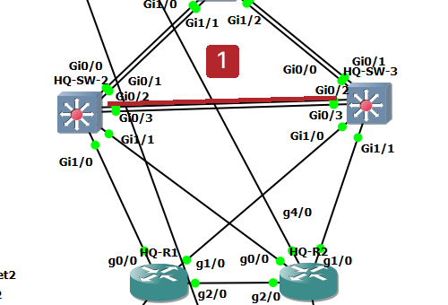

DC(Arista): DC-SW3-L3 ↔ DC-SW4-L3 Eth6, Vl50 shutdown

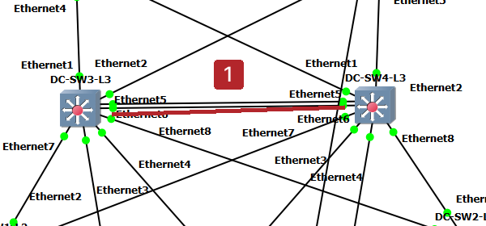

BR1(Aruba): BR1-SW1-L3 ↔ BR1-SW2-L3 1/1/4, vlan10 shutdown

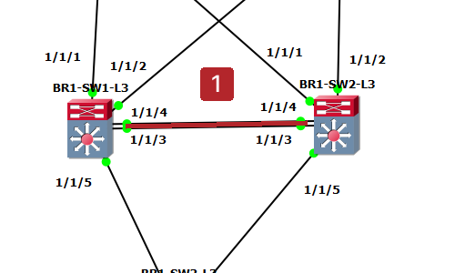

| 순서 | 동작 | 기대 결과 | 측정값 | 판정 |
|---|---|---|---|---|
| 1 | 호스트에서 VIP로 연속 `ping` 시작 | 응답 정상 | HQ: HQ-PC1에서 `ping 10.1.10.1` 시작, 응답 정상. 시험 전 HQ-SW-2 Master(우선순위 110), HQ-SW-3 Backup(우선순위 90, Master addr `10.1.10.2`) | 통과(HQ, DC, BR1) |
| 2 | Active 장비의 사용자 VLAN SVI `shutdown` | Backup이 Master로 전환, 호스트 `ping` 중단 시간 측정 | HQ: HQ-SW-2 `interface vlan 10` `shutdown`(13:31:46) 후 Vl10 `Init`(Vl20은 `Master` 유지). HQ-SW-3이 Master로 전환해 Wireshark에서 `10.1.10.3`이 약 1초 간격으로 광고 전송. 시험 전체 `ping` 29개 중 28개 응답(손실 1, 3%, 최대 80.308 ms). DC: DC-SW3-L3 `interface vlan 50` `shutdown` 후 DC-SW4-L3이 Master 전환(`Last Transition 00:00:00 ago`). Wireshark에서 SW-3(`10.2.50.2`) 마지막 광고 189.80초, SW-4(`10.2.50.3`) 첫 광고 192.96초로 약 3.2초 공백(우선순위 0 광고 없이 Master-down 타이머 만료로 전환). DC-DNS-1 `ping 10.2.50.1` 119개 중 114개 응답(손실 5, 4.2%, 최대 551.311 ms). BR1: BR1-SW1-L3 `interface vlan 10` `shutdown` 후 BR1-SW2-L3 vlan10 `MASTER`(Master addr `10.3.10.3`), vlan20은 `BACKUP` 유지. Wireshark에서 SW-1(`10.3.10.2`) vlan10 마지막 광고 41.37초, SW-2(`10.3.10.3`) 첫 광고 45.35초로 약 3.97초 공백. BR1-PC1 `ping 10.3.10.1` 175개 중 107개 응답(손실 68, 38%, 최대 375.911 ms)이나 이 손실은 전환 구간만이 아니라 시험 전체(복구 구간 포함) 값으로 전환 시간으로는 사용하지 않음 | 통과(HQ, DC, BR1) |
| 3 | SVI `no shutdown`(Arista는 `no shutdown`) | `preempt`로 Active가 Master 복귀, 중단 시간 측정 | HQ: HQ-SW-2 `no shutdown` 후 13:32:25 `%VRRP-6-STATECHANGE: Vl10 Grp 10 state Backup -> Master`, `show vrrp brief`에서 Vl10 `Master` 복귀. 위 `ping` 통계(손실 1)는 전환·복귀 전체 합계. DC: DC-SW3-L3 `no shutdown` 후 Vl50 `Master`(`Last Transition 00:00:01 ago`) 복귀. DC-SW4-L3은 `Backup`으로 복귀(`Last Transition 00:00:01 ago`). BR1: BR1-SW1-L3 vlan10 `no shutdown` 후 `MASTER`(우선순위 110) 복귀, BR1-SW2-L3 vlan10은 `BACKUP`으로 복귀 | 통과(HQ, DC, BR1) |
| 4 | 사이트별 반복 | 모든 사이트에서 동일 결과 | 벤더별 대표 시험(HQ Cisco, DC Arista, BR1 Aruba)에서 모두 Backup이 Master로 전환되고 `preempt`로 복귀. 전환 시간은 HQ 약 1초(`ping` 손실 1), DC 약 3.2초, BR1 약 4.0초 | 통과 |

중단 시간은 측정값 열에 초 단위로 기록하고 면접용 근거로 사용.

## 시험 범위

- 벤더별 대표 시험: Cisco(HQ), Arista(DC), Aruba(BR1). BR2는 HQ와 같은 Cisco 구성이라 대표 시험으로 대체하고 개별 시험은 하지 않음. 4번 행(사이트별 반복)은 이 범위로 판정.

## HQ 결과(Cisco, VLAN 10 / VIP 10.1.10.1)

- 시험 전: HQ-SW-2 Master(우선순위 110), HQ-SW-3 Backup(우선순위 90).
- 중단: HQ-SW-2 `interface vlan 10` `shutdown` → Vl10 `Init`, HQ-SW-3 Master 전환. VLAN 20은 영향 없이 HQ-SW-2 `Master` 유지.
- 복구: `no shutdown` → `preempt`로 HQ-SW-2가 Vl10 Master 복귀.
- `ping` 손실 1개(약 1초, 최대 응답 80.308 ms). Wireshark 캡처는 전환 후 HQ-SW-3의 광고(약 1초 간격)만 보여 광고 중단 시점의 정밀 측정은 없음.

HQ-SW-3 시험 전 `show vrrp brief`

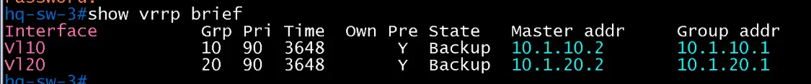

HQ-SW-2 시험 전 `show vrrp brief`

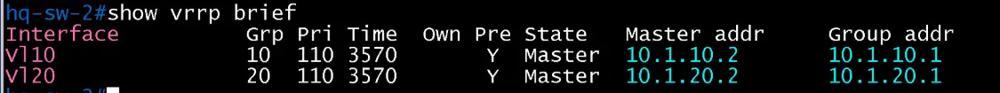

HQ-SW-2 Vl10 `shutdown` 후

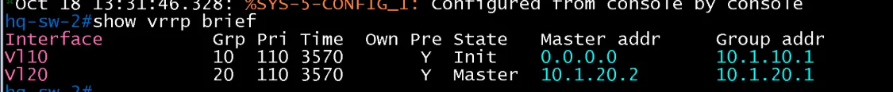

Wireshark(`vrrp`): HQ-SW-3(`10.1.10.3`)의 Master 광고

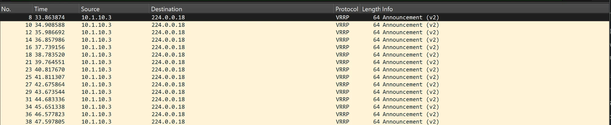

`ping` 통계

`no shutdown` 후 `preempt`로 Master 복귀

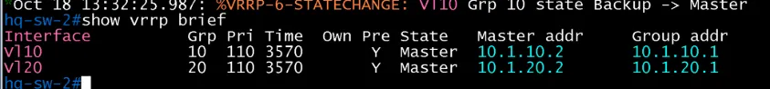

## DC 결과(Arista vEOS-lab, VLAN 50 / VIP 10.2.50.1)

- 시험 전: DC-SW3-L3 Master(우선순위 110), DC-SW4-L3 Backup(우선순위 90).
- 중단: DC-SW3-L3 Vl50 shutdown → show vrrp brief 비어 있음, DC-SW4-L3 Master 전환.
- 전환 시간: Wireshark 기준 SW-3 마지막 광고(189.798612)에서 SW-4 첫 광고(192.958333)까지 약 3.16초. HQ(Cisco, 손실 약 1초)보다 길고 ping 손실도 5개로 큼.
- 복구: `no shutdown` → DC-SW3-L3 Vl50 Master 복귀, DC-SW4-L3 Backup 복귀.
- 한계: 아래 Wireshark 캡처 일부(SW-4 광고 구간)는 전환 시점이 다른 구간이라 시각 대응은 하지 않음.

DC-SW3-L3 시험 전 show vrrp brief

DC-SW4-L3 시험 전 show vrrp brief

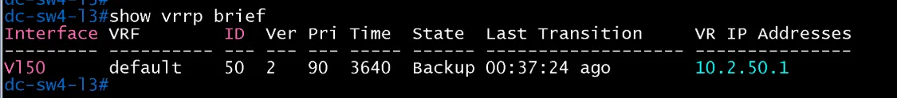

Wireshark(rrp): 시험 전 SW-3(10.2.50.2) 광고

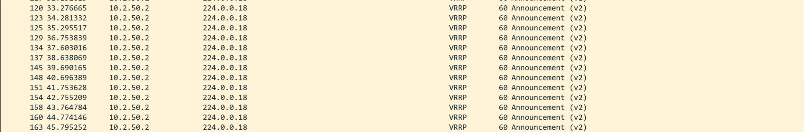

DC-SW3-L3 Vl50 shutdown 후

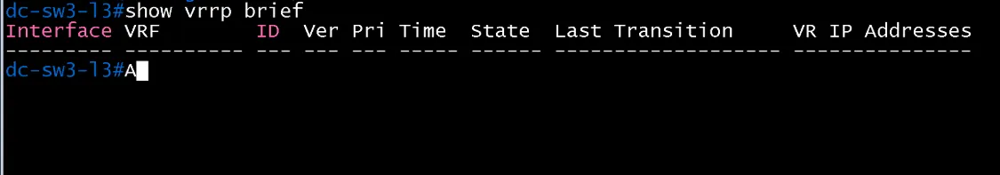

DC-SW4-L3 Master 전환

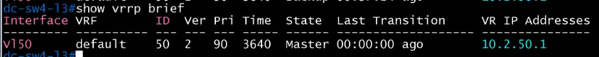

Wireshark: SW-4(10.2.50.3) Master 광고

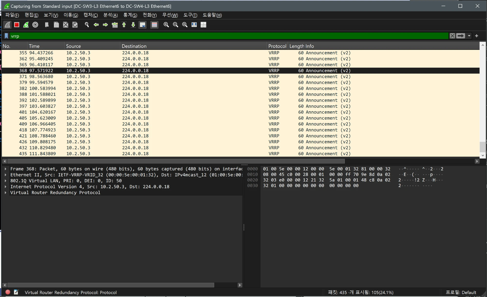

Wireshark: SW-3 마지막 광고에서 SW-4 첫 광고로 전환(약 3.16초)

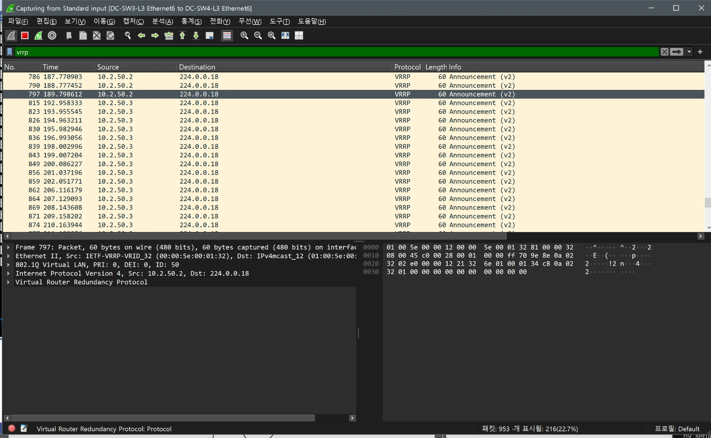

ping 통계

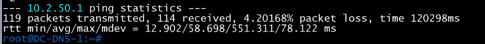

`no shutdown` 후 DC-SW3-L3 Master 복귀

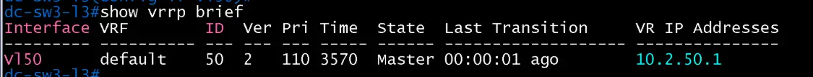

복구 후 DC-SW4-L3 Backup 복귀

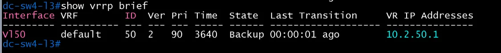

## BR1 결과(Aruba AOS-CX Virtual, VLAN 10 / VIP 10.3.10.1)

- 시험 전: BR1-SW1-L3 vlan10·vlan20 `MASTER`(우선순위 110), BR1-SW2-L3 `BACKUP`(우선순위 90).
- 중단: BR1-SW1-L3 vlan10 `shutdown` → BR1-SW2-L3 vlan10 `MASTER`. vlan20은 BR1-SW1-L3이 계속 Master.
- 전환 시간: Wireshark 기준 SW-1(`10.3.10.2`) 마지막 광고(41.374596)에서 SW-2(`10.3.10.3`) 첫 광고(45.347888)까지 약 3.97초. 우선순위 0 광고 없이 Master-down 타이머 만료로 전환(DC Arista와 같은 방식, HQ Cisco보다 길음).
- 복구: `no shutdown` → BR1-SW1-L3 vlan10 `MASTER` 복귀, BR1-SW2-L3 `BACKUP` 복귀.
- `ping`: 175개 중 손실 68개(38%). 시험 전체 구간 값이며 전환 시간 근거로 쓰지 않음. 전환 시간은 Wireshark 값 기준.
- 시험 경위: 첫 시도에서는 BR1 L2 루프(VRRP 광고 폭주)로 전환이 지연되어 측정값으로 쓰지 않고, 루프 해소 후 재시험한 결과임. 루프 원인과 조치는 KAN-31 트러블슈팅 기록에 정리 예정.

BR1-SW1-L3 시험 전 `show vrrp brief`

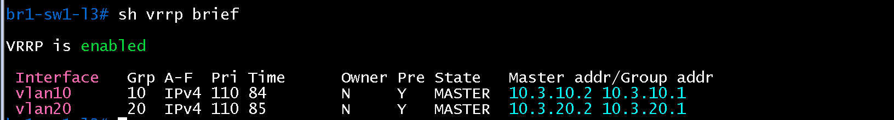

BR1-SW2-L3 시험 전 `show vrrp brief`

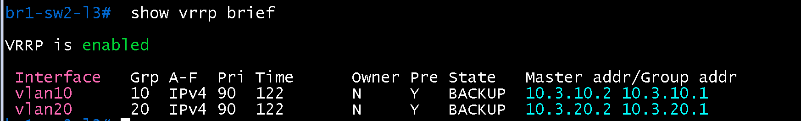

BR1-SW2-L3 vlan10 Master 전환

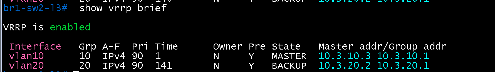

Wireshark(`vrrp`): 시험 전 SW-1 광고

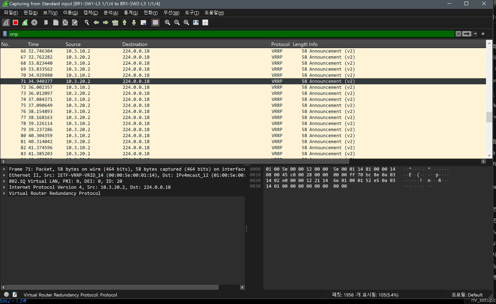

Wireshark: SW-1 마지막 광고에서 SW-2 첫 광고로 전환(약 3.97초)

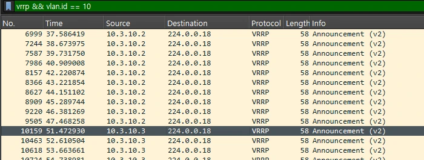

2차 시험(2026-10-19, 같은 링크, 필터 `vrrp && vlan.id == 10`): SW-1(`10.3.10.2`) 마지막 광고 47.468258초(프레임 9505), SW-2(`10.3.10.3`) 첫 광고 51.472930초(프레임 10159), 공백 약 4.00초. 1차(3.97초)와 같은 길이로 재현됨. 아래 이미지는 2차 캡처.

`ping` 통계

복구 후 BR1-SW1-L3

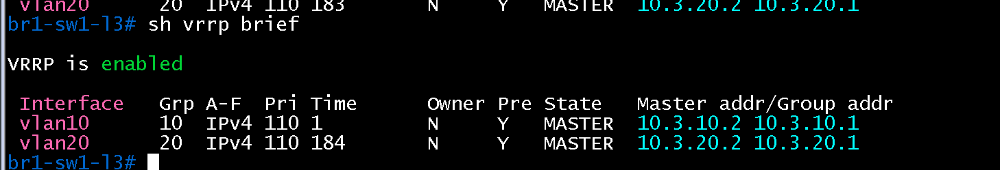

복구 후 BR1-SW2-L3

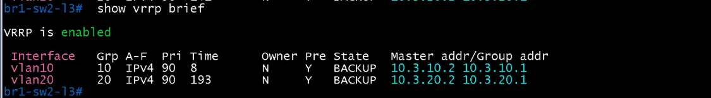

## HQ 재시험(2026-10-19, 장비 로그 기준)

- HQ-SW-2 `interface vlan 10` shutdown 후 전환 시각을 장비 로그로 확인.

| 장비 | 로그 시각 | 내용 |
|---|---|---|
| HQ-SW-2 | 00:13:56.227 | `%VRRP-6-STATECHANGE: Vl10 Grp 10 state Master -> Init` |
| HQ-SW-3 | 00:13:56.415 | `%VRRP-6-STATECHANGE: Vl10 Grp 10 state Backup -> Master` |

- 전환 시간: 약 0.19초(0.188초). 두 장비의 시계가 같은지는 확인하지 못해 장비 로그 기준 값으로만 기록.
- Wireshark 프레임 564(331.03초): `10.1.10.3` → `224.0.0.18`, VRID 10, Priority 90, VIP `10.1.10.1`의 HQ-SW-3 광고. 직전 `10.1.10.2`의 마지막 광고 프레임은 이 재시험에서 아직 확인하지 못함.
- 시험 전 광고 프레임 109: `10.1.10.2`, Priority 110.

HQ-SW-2 로그

HQ-SW-3 로그

Wireshark 프레임 564(HQ-SW-3 광고)

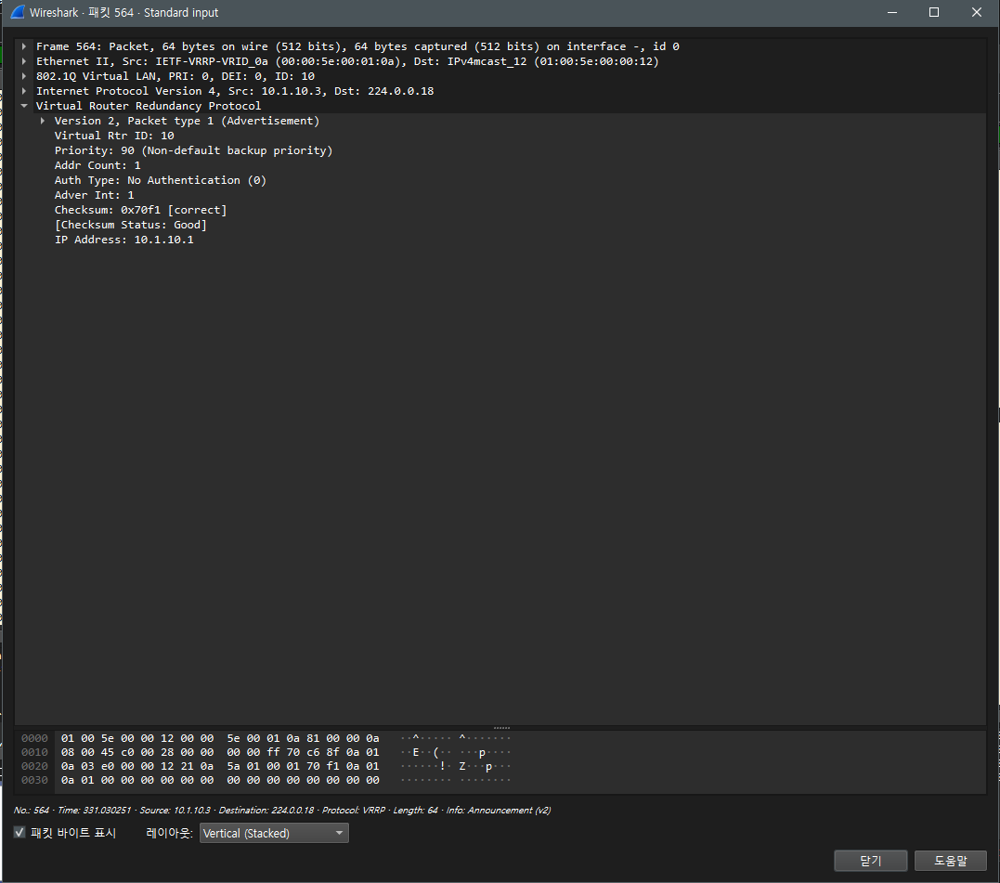

### HQ 재시험 복구 구간(`no shutdown`, 장비 로그 기준)

| 장비 | 로그 시각 | 내용 |
|---|---|---|
| HQ-SW-2 | 00:34:47.639 | Vl10 `Init -> Backup` |
| HQ-SW-2 | 00:34:49.635, 00:34:50.634 | Vlan10 인터페이스 up, 라인 프로토콜 up |
| HQ-SW-2 | 00:34:51.209 | Vl10 `Backup -> Master`(`preempt`로 복귀) |
| HQ-SW-3 | 00:34:53.934 | Vl10 `Master -> Backup` |

- HQ-SW-2는 Backup 진입 후 약 3.6초(47.639 ~ 51.209) 만에 Master로 복귀. HQ-SW-3이 Backup으로 내려간 시각(53.934)은 그보다 약 2.7초 뒤이며, 이 사이에 두 장비 모두 Master로 표시된 구간이 있는 것으로 로그에서 읽히나 두 장비 시계 일치는 확인하지 못함.
- 복구 구간 HQ-PC1 `ping 10.1.10.1`: 16개 전송, 15개 응답(손실 1개, 6%), 최대 28.201 ms. 응답은 seq 0~14가 모두 성공하여 손실 1개는 마지막 전송 패킷으로 보이며(`Ctrl+C` 직전으로 추정, 확인하지 못함) 복구 중 응답 중단은 보이지 않음.

HQ-SW-2 복구 로그

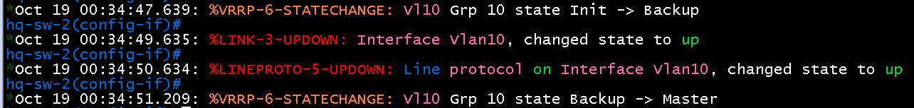

HQ-SW-3 복구 로그

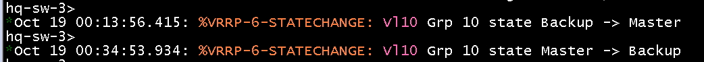

복구 구간 ping 통계

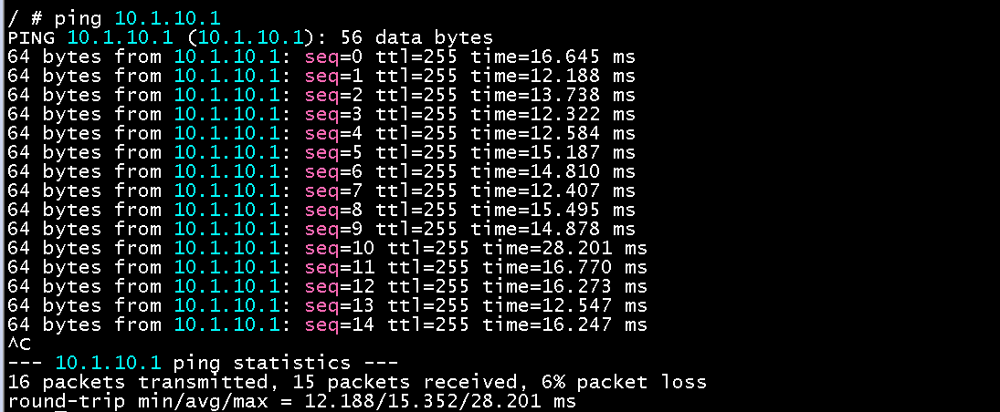
