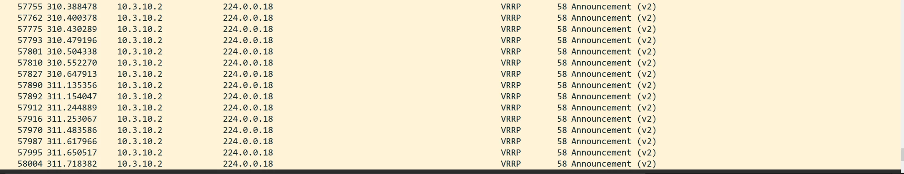
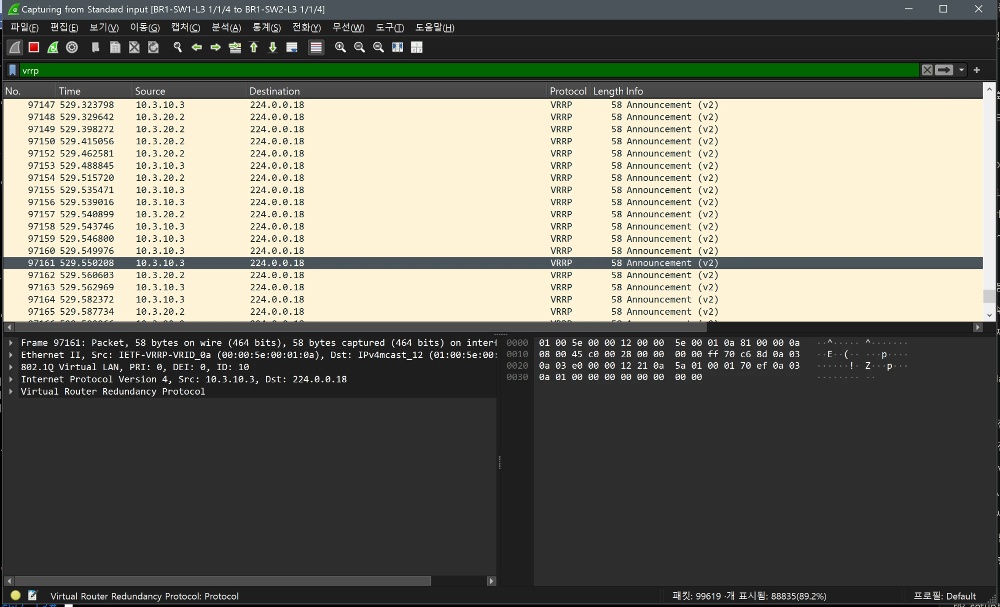
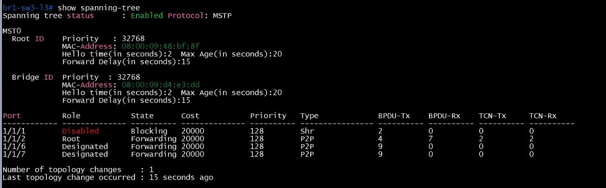
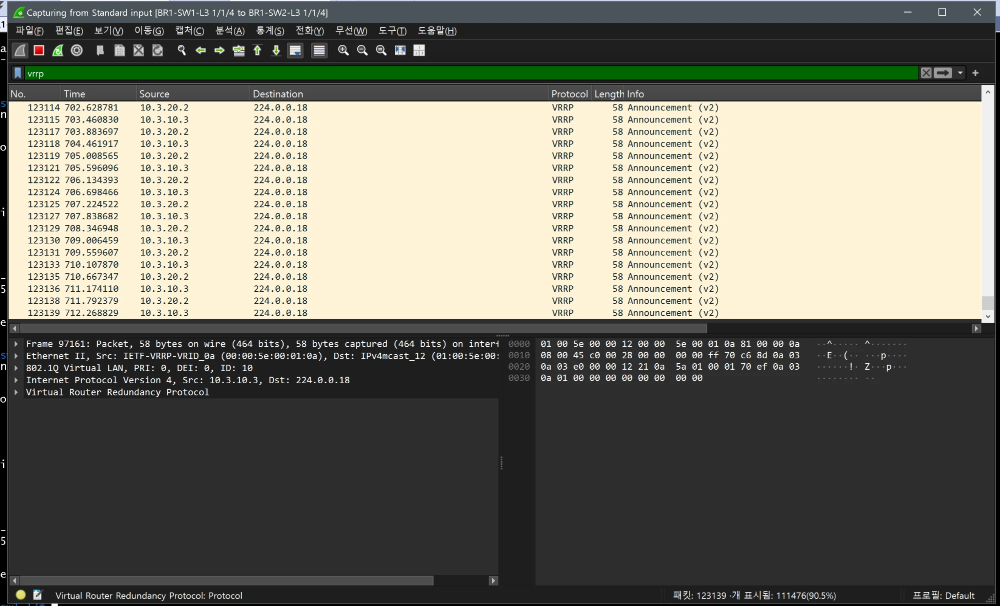

# 트러블슈팅 로그

- Jira: KAN-31
- 작성일: 2026-10-18
- 범위: 구성과 검증 중 설계 문서 또는 기대 결과와 달랐던 항목, 원인, 조치. 확인하지 못한 원인은 추정으로 표시.

| # | 분류 | 항목 | 관련 티켓 | 상태 |
|---|---|---|---|---|
| 1 | 장비 한계 | Arista vEOS-lab 인터페이스 ACL 미지원 | KAN-26 | 해결(설계 변경) |
| 2 | 구성 | OSPF 프로세스 간 router-id 충돌 | PI OSPF | 해결 |
| 3 | 명령 | 장비별 미지원, 오기 명령 | KAN-25, 28, 37 | 해결 |
| 4 | 구성 | DMVPN 터널 생성 전 `no passive-interface tunnel 0` 입력 | DMVPN | 해결 |
| 5 | 설계 | QoS DSCP 매치가 DNS를 분류하지 못함 | KAN-25 | 해결(설계 변경) |
| 6 | 시험 | QoS 시험 중 DNS 첫 질의 타임아웃 | KAN-25 | 한계로 기록 |
| 7 | 시험 | BR1 L2 루프와 VRRP 광고 폭주 | KAN-27 | 조치 완료, 근본 원인 미확인 |
| 8 | 시험 | Hub 장애 후 shortcut이 설계 기대보다 일찍 끊김 | KAN-30 | 기대 결과 수정 |
| 9 | 절차 | 미실시 단계가 있는 상태에서 Jira 완료 처리 | KAN-28 | 문서에 `미실시` 명시 |
| 10 | 운영 | GitHub Actions 경로 필터로 `verification` 푸시가 알림되지 않음 | - | 확인(설정 의도) |

## 1. Arista vEOS-lab 인터페이스 ACL 미지원

- 증상: DC 스위치(`DC-SW3-L3` 등)에서 `ip access-group` 입력 시 "Unavailable command ... hardware platform" 응답.
- 원인: 랩 이미지가 cEOS가 아니라 vEOS-lab 4.29.2F라서 인터페이스 ACL 기능을 지원하지 않음. 처음에는 cEOS로 알고 설계함.
- 조치: 서버 VLAN DNS ACL을 스위치가 아니라 DC 라우터(`DC-R1~R4`) `Gi0/0`, `Gi1/0` 출력 방향에 `dns-only`로 적용. 설계 문서와 검증 문서 갱신. MLAG는 vEOS-lab에서 지원되어 구성.
- 교훈: 설계 전에 `show version`으로 이미지 종류를 확인.
- 남은 일: 일부 문서(`port-mapping`, `network-project-final`, `config-guide` 등)에 cEOS 표기가 남아 있어 일괄 정정 필요.

## 2. OSPF 프로세스 간 router-id 충돌

- 증상: Private Internet 구간 OSPF process 2에 같은 router-id를 지정하면 IOS가 "in use by ospf process N"으로 거부.
- 원인: 한 라우터에서 프로세스 번호가 달라도 router-id는 겹칠 수 없음. 프로세스 번호로 구분하면 충돌이 없다고 잘못 판단했음.
- 조치: PI 쪽 process 2 router-id를 해당 PI 링크 IP(`203.0.113.1`, `.5`, `.9`, `.13`, `.17`)로 변경하고 `.ios`와 문서를 정정.
- 교훈: router-id는 프로세스별이 아니라 장비 전체에서 유일해야 함.

## 3. 장비별 미지원, 오기 명령

| 장비 | 잘못 쓴 명령 | 올바른 명령 |
|---|---|---|
| Cisco IOS | `clear policy-map interface` | 미지원. 전후 `show policy-map interface` 값을 비교 |
| Cisco IOS | `show ip ospf \| include Router with ID` | `include`는 대소문자를 구분하므로 출력 문자열 기준으로 지정 |
| Arista | `show port-channel summary` | `show port-channel dense` |
| Arista | `show lacp neighbor` | `show lacp peer` |

- 조치: 검증 문서와 안내의 명령을 위 표 기준으로 정정.
- 교훈: 벤더 간 명령을 옮겨 쓰지 말고 장비에서 먼저 확인. 통일 표는 `docs/config-guide/README.md` 8절에 정리 예정.

## 4. DMVPN 터널 생성 전 `no passive-interface tunnel 0`

- 증상: Tunnel0이 없는 상태에서 OSPF 설정 중 `no passive-interface tunnel 0` 입력이 오류.
- 원인: 인터페이스가 아직 만들어지지 않은 순서에서 입력.
- 조치: 터널 인터페이스를 먼저 만든 뒤 OSPF에서 해제하도록 구성 순서를 정리.
- 교훈: DMVPN 구성은 터널, NHRP, IPsec, OSPF 순서로 진행.

## 5. QoS DSCP 매치가 DNS를 분류하지 못함

- 증상: DNS 질의를 보내도 `cm-business` 카운터가 오르지 않음.
- 원인: 처음 설계는 DSCP 매치로 DNS를 분류했으나, 출력 인터페이스에서 DNS 패킷에 DSCP를 미리 표시하는 지점이 없어 매치되지 않음.
- 조치: `acl-qos-dns`(UDP/TCP 53, 출발지 또는 목적지 포트)로 직접 분류하고 분류된 패킷에 `set dscp af31`을 표시. 설계 문서(`qos-design.md`)와 구성 정정.
- 결과: BR1, BR2, HQ, DC-R2에서 `cm-business`와 `Packets marked` 증가를 확인. Wireshark에서도 af31 확인.
- 교훈: 분류 기준이 되는 마킹이 실제로 앞단에서 만들어지는지 먼저 확인.

## 6. QoS 시험 중 DNS 첫 질의 타임아웃

- 증상: 대량 트래픽과 동시에 보낸 DNS 20회 중 처음 2회가 `connection timed out`.
- 원인: DC-R2에서는 `cm-business` drop이 0이라 DC-R2 이전 구간의 지연으로 보임(추정).
- 조치: 정책 결함이 아니라 시험 환경의 앞단 지연으로 판단하고 한계로 문서에 기록. 병목 시험 후 `shape average 10000000`으로 복구.

## 7. BR1 L2 루프와 VRRP 광고 폭주

- 증상: BR1 VRRP 시험에서 `shutdown`해도 Backup이 Master로 바뀌지 않음. Wireshark에서 VRRP 광고가 초당 약 190개(정상 1개) 쏟아지고 호스트 `ping`이 100% 손실.
- 확인한 것: `show spanning-tree`에서 BR1-SW1-L3과 BR1-SW3-L3이 둘 다 자신을 루트로 표시하고 Blocking 포트가 없었음. SW-3의 `BPDU-Rx`가 6004 / 6000에서 계속 고정. 세 장비의 MST 설정(이름 `br1`, revision 1, digest)과 트렁크 설정(native 999, 허용 10,20,100), startup-config는 설계와 같았음.
- 원인: SW-3 STP 프로세스가 BPDU를 처리하지 못해 스스로 루트가 되고 모든 포트를 Forwarding으로 열어 SW-1, SW-2, SW-3 삼각 루프가 생긴 것으로 추정. 처음 폭주가 시작된 원인(가상 장비 소프트웨어 문제 등)은 확인하지 못함.
- 조치: SW-3 `1/1/1` `shutdown`으로 루프를 끊은 뒤 `no spanning-tree` 후 `spanning-tree`로 STP를 재시작. SW-3이 SW-1(우선순위 4096)을 루트로 인식하고 SW-3 `1/1/2`가 `Alternate/Blocking`이 되어 수렴. 이후 `1/1/1`을 복구하고 VRRP를 처음부터 재시험(`vrrp-failover.md`).
- 교훈: L2 이중화 시험 전에 STP 루트와 Alternate 포트, 광고 간격(1초)을 먼저 확인. 폭주 중 얻은 시험값은 사용하지 않음.

증거 캡처

폭주 초기 Wireshark(`vrrp`): 5초 시점에 이미 광고가 밀리초 간격

폭주 지속: 311초 시점 프레임 58,004번

폭주 지속: 529초 시점 프레임 97,000번대

BR1-SW1-L3 `show spanning-tree`(자신이 루트)

BR1-SW3-L3 `show spanning-tree`(자신이 루트, 모든 포트 Forwarding)

BR1-SW2-L3 `show spanning-tree`

BR1-SW3-L3 `show spanning-tree mst-config`(세 장비 동일)

BR1-SW3-L3 `1/1/1` Administratively down

STP 재시작 후 BR1-SW3-L3(Root가 SW-1로 변경)

`1/1/1` 복구 후 BR1-SW3-L3

복구 후 BR1-SW2-L3(`1/1/5` Alternate/Blocking)

복구 후 BR1-SW2-L3 `show spanning-tree mst`

복구 후 BR1-SW3-L3 `show spanning-tree mst`

폭주 해소 후 Wireshark(광고 1초 간격)

## 8. Hub 장애 후 shortcut이 설계 기대보다 일찍 끊김

- 증상: 설계 문서의 기대는 "기존 shortcut은 유지"였으나, shortcut ESP(`203.0.113.9` ↔ `.13`)가 Hub 장애 후 약 44초(64.04 ~ 108.72초)만 유지되고 중단.
- 원인: Hub가 광고하던 OSPF 경로가 Dead 시간(약 40초) 뒤 사라지며 HQ-R2의 `10.3.10.0` 경로가 테이블에서 사라짐(`% Subnet not in table`)으로 보임. 이 해석은 추정.
- 결과: 통신은 ISP(MPLS L3VPN) 경로로 우회되어 `ping` 294개 모두 응답. `traceroute`가 `100.1.11.2`, `100.1.31.1`을 경유하고 TTL이 60에서 57로 변화.
- 조치: `dmvpn-hub-failure.md`의 기대 결과를 실측에 맞게 수정. 새 Spoke 쌍(BR2 ↔ BR1) 시험은 미실시.

## 9. 미실시 단계가 있는 상태에서 Jira 완료 처리

- 증상: KAN-28(EtherChannel)을 3단계(HQ 모든 멤버 다운) 시험 전에 완료 처리.
- 조치: 문서에 `미실시`와 시험 범위(벤더별 대표 시험)를 명시하고 상태 표기를 `검증 완료(벤더별 대표 시험)`로 정정.
- 교훈: 미실시 단계는 문서에 남기고 완료 기준을 먼저 합의.

## 10. GitHub Actions 경로 필터

- 증상: `notify-portfolio` 실행 목록이 #90(`8c8627a`, 2026-10-18 21:09)에서 멈추고 이후 푸시가 보이지 않음.
- 원인: `.github/workflows/notify-portfolio.yml`이 `README.md`, `docs/**`, `configs/**` 변경에만 실행되도록 되어 있고, 이후 커밋은 `verification/`만 변경.
- 영향: 포트폴리오는 `portfolio-site`의 1시간 주기 동기화로 반영되어 누락은 없음.
- 선택: 검증 문서도 즉시 반영하려면 `paths`에 `verification/**`을 추가.
